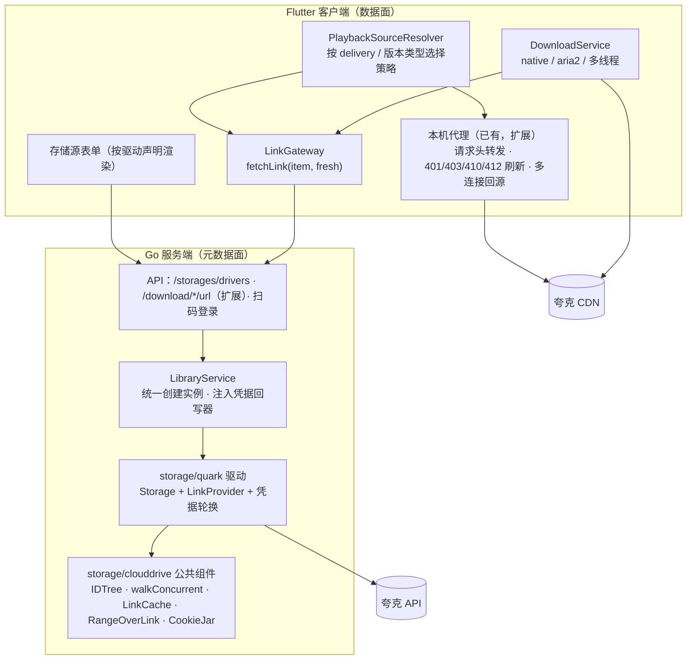
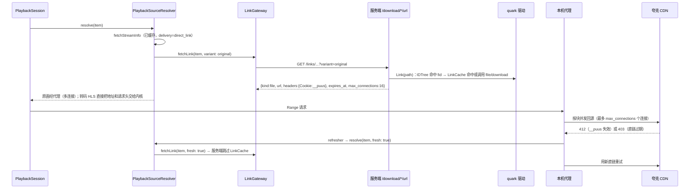

# 网盘存储源任务文档（首个驱动：夸克网盘）

> 跨 `backend/` 与 `client/` 两个仓库。涉及 `client/lib/playback/` 的改动同时遵守 `playback_engine_plan.md` 与 `playback_cache_plan.md` 的约束，完成后更新两份文档的进度记录。
>
> 参考实现：[ZXEB/quarklite](https://github.com/ZXEB/quarklite)（commit `5ba21ac`，GPL-3.0）。**只参考协议，不复制代码**（见 §1.3）。

---

## 0. 一句话说明

服务端负责网盘的**元数据面**：登录态、目录与 fid 解析、扫描、刮削、文件管理、获取直链。客户端负责**数据面**：拿到"直链 + 请求头 + 过期时间"后，播放和下载都由本机直接连网盘 CDN，流量不经过服务器。

两端之间只约定一个与网盘无关的契约 `StreamLink`，一个文件可以有多个**版本**（原画、官方转码的各档清晰度）：默认播原画，播放页可以切到转码（D7）。以后接入 123 网盘、迅雷等新网盘时，**只需要在服务端新增驱动，客户端不用改**。

---

## 1. 背景结论（已核实）

### 1.1 夸克协议要点（来自 quarklite `lib/api/quark_client.dart`、`quark_auth.dart`）

| 能力 | 接口 | 要点 |
|---|---|---|
| 校验登录 | `GET pan.quark.cn/account/info?fr=pc&platform=pc` | `data` 不是对象就表示登录失效 |
| 会话续期 | `GET drive.quark.cn/1/clouddrive/config` | 请求时**去掉 `__puus`**，服务端会通过 `Set-Cookie` 重新下发；quarklite 每 100 分钟续期一次 |
| 列目录 | `GET …/file/sort?pr=ucpro&fr=pc&pdir_fid=&_page=&_size=100&_fetch_total=1&_sort=file_type:asc,updated_at:desc` | 按 `metadata._total` 翻页；根目录 fid 为 `"0"`；字段有 `fid / file_name / size / dir / file_type / updated_at(ms) / pdir_fid` |
| 获取直链 | `POST …/file/download {"fids":[…]}` | **必须用桌面客户端 UA**（用网页 UA 容易被限速）；错误码 `23018` 时重试一次；返回 `download_url` |
| 访问直链 | CDN | 必须带 `Cookie`（获取直链时的快照）、`Referer: https://pan.quark.cn/` 和**同一个 UA**；quarklite 用 Gopeed 开多连接分片下载才能跑满速 |
| 新建目录 | `POST …/file {pdir_fid,file_name,dir_init_lock:false,dir_path:""}` | 重名时报错，需要回退为列出父目录、复用同名目录 |
| 重命名 / 移动 / 删除 | `POST …/file/rename`、`/file/move`、`/file/delete` | 移动和删除用 `filelist` 批量操作；移动或删除可能返回 `task_id`，需要轮询 `GET …/task` |
| 扫码登录 | `uop.quark.cn/cas/ajax/getTokenForQrcodeLogin` → 轮询 `getServiceTicketByQrcodeToken`（`status==2000000`）→ `pan.quark.cn/account/info?st=` | 从 `Set-Cookie` 合成 Cookie，去掉 `push_vurl`、`logout_id` |
| 通用 | 所有响应 | `code != 0` 表示失败；每次响应都要把 `Set-Cookie` 合并回当前 Cookie |

quarklite 里还有 123 网盘（Bearer token，过期后用账号密码自动重登）和迅雷（access_token / refresh_token 轮换 + captcha_token）。三种网盘有几个共同点：

- 都是**按 ID 定位文件的树**；
- **凭据会轮换**，轮换后需要保存新值；
- 直链**需要特定请求头**，并且有**有效期**。

本文的抽象就是从这三点提炼出来的。

### 1.2 本项目现状（重构的输入）

| # | 事实 | 位置 | 对设计的影响 |
|---|---|---|---|
| F1 | `Storage` 接口是按路径设计的，可选能力通过小接口提供（`RangeReader`、`StreamURLWithUA`、`RecursiveListerWithProgress`） | `backend/internal/storage/storage.go` | 夸克按 fid 定位，需要一层**路径 → ID 解析**；新能力继续用可选接口提供 |
| F2 | `Factory func(settings)` 拿不到存储源 ID；实例在 `LibraryService` 中有 3 处创建，缓存在 `storages map` | `service/library.go:581/648/713` | 驱动没法把轮换后的凭据写回数据库，需要**注入回写器**，创建实例的逻辑也要收拢到一处 |
| F3 | `/api/v1/storages` 整组接口都要求 `AdminRequired()` | `api/router.go:348` | 非管理员客户端**读不到存储源配置**，"客户端从 `storage.settings` 读 Cookie"这条路走不通 |
| F4 | 302 模式下客户端用 HEAD 跟随 `Location` 拿直链，但 302 不能带请求头；proxy 模式会占用服务器带宽 | `handlers/stream.go:238`、`playback_source_resolver.dart:117` | 需要一种新的投递方式：**JSON 返回直链 + 请求头** |
| F5 | `/download/{movie,source}/:id/url` 已经通过 JSON 返回直链，客户端下载链路也在调用它 | `handlers/stream.go:576`、`download_service.dart:228` | 直接**扩展这个接口**，播放和下载共用 |
| F6 | `movieStreamProvider` 是非 autoDispose 的 `FutureProvider.family`，App 运行期间一直缓存 | `providers/media_provider.dart:146` | 直链**不能放进 `StreamInfo`**，否则会一直用过期的地址；`StreamInfo` 只能带静态的"投递方式"标记 |
| F7 | 播放源已支持 `httpHeaders`，mpv 和原生内核都会带上；本机代理会转发请求头、手动跟随重定向，遇到 401/403/410 调用 `UpstreamRefresher` 重新解析，遇到 403/429 退避重试；缓存键与 URL 无关 | `playback/domain/playback_source.dart`、`cache/cache_proxy_server.dart:715`、`cache/proxied_source_resolver.dart:169` | 直链过期和地址轮换**基本不用新写代码**；要补的是刷新时绕过服务端的直链缓存 |
| F8 | 下载有原生下载器、aria2、多线程、单线程四条路径，都接收 `headers`；构造请求头的逻辑在 `download_service.dart` 和 `playback_source_resolver.dart` 里重复了 3 处 | `download_service.dart:398/1157`、`playback_source_resolver.dart:154` | 请求头只要合并对了就能用；**链接自带的请求头优先级最高**（UA 不能被默认的 aria2 UA 覆盖） |
| F9 | 外挂字幕通过 `store.List` 查找，字幕内容和 `.strm` 文件经服务端 `/stream/...` 代理读取 | `service/media.go:884`、`handlers/stream_strm.go:61` | 驱动仍要实现 `Read` / `ReadRange`（只用于小文件）；`List` 需要短期缓存，否则每次播放都要访问网盘 |
| F10 | 增量扫描（`MtimeCacheStrategy`）只比较根目录下各子目录的 mtime | `service/mtime_strategy.go:39` | 需要验证夸克的目录 `updated_at` 是否会随子项变化（§1.4） |
| F11 | 存储源表单在客户端、Web 后台、后端三处各自手写，**已经不一致**：客户端 OpenList 表单发送 username/password 且 token 选填，后端却要求 token、不读 username；Web 后台的本地存储用 `root_path`，后端读的是 `path` | `storage_form_screen.dart:235`、`openlist.go:127`、`web/admin/src/pages/storages/index.tsx:31`、`local.go:60` | 新驱动改用**后端声明字段、前端按声明渲染**的表单；已有类型这次不迁移（§9 D6） |
| F12 | 客户端遇到不认识的存储类型时，`StorageType.fromString` 会**回退成 WebDAV** | `screens/settings/storage_type.dart:18` | 旧版客户端会把夸克存储源显示成 WebDAV，表单里看不到 Cookie；保存时后端因为缺少 `url` 会拒绝（`webdav.go:58`），配置不会被破坏，但界面会误导用户。新版客户端需要有"未知类型"兜底 |
| F13 | 后端已经依赖 `golang.org/x/sync/singleflight`、`golang.org/x/time/rate`；`httputil.Client` 会缓存 GET 响应，而且只返回 body | `go.mod`、`internal/httputil/client.go` | 夸克需要读取响应头（`Set-Cookie`），不能复用 `httputil.Client`，限流和请求合并直接用 x/ 库 |
| F14 | WebDAV 和 OpenList 驱动各自复制了一套递归并发列目录的 worker 池 | `webdav.go:250`、`openlist.go:591` | 抽出公共的 `walkConcurrent` 给新驱动用，旧驱动这次不迁移 |
| F15 | 播放器没有"切换版本/画质"的入口，只有倍速、音轨、字幕三个弹出菜单（`showPlayerPopoverMenu`）；Android Media3 没有依赖 `media3-exoplayer-hls`，原生内核**不能播 HLS**；Aether 和 Media3 都会把 `httpHeaders` 带到每个请求上 | `custom_video_controls.dart:1649`、`packages/native_player/android/build.gradle.kts:44`、`AetherPlayerBackend.swift:65`、`Media3PlayerBackend.kt:195` | 新增"画质"菜单（按会话能力显示）；转码版本要么在 Android 上补 HLS 模块（Apache-2.0），要么由内核选择规则改用 mpv（D8） |

### 1.3 许可证

quarklite 是 GPL-3.0，`playback_engine_plan.md` §6.12 规定**不得引入 GPL 组件**。

做法：只把接口地址、参数和请求头当作协议事实来参考，Go 驱动和 Dart 代码全部独立编写，不复制源码、注释和结构。AList 的 quark_uc 驱动是 AGPL-3.0，同样只能参考，不能复制。

### 1.4 待验证假设（Stage 0 Spike，验证前不能写死）

| # | 假设 | 不成立时的影响 |
|---|---|---|
| H1 | 服务端获取的直链可以在**另一个出口 IP** 上使用（不绑定 IP） | 不成立时启用 §5.8 的"委托解析"：客户端用服务端下发的 Cookie 和 fid 自己调用 `file/download` |
| H2 | 直链有效期 ≥ 30 分钟，过期时间能从 URL 参数里解析出来 | 决定服务端直链缓存的 TTL 和客户端的刷新频率 |
| H3 | 单连接速度够播 4K Remux（≥ 10 MB/s） | 不够时代理改为多连接预读（已因 D7 提前到 Stage 4.3） |
| H4 | 目录的 `updated_at` 会随直接子项的增删而变化 | 不成立时由驱动声明 `ReliableDirModTime()=false`，扫描对这个存储源改用全量扫描 |
| H5 | 只轮换 `__puus` 时，其他 Cookie 字段长期有效 | 决定凭据回写的频率，以及 Cookie 失效时的提示方式 |
| H6 | 移动和删除是否异步返回 `task_id`；限流时返回什么错误码 | 决定 `Rename` 的实现方式和重试策略 |

### 1.5 Stage 0 结论（2026-10-29，Mac，家庭宽带；账号 `member_type=EXP_SVIP`，`SUPER_VIP` 状态为 `ONCE_EXPIRE`）

工具：`/tmp/quark_spike`（独立 Go 程序，不在仓库里）。样片：5.9 GB 的 4K 60fps MP4，时长 6665 秒。

| # | 结论 | 对设计的影响 |
|---|---|---|
| H1 | **不绑定 IP**：16:24 在家庭宽带下获取的直链和 `__puus`，16:41 在手机热点（iPhone 个人热点 172.20.10.x，走蜂窝网络出口）下访问，返回 206；请求头必需性的结论和宽带下一致。热点下每个连接 0.05–0.07 MB/s，16 个连接 1.19 MB/s | **D1 维持 A**（服务端获取直链后下发），§5.8 的委托解析不用做 |
| H2 | 原画直链的 `auth_key` 形如 `时间戳-随机数-uid-md5`，第一段是过期时间：原画直链约 **64 小时**，在线播放（转码）直链约 **5.6 小时**；CDN 还返回 `Expires` 和 `Etag` | `ExpiresAt` 从 `auth_key` 第一段解析；直链本身寿命很长，真正限制有效期的是 `__puus`（见下一行） |
| H2′ | **CDN 只校验 `__puus`，而且必须是新签发的**：`file/download` 或续期接口响应里下发的 `__puus` 都能用，新签发的 `__puus` 访问旧直链也能用；从浏览器复制来的 `__puus` 和获取直链之前的 Cookie 快照都返回 **412**（`Ks-Deny-Reason: third-party-remote-auth`）；Referer 和 UA **都不是必需的** | ① 驱动必须**合并每次响应的 Set-Cookie**，下发给客户端的是合并之后的 `__puus`（quarklite 用的是请求前的快照，在本账号上不可用）；② 下发给客户端的 Cookie **只包含 `__puus`**，`__pus`、`__kps` 等长期登录凭据不出服务端，D2 的风险因此大幅降低；③ 本机代理遇到 412 也要触发刷新（现在只处理 401/403/410） |
| H3 | **原画直链限速**：URL 里的 `sp=100` 就是每个连接的速度上限（KB/s）。实测 1 个连接 0.10 MB/s，8 个连接 0.76 MB/s，16 个连接 1.6–3 MB/s（大部分连接稳定在 0.10，偶尔有连接能到 1.6+）；换 UA 没有区别。**官方在线播放接口 `file/v2/play` 返回转码后的 HLS**（4k / super / high / low），`sp` 与码率对应（4K 为 1028）；4K 的单个分片单连接 1.86 MB/s，高于这条流的平均码率 1.0 MB/s。HLS 的播放列表和分片同样只要求 `__puus`。**转码的代价**：原片为 HEVC 10bit（`yuv420p10le`），转码后是 H.264 8.2 Mbps + AAC 双声道 128 kbps，没有单独的音轨列表，HDR、多声道和内封字幕全部丢失。另外，原片的 `moov` 在文件末尾（`moov_behind=true`，16.8 MB），限速时光读 moov 就要约 10 秒（按 16 个连接算） | 对限速账号来说，单连接播放原画不可行。见新增的决策项 **D7** |
| H4 | 只有**新增直接子项、移入子项**会更新父目录的 `updated_at`；**重命名子项、移出子项**不会更新，**孙级变化也不会**向上传递 | 和现有 WebDAV / 本地存储只比较根目录子项 mtime 的局限一致（新增能检测到，根目录下的增删按名称比对能检测到），**不需要 `ChangeHints`**，从 Stage 1 和 3.3 中删除 |
| H5 | 续期接口去掉 `__puus` 后请求，会下发新的 `__puus`（`Max-Age=86400`，`Domain=quark.cn`）；**服务端签发的 `__puus` 在约 16 小时后仍然可用**（2026-10-30 08:23 补测，原画直链同样还有效）；从浏览器复制来的 `__puus` 不可用的原因不明（可能是浏览器里那个已经很旧了） | 续期仍按每 60 分钟一次（代价很小）；客户端拿到的直链和 `__puus` 在几小时内不会因为凭据过期而中断，所以下载暂停后用旧地址续传是可行的 |
| H6 | `file`（新建目录）同步返回 `fid` 和 `finish`；`rename` 同步完成；`move` 和 `delete` **返回 `task_id`**，分别在 55ms 和 625ms 后完成；移动后 fid 不变 | `Rename` 跨目录时必须**等任务完成**再执行后续操作；目录移动后 IDTree 只需要更新父级关系 |
| 错误码（Stage 2 前补测） | `file/download` 和 `file/v2/play` 遇到不存在的 fid 返回 **HTTP 404 + code 21001**（`file not found`）；**`file/sort` 遇到不存在的目录 fid 返回 code 0 和空列表**，没有报错；`_size` 设为 100、200、500 都被接受（样本目录只有 6 项，无法确认上限）；对目录调用 `file/download` 也返回 code 0 | ① 21001 映射为 `storage.ErrNotFound`；② **缓存的目录 fid 过期时，列出来会是空目录**。这会让扫描误判为"目录被清空"，也会让 AI 整理"删除空目录"误删真实目录（`ai_tidy.go:635` 的逻辑是 `List` 为空或出错就 `RemoveAll`）。所以列目录结果为空时，要让缓存失效、重新解析后再确认一次；扫描开始前让整棵树的缓存失效；删除和移动之前强制重新解析；③ 分页一直翻到 `_total` 为止，不能用"本页少于 size"判断结束 |
| 其他 | 没登录时 `pan.quark.cn/account/info` 也返回 `{"code":"OK","data":{}}`，网盘接口则返回 `HTTP 401 code=31001`；两个域名的 `code` 类型不一样（字符串和数字）；目录的 `file_type=0`，`dir=true` | `Connect` 改用网盘接口（`/config`）校验 Cookie；错误码按字符串和数字都要能解析 |

---

## 2. 目标与非目标

### 2.1 目标

1. 夸克可以作为存储源添加：粘贴 Cookie 登录（Stage 6 加扫码登录），支持浏览、扫描、刮削、AI 整理（重命名、移动、新建目录、删除）。
2. 播放和下载由客户端直连夸克 CDN，服务器只调用接口（几 KB 一次）。默认播原画：限速账号（每连接 100 KB/s）由本机代理多连接并发回源；播放页可以切到官方转码 HLS。
3. 旧版客户端、Web 后台、字幕、`.strm` 仍然可以通过服务端代理正常使用（向后兼容）。
4. 凭据轮换后自动保存，服务重启不掉线。
5. 抽象可以复用：新增 123 网盘、迅雷时，只需要服务端新增一个驱动包。

### 2.2 非目标

- 上传、分享链接转存、相册、BT 下载（quarklite 的其余功能）。
- 把已有的 WebDAV、OpenList、本地存储迁移到新的公共组件或按声明渲染的表单（另开任务）。
- 客户端单独保存网盘账号（凭据只保存在服务端）。

---

## 3. 总体架构

### 3.1 分层与职责



**依赖规则**：

- `storage` 包不依赖 `repository` 或 `service`；驱动通过回调接口拿到宿主提供的能力（凭据回写）。
- 驱动子包（`storage/quark`）依赖 `storage` 和 `storage/clouddrive`，反方向不允许依赖；驱动在 `cmd/server/main.go` 里通过空导入注册。
- 客户端只认识 `StreamLink`、`LinkVariant` 和 `delivery` 这几个与网盘无关的概念，**代码里不出现 "quark"**；表单和图标例外。

### 3.2 两条数据流

**元数据面（扫描 / 浏览 / 刮削）**：完全在服务端。
`Scanner → quark.ListRecursiveWithProgress → IDTree 逐级解析路径 → 夸克 file/sort（限流 + 翻页）`

**数据面（播放）**：



下载与播放共用 `LinkGateway`，下载固定使用原画版本，按 `max_connections` 设置 aria2 / 多线程的连接数，续传时重新获取直链。

切换画质时，会话用新版本重新解析，并从当前位置重新打开（流程和现有的内核回退一样）。

---

## 4. 服务端设计

### 4.1 目录结构

```
backend/internal/storage/
├── storage.go               # 不改
├── link.go                  # 新增：Link / LinkKind / LinkVariant / LinkOptions / LinkProvider / VariantLister / ErrLinkRejected
├── settings.go              # 新增：SettingsPersister / SettingsPersistable
├── driver_meta.go           # 新增：DriverMeta / FieldSpec / DriverCaps / RegisterDriver / Drivers；Register 保持不变
├── clouddrive/              # 按 ID 定位的网盘的公共组件（不依赖具体网盘）
│   ├── idtree.go            # 路径 → ID 解析：LRU + 按目录 singleflight + 失效
│   ├── walk.go              # walkConcurrent：有界 worker 池递归列目录（对齐现有进度和部分失败语义）
│   ├── linkcache.go         # 直链缓存：singleflight + 提前过期余量 + fresh 跳过
│   ├── rangelink.go         # RangeOverLink：基于 Link 实现 Read / ReadRange（服务端代理字幕、strm、旧客户端）
│   ├── cookiejar.go         # Cookie 字符串的合并、去除指定字段、脱敏
│   └── *_test.go
└── quark/
    ├── client.go            # 夸克 API 传输层：请求头、限流、错误码映射、翻页、Set-Cookie 合并；file/download 与 file/v2/play
    ├── session.go           # 会话续期：定时器 + 鉴权失败时触发；防抖回写；Disconnect 时停止
    ├── driver.go            # 实现 Storage 及各可选接口，init() 中 RegisterDriver
    ├── auth_qr.go           # Stage 6：扫码登录（QRAuthenticator）
    └── *_test.go            # 用 httptest 模拟夸克 API 和 CDN
```

### 4.2 核心契约

```go
// storage.go（新增，全部是可选接口，旧驱动不受影响）

// Link 是交给客户端或服务端代理使用的直链；Header 是访问直链时必须携带的请求头
type Link struct {
	URL            string
	Kind           LinkKind // file（可 Range 的原文件）| hls（播放列表）
	Variant        string   // 版本 ID，原画为 "original"
	Header         http.Header
	ExpiresAt      time.Time // 零值表示未知
	MaxConnections int       // 建议的并发连接数上限，0 表示不限
}

type LinkKind string

const (
	LinkKindFile LinkKind = "file"
	LinkKindHLS  LinkKind = "hls"
)

// LinkVariant 是同一文件可选的版本（原画、各档转码），只描述，不含地址
type LinkVariant struct {
	ID            string   `json:"id"`
	Label         string   `json:"label"`
	Kind          LinkKind `json:"kind"`
	Width, Height int      `json:"width,omitempty"`
	Size          int64    `json:"size,omitempty"`
	Original      bool     `json:"original"`
}

type LinkOptions struct {
	Variant   string // 为空表示原画
	Fresh     bool   // 跳过缓存，同时让驱动刷新会话（客户端刷新时传入）
	ClientIP  string
	UserAgent string
}

// LinkProvider 由需要"直链 + 请求头"的驱动实现；实现了它的存储源，客户端可以直连
type LinkProvider interface {
	Link(ctx context.Context, path string, opts LinkOptions) (*Link, error)
}

// VariantLister 由提供转码等多版本的驱动实现；没有实现时只有原画
type VariantLister interface {
	Variants(ctx context.Context, path string) ([]LinkVariant, error)
}

// SettingsPersister 由宿主注入：驱动轮换凭据后回调，把 patch 合并写回存储源配置
type SettingsPersister func(ctx context.Context, patch map[string]string) error

type SettingsPersistable interface {
	SetSettingsPersister(SettingsPersister)
}

// DriverMeta 描述驱动的配置字段和能力，前端按它渲染表单
type DriverMeta struct {
	Type   string        `json:"type"`
	Label  string        `json:"label"`
	Fields []FieldSpec   `json:"fields"`
	Caps   DriverCaps    `json:"capabilities"`
	QRAuth QRAuthenticator `json:"-"`
}

type FieldSpec struct {
	Key, Label, Help, Placeholder string
	Kind     string   // text | password | textarea | url | select
	Required bool
	Default  string
	Options  []string // select
}

type DriverCaps struct {
	DirectLink  bool     `json:"direct_link"`
	StreamModes []string `json:"stream_modes"` // 可选的流媒体模式；夸克为空，不显示选择
	QRLogin     bool     `json:"qr_login"`
}

func RegisterDriver(meta DriverMeta, factory Factory) // 同时写入 registry 和 metas
```

```go
// clouddrive/idtree.go

type Entry struct {
	ID, Name string
	IsDir    bool
	Size     int64
	ModTime  time.Time
}

// Lister 是各网盘驱动要提供的唯一原语：按目录 ID 列出直接子项（驱动内部负责翻页）
type Lister func(ctx context.Context, dirID string) ([]Entry, error)

type IDTree struct { /* rootID、LRU[path]→Entry、LRU[dirID]→children(短 TTL)、singleflight */ }

func NewIDTree(rootID string, list Lister, opts TreeOptions) *IDTree
func (t *IDTree) Resolve(ctx context.Context, p string) (Entry, error) // 逐级解析，命中缓存时不访问网络
func (t *IDTree) Children(ctx context.Context, p string) ([]Entry, error)
func (t *IDTree) Invalidate(p string)                                   // 改名、移动、删除，以及 Link 返回"文件不存在"时调用
```

### 4.3 夸克驱动

| `Storage` 方法 | 实现 |
|---|---|
| `Connect` | 先续期一次拿到新的 `__puus`，再用网盘接口（`/config`）校验 Cookie（`account/info` 判断不了登录状态，见 §1.5），然后启动会话续期协程。**协程不绑定请求的 ctx**：`GetStorage` 会用请求的 ctx 调用 Connect |
| `Disconnect` | 停止续期协程，清空缓存；可以重复调用 |
| `List` / `Stat` | `IDTree.Children` / `Resolve`；子项列表缓存 60 秒（满足 F9：每次播放查找字幕时不重复访问网盘） |
| `ListRecursiveWithProgress` | `walkConcurrent` 加 4 个 worker；列出的结果写入 IDTree，扫描结束时缓存已经全部预热 |
| `Link`（LinkProvider） | `IDTree.Resolve` → `LinkCache`。原画调用 `file/download`（桌面客户端 UA，23018 时重试），转码调用 `file/v2/play` 取对应清晰度的播放列表。遇到"文件不存在"时调用 `Invalidate` 再解析一次。**缓存只缓存 URL，Header 每次都从会话里取最新的 `__puus`**，只下发 `Cookie: __puus=…`（§1.5 H2′）。`MaxConnections` 按 URL 里的 `sp`（单连接上限，KB/s）计算：`ceil(目标速率 / sp)`，限制在 1 到 `max_connections` 配置之间 |
| `Variants`（VariantLister） | 原画排第一，后面是 `file/v2/play` 返回的、`accessable=true` 的各档转码；一次调用同时把各档地址写进 `LinkCache`，结果缓存 10 分钟 |
| `Read` / `ReadRange` | `RangeOverLink`（服务端代理，只给字幕、strm、旧客户端用） |
| `GetStreamMode` | `proxy`：`/stream/...` 一律由服务端代理，保证兼容 |
| `GetStreamURL` | 返回 `Link().URL`（只是为了满足接口，没有调用方依赖它） |
| `MkdirAll` | 逐级解析，缺哪级就创建哪级；重名时列出父目录复用同名目录 |
| `Rename` | 同一目录内只改名；跨目录时先移动（有 task 就等待完成），再改名；完成后让新旧两个路径的缓存都失效 |
| `RemoveAll` | 调用 `file/delete`（文件进回收站），让对应路径的缓存失效 |

**配置项**：

| 键 | 必填 | 说明 |
|---|---|---|
| `cookie` | 是 | 驱动会通过回写器自动更新 |
| `root_fid` | 否 | 只挂载某个子目录，默认 `"0"` |
| `link_delivery` | 否 | `client`（默认，客户端直连）或 `server`（全部由服务端代理，用于不希望把 Cookie 下发到客户端的场景，见 D2） |
| `max_connections` | 否 | 原画播放和下载的并发连接上限，默认 16，范围 1–32（连接越多，风控风险越大） |

**会话与凭据轮换（`session.go`）**：

- 由 `CookieJar` 统一合并每次响应的 `Set-Cookie`。
- 每 60 分钟续期一次（H5 有结论后再调整）；接口返回鉴权失败、或客户端带 `fresh=1` 刷新时也立即续期，然后**把原请求重试一次**；同一时间只有一次续期（singleflight）。
- Cookie 有变化时，通过回写器**防抖写回**（最多每 5 分钟一次）。
- 每个驱动实例有一个 generation 编号：实例被 `UpdateStorage` 替换后，旧实例的回写直接作废，不会覆盖用户刚填的新 Cookie。

**限流与重试**：

- 每个实例一个 `rate.Limiter`，默认 8 次/秒、突发 8。
- 网络错误和 5xx 退避重试 2 次；鉴权失败按上一条处理；限流错误码（H6）退避后重试。
- 只有获取直链的接口用桌面客户端 UA，其余接口用网页 UA（与参考实现一致）。访问 CDN 不需要 UA 和 Referer（§1.5）。

**日志**：Cookie 一律脱敏（`CookieJar.Redacted()`），直链只记录 host 和 path。

### 4.4 服务层

- 新增 `LibraryService.instantiate(id int64, typ string, settings map[string]string) (storage.Storage, error)`，把 3 处 `storage.New` + `Connect` 收拢到这里。如果实例实现了 `SettingsPersistable`，就注入回写器：在事务里读出配置、合并 patch、写回，并且只允许写驱动声明为"可轮换"的键（夸克只有 `cookie`）。
- 测试连接（`TestConnection`）不注入回写器。
- 扫描器不用改：夸克目录 mtime 的行为和现有存储一致（§1.5 H4）。

### 4.5 API

| 接口 | 变更 | 说明 |
|---|---|---|
| `GET /api/v1/storages/drivers`（管理员） | 新增 | 返回 `[]DriverMeta`；客户端和 Web 后台按它渲染新驱动的表单 |
| `GET /api/v1/movies/:id/stream`、`…/episodes/:id/stream` | 新增字段 | `delivery`：`direct_link`（存储源实现了 LinkProvider 且 `link_delivery=client`）或 `stream`。这个值是静态的，可以被客户端缓存（F6） |
| `GET /api/v1/links/{movie,source}/:id` | 新增 | 播放用：`?variant=`（默认原画）、`?fresh=1`；返回 `{kind, variant, url, headers, expires_at, max_connections}` |
| `GET /api/v1/links/{movie,source}/:id/variants` | 新增 | 返回 `[]LinkVariant`；没有实现 VariantLister 的存储源只返回原画。只在打开画质菜单时调用，不阻塞起播 |
| `GET /api/v1/download/{movie,source}/:id/url` | 扩展 | 下载用：和 `/links` 共用实现，固定原画。**客户端带 `direct=1` 时**，对允许直连的存储源返回 `headers`、`expires_at`、`max_connections`、`delivery:"direct_link"`，支持 `fresh=1`；不带 `direct=1`（旧客户端）或其他存储源时返回不变（Stage 3 实施时补充：旧客户端不会带请求头，直接下发直链会导致下载失败） |
| `POST /api/v1/storages/auth/:type/qr`、`GET …/qr/:session`（管理员，Stage 6） | 新增 | 扫码登录。会话保存在服务端内存（TTL 3 分钟）；成功后返回 `settings` 的 patch，由前端填进表单再保存 |

### 4.6 性能热点

| 热点 | 措施 |
|---|---|
| 冷启动后第一次播放要逐级解析路径（深 N 层就要 N 次列目录） | IDTree 按目录 singleflight，同一层目录只请求一次；扫描时预热缓存；需要时启用 Stage 7.1 持久化索引 |
| 刚进入播放就有多个请求同时要直链（HEAD、Range、字幕、预加载下一集） | `LinkCache` 用 singleflight 合并请求；缓存在 `ExpiresAt - 60s` 时失效，未知过期时间时默认缓存 10 分钟 |
| 扫描大目录触发风控 | 4 个 worker 加全局限流；翻页每页 100 条 |
| 每次播放查找字幕都要列目录（F9） | 子项列表缓存 60 秒 |
| 过期直链导致客户端反复刷新 | `fresh=1` 强制重新获取，代理每个请求只刷新一次（F7 已有） |
| 原画每连接 100 KB/s（H3） | 播放：本机代理多连接按块回源（Stage 4，§5.3）；下载：按 `max_connections` 开多连接；连接数从 `sp` 推算，账号不限速时自动降到少量连接 |
| `moov` 在文件末尾的 MP4 起播慢（读 16.8 MB 约需 10 秒） | 代理在起播阶段优先满足播放器对文件尾部的请求，把所有连接都给尾部的块；播放页提示"可切换到转码以加快起播" |

---

## 5. 客户端设计

### 5.1 契约

```dart
// data/models/stream_link.dart（新增）
class StreamLink {
  final String url;
  final StreamLinkKind kind;         // file | hls
  final String variant;              // 原画为 original
  final Map<String, String> headers; // 优先级最高，覆盖所有默认请求头
  final DateTime? expiresAt;
  final int? maxConnections;
}

class LinkVariant {
  final String id;
  final String label;
  final StreamLinkKind kind;
  final bool original;
}

// data/models/stream_info.dart（新增字段）
enum StreamDelivery { stream, directLink }
// StreamInfo 新增 delivery 和 sourceId（剧集需要用 source_id 获取直链）

// playback/session/playback_gateways.dart（PlaybackSourceGateway 新增方法）
Future<StreamLink?> fetchLink(PlaybackItem item, {String? variant, bool fresh = false});
Future<List<LinkVariant>> fetchVariants(PlaybackItem item);

// playback/session/playback_source_resolver.dart
Future<ResolvedPlayback> resolve(PlaybackItem item, {String? variant, bool fresh = false});
```

### 5.2 播放源解析（策略模式）

`PlaybackSourceResolver.resolve` 的执行顺序：

1. 先找本地已下载的文件；
2. 调用 `fetchStreamInfo`；
3. 按 `delivery` 选择策略：
   - `directLink`：调用 `fetchLink(item, variant, fresh)`，返回 `PlaybackSource.network(link.url, httpHeaders: {...defaults, ...link.headers})`。**不用 HEAD 解析 302**。
   - `stream`：保持现有逻辑（HEAD 解析 302 + WebDAV / Bearer 鉴权），行为不变。

`ProxiedSourceResolver` 按链接类型处理：

- `kind=file`：**始终经过本机代理**（配额为 0 时只透传、不写缓存，D3），把 `maxConnections` 交给代理。`_refresher` 改为调用 `_inner.resolve(item, variant: 当前版本, fresh: true)`。缓存键不变（与 URL 无关），所以直链轮换不影响缓存命中。
- `kind=hls`：**不经过代理**，地址和请求头直接交给内核（代理是按单个文件做 Range 缓存的，不适合播放列表），所以也不会写缓存。

### 5.3 本机代理：多连接回源（`cache_proxy_server.dart`）

- 条目新增 `maxConnections`（默认 1，即现有行为，对已有存储源没有影响）。
- 大于 1 时，回源从"一个缺口一个请求"改成**按块并发**：块大小 1 MiB（起播阶段 256 KiB，尽快交付第一批字节）；同一个条目最多 `maxConnections` 个连接；按播放器的读取位置向后预读 `maxConnections` 个块；响应体仍然按顺序交付。拖动进度时取消预读窗口外的请求。
- 写缓存仍按现有的 4 MiB 块对齐，并发取回的小块先在内存里拼好再写入。
- `expired` 判断加上 **412**（§1.5：`__puus` 失效时 CDN 返回 412）。
- 测试：用现有的 `RangeTestServer` 加上单连接限速，验证并发回源时数据完整，以及拖动进度时取消预读、刷新后继续。

### 5.4 画质切换（播放页）

- `PlaybackSession` 新增 `variants`（打开后在后台调用 `fetchVariants`，不阻塞起播）、`currentVariant` 和 `switchVariant(id)`。切换时记下当前位置，用新版本重新解析，再从这个位置打开，流程复用现有的内核回退逻辑。
- 控制层新增"画质"弹出菜单，只在 `variants.length > 1` 时显示（能力驱动，遵守 `playback_engine_plan.md` §6.4），样式复用 `showPlayerPopoverMenu`；标签直接用后端的 label：原画为"原画"，转码版本只写档位（"超清""高清""流畅"），不加"转码"后缀（2026-10-30 用户确认）。
- 选择会记住，范围是本次会话里的同一部片子 / 同一部剧（D7：默认原画）。
- 内核选择：转码版本是 H.264 SDR 的 HLS。Android 的 Media3 需要补上 HLS 模块，或者由选择规则改用 mpv（D8）。

### 5.5 下载

- 固定下载原画。`_fetchDownloadUrl` 改为返回 `StreamLink`（旧服务端没有 `headers` 字段时，就退回到只有 url 的形式）。
- `getDownloadInfo` 和 `startDownload` 合并请求头时，**`link.headers` 最后合并**；只有链接不是直链时才附加 WebDAV / Bearer 鉴权。
- 用 `maxConnections` 设置多线程下载的 `threadCount`，并传给 aria2 的 `split` 和 `max-connection-per-server`（aria2 规定后者最多 16）。原生下载器（iOS URLSession / Android）只有单连接，限速账号下载会很慢，界面上要提示。
- **2026-10-30 调整（D9）**：`/download/*/url?direct=1` 返回驱动的 `download_connections`（默认 512，范围 1–512），`/links` 仍返回播放用的 `max_connections`；客户端按全局预算 256 平分给预计同时下载的任务（`DownloadService.shareConnections`，最多同时 2 个任务：单任务 256，两个任务各 128）；原生下载器线程上限放宽到 512，iOS 后台会话每主机连接数从 6 改为 256，Android 分片协程改用 `Dispatchers.IO.limitedParallelism(256)`；aria2 仍受每服务器 16 个连接的硬上限限制。
- 续传：aria2 和原生下载器续传时会**沿用原来的地址和请求头**（`download_service.dart:889`，Stage 4 计划时核实，更正了本条原先的说法）。H5 补测表明 `__puus` 至少 16 小时有效，所以短时间暂停后续传没有问题；长时间暂停后续传失败（412）时，走现有的"重试"流程，它会重新获取直链。

### 5.6 存储源表单

- `StorageType` 新增 `quark`（图标、颜色），以及 `unknown` 兜底（修复 F12）：遇到不认识的类型时只读展示，**不允许保存成 webdav**。
- 新增 `DriverFieldsForm`：按 `/storages/drivers` 返回的 `FieldSpec` 渲染输入框，复用 `FormFieldBlock`、`PasswordTextField`、`shadcn.TextField`。`StorageFormScreen` 遇到声明了字段的类型就用它渲染，WebDAV、本地存储、OpenList 继续用现有的手写表单（D6）。
- `capabilities.stream_modes` 为空时不显示"流媒体模式"选择。
- Stage 6：`qr_login=true` 时显示"扫码登录"，弹窗展示二维码并轮询结果，成功后把 Cookie 填进表单。

### 5.7 Web 后台

`web/admin/src/pages/storages/index.tsx` 和 `detail.tsx` 改为从 `/storages/drivers` 读取类型和字段列表；接口失败时退回到现有的静态表。F11 里本地存储的 `root_path` 问题建议另开任务修复，不在这次范围内。

### 5.8 委托解析（只在 H1 不成立时启用）

如果直链绑定了服务端 IP，`/download/*/url` 改为返回 `{delivery:"delegated", resolver:"quark", file_id, headers:{Cookie…}}`。客户端新增 `DelegatedLinkResolver` 注册表（按 `resolver` 键查找对应策略），夸克的实现只负责调用一次 `file/download`，大约 60 行，独立编写。

这种情况下 `StreamLink` 契约和代理刷新逻辑不变，上层不用改。

---

## 6. 设计模式一览

| 模式 | 落点 | 目的 |
|---|---|---|
| 注册表 + 工厂 | `RegisterDriver(meta, factory)` | 新增网盘只需注册一次；元数据和实现放在一起 |
| 接口隔离 | `LinkProvider` / `VariantLister` / `SettingsPersistable` / `QRAuthenticator` | 旧驱动零改动；新能力按需实现 |
| 适配器 | `quark.Client` → `clouddrive.Lister` / `Link` | 把网盘私有接口适配成按路径操作的 Storage |
| 模板方法（组合实现） | `IDTree` + `walkConcurrent` + `LinkCache` + `RangeOverLink` | 按 ID 定位的网盘共享路径解析、并发、缓存和代理读取，驱动只需提供"列目录"和"获取直链"两个原语 |
| 回调注入（依赖倒置） | `SettingsPersister` | `storage` 包不依赖数据库，也能保存轮换后的凭据 |
| 单飞 + 缓存旁路 | IDTree 和 LinkCache 的 singleflight | 消除惊群，降低风控风险 |
| 策略 | 客户端 `delivery` 分支（`directLink` / `stream` / `delegated`），以及按 `kind`（file 走代理、hls 直连内核）分流 | 投递方式和版本类型可替换，会话层无感知 |
| 装饰器 | 现有 `ProxiedSourceResolver` | 直链复用缓存和刷新逻辑，不用新写代码 |
| 按声明渲染的界面 | `DriverMeta.Fields` → `DriverFieldsForm` / Web 后台 | 字段定义只有一份，消除 F11 那种漂移 |

---

## 7. 新增网盘检查清单（验证扩展性）

以 123 网盘为例，**只改服务端**：

1. 新建 `storage/pan123/`：编写 `client.go`（Bearer token，过期后重登），实现 `Lister` 和获取直链的函数；
2. `driver.go` 组合 `IDTree`、`walkConcurrent`、`LinkCache`、`RangeOverLink`，实现 `Storage` 和 `LinkProvider`；
3. token 轮换后通过 `SettingsPersister` 写回；
4. 调用 `RegisterDriver`，声明字段（账号、密码、token）和能力；
5. 在 `cmd/server/main.go` 里加一行空导入；
6. 补 httptest 用例。

客户端表单、播放、下载、Web 后台都不用改。只有想加专属图标时，才需要往 `StorageType` 里加一个枚举值。

---

## 8. 实施阶段

每个阶段动手前给出该阶段的计划，确认后再改代码；做完一个阶段，更新一次 §12。

### Stage 0：Spike（不改业务代码）

- [x] 0.1 在 `/tmp` 下写一个独立的 Go 小程序：用 Cookie 列目录、获取直链，记录直链的参数和有效期（H2），以及目录 `updated_at` 的变化（H4），并测试移动和删除是否异步（H6）
- [x] 0.2 在 Mac 上获取直链，切换到手机热点后再访问，验证 H1（不绑定 IP）
- [~] 0.3 单连接 Range 测速（H3，已完成）；续期接口与 Cookie 有效期观察（H5，`__puus` 实际有效期待测）
- [ ] 0.4 结论写进 §1.5，并据此确定 D1–D3、D7（D7 已定：默认原画，可切转码）

### Stage 1：存储层契约与公共组件（纯新增）

- [x] 1.1 新增 `link.go`、`settings.go`、`driver_meta.go`（接口、`RegisterDriver`、`Drivers`、`DriverMetaOf`）；`storage.go` 和 `Register` 不改
- [x] 1.2 实现 `clouddrive/`：IDTree、walk、linkcache、rangelink、cookiejar（另有内部的 `lru.go`）
- [x] 1.3 单测 30 项（clouddrive 28 项、storage 2 项）：路径解析与缓存失效、singleflight 合并、部分目录失败的语义与 openlist 一致、LinkCache 的过期和 fresh、RangeOverLink 处理 206/200/404/412、Cookie 合并与脱敏

### Stage 2：夸克驱动

- [x] 2.1 `quark/client.go`：API 传输层（限流、Cookie 合并、错误码映射、重试、翻页、各接口）
- [x] 2.2 `quark/session.go`：续期（启动时、每 60 分钟、鉴权失败、fresh）、防抖回写、关闭后不再回写
- [x] 2.3 `quark/link.go`：原画直链、转码版本、`auth_key` 过期时间解析、按 `sp` 计算连接数
- [x] 2.4 `quark/driver.go`：实现 `Storage` 及各可选接口，`RegisterDriver`；按 §1.5 的错误码结论做防护（空目录二次确认、扫描前让缓存失效、破坏性操作前重新解析）
- [x] 2.5 在 `cmd/server/main.go` 里空导入
- [x] 2.6 httptest 模拟夸克 API 和 CDN 的单测；`go vet ./...`、`go test ./...` 通过；另加只读的真实接口冒烟测试 `live_test.go`（默认跳过）

### Stage 3：服务层与 API

- [x] 3.1 `storage`：新增可选接口 `ClientDirectPolicy` 和辅助函数 `ClientLinkProvider(store)`（实现了 LinkProvider，且没有关闭客户端直连）
- [x] 3.2 repository：`MergeStorageSettings(id, patch)`，在事务里只更新 `settings` 列
- [x] 3.3 LibraryService：
  - 实例缓存后挂上回写器，只允许写驱动声明为可轮换的键；
  - 用 `settingsMu` 串行化"用户保存配置"和"驱动回写"，写之前用指针比较确认实例还是当前实例；
  - `GetStorage` 并发创建同一存储源时去重，避免泄漏续期协程
- [x] 3.4 API：
  - `GET /storages/drivers`；
  - movie/episode 的 stream 接口加 `delivery` 字段（`.strm` 文件和关闭直连的存储源返回 `stream`）；
  - 新增 `GET /links/{movie,source}/:id`（`variant`、`fresh`）和 `.../variants`；
  - `/download/*/url` 在客户端带 `direct=1` 时，对直链存储源返回 `headers`、`expires_at`、`max_connections`，并支持 `fresh`（不带时行为不变，旧客户端继续走服务端代理）；
  - 抽出电影和剧集播放源的定位逻辑，供 download 和 links 共用
- [x] 3.5 测试：service（回写白名单、旧实例回写作废、并发创建去重、删除后回写作废）、repository（合并）、handler（links、variants、download 扩展、delivery、strm、drivers）；`go vet ./...`、`go test ./...`
- 说明：`swag init` 目前在本仓库无法运行（解析 `reference/OpenList` 时报错），新接口按现有风格写 swag 注释，不重新生成 docs

### Stage 4：客户端播放与下载

- [x] 4.1 数据层：`StreamLink`、`StreamLinkKind`；`StreamInfo` 加 `delivery`、`sourceId`；`ApiConstants` 和 `MediaService` 加 `/links` 接口
- [x] 4.2 会话层：
  - Gateway 加 `fetchLink(item, sourceId, variant, fresh)`；
  - `PlaybackSourceResolver.resolve(item, {variant, fresh})` 增加直链分支：不做 HEAD，链接自带的请求头最后合并；
  - `ResolvedPlayback` 增加链接类型、版本和连接数；
  - `ProxiedSourceResolver` 按链接类型分流：原画直链始终经过代理（配额为 0 时只透传、不写缓存），HLS 直接交给内核，其他存储源的行为完全不变；刷新时带上 `variant` 和 `fresh`
- [x] 4.3 本机代理（`cache_proxy_server.dart` 和 `playback_proxy.dart`）：
  - 登记时带上 `connections`；
  - 每个条目一个连接配额，新请求优先（用户拖动进度或读取 moov 时优先满足）；
  - 按块并发回源：块大小 64 KiB → 256 KiB → 1 MiB，预读窗口为 N 块，响应体按顺序交付，取消时中止还在进行的请求；
  - 缓存模式下先探测文件大小再走现有的拼装流程，缺口改为并发获取；透传模式另写一个并发响应；
  - 412 也触发刷新；同一个条目并发刷新时只刷新一次；
  - `connections == 1` 时走原来的代码路径
- [x] 4.4 下载：`_fetchDownloadUrl` 带 `direct=1` 并返回 `StreamLink`；链接自带的请求头最后合并；按 `maxConnections` 设置原生下载器、多线程下载的 `threadCount`，以及 aria2 的 `split` 和 `max-connection-per-server`（最多 16）；续传沿用现有逻辑（见 §5.5）
- [x] 4.5 单测（纯 Dart，在本机跑）：模型解析；解析器的直链分支、请求头优先级、`fresh` 和 `variant`；按链接类型分流；代理的并发正确性（区间不对齐、单连接限速下吞吐随连接数提升、两个请求共享连接配额、取消、412 只刷新一次、缓存模式写盘后从磁盘读、HEAD/200/206、上游文件变化）；下载的请求头和连接数。`flutter analyze`、`flutter test` 全部通过
- [x] 4.6 实机验证（2026-10-30 改为由我在隔离环境里验证，结果见 §12）：在隔离环境（`/tmp` 下的后端、全新的模拟器）里播放夸克原画，测首帧时间、拖动进度和缓存命中，并下载一部片子；Android 和 macOS 的验证方式需要用户确认

### Stage 4b：画质切换

- [x] 4b.1 `PlaybackSession` 实现 variants、currentVariant、switchVariant；单测用 `FakePlaybackEngine`
- [x] 4b.2 控制层"画质"菜单（能力驱动）；按 D8 处理 Android 的 HLS 播放
- [x] 4b.3 验证：移动端和桌面端，原画和转码来回切换，进度保持不变，字幕和音轨状态正常（2026-10-30 只在 iOS 模拟器上验证；macOS、Android 只确认能编译，结果见 §12）

### Stage 5：表单（客户端 + Web 后台）

- [x] 5.1 `StorageType.quark` 与 `unknown` 兜底；`DriverFieldsForm`
- [x] 5.2 Web 后台按驱动声明渲染表单
- [x] 5.3 UI 自查：浅色/深色、手机/桌面、加载/空/错误态、长 Cookie 不撑破布局（2026-10-30 客户端在 iOS 模拟器上检查，桌面宽屏和各状态用 widget 测试覆盖；Web 后台在浏览器中检查，结果见 §12）

### Stage 6：扫码登录（可选）

- [ ] 6.1 服务端实现 `QRAuthenticator` 和会话接口
- [ ] 6.2 客户端弹窗：二维码渲染方式见 D5，轮询加超时处理，手机端提供"在夸克 App 中打开"

### Stage 7：按需优化（根据 Stage 0 / 4 的测量结果决定做不做）

- [ ] 7.1 持久化路径索引表 `storage_path_index(storage_id, path, file_id, is_dir, mod_time)`，扫描时写入，冷启动后直接命中
- （原 7.2 多连接预读已经因为 D7 提前到 Stage 4.3）

---

## 9. 待决策事项

| # | 问题 | 选项 | 建议 |
|---|---|---|---|
| D1 | 直链由谁获取 | A. 服务端获取后下发（§3.2）；B. 委托客户端获取（§5.8） | **A（H1 已确认不绑定 IP）** |
| D2 | Cookie 会随请求头下发给**所有已登录用户**（CDN 必须带 Cookie，这点无法避免；Stage 0 已确认只需要下发 `__puus`，长期登录凭据不出服务端） | A. 接受，同时提供 `link_delivery=server` 开关；B. 只给管理员下发直链，非管理员走服务端代理；C. 一律走服务端代理 | 自用服务器选 A；有共享用户时选 B。**2026-10-30 起按 D9 下发完整会话 Cookie**（含 `__pus`、`__kps` 等长期凭据），有共享用户时更应选 B 或 C |
| D3 | 配额为 0（关闭缓存）时，直链是否强制经过本机代理（透传） | A. 不强制，请求头直接交给内核（过期后要重新打开）；B. 强制透传以获得刷新能力 | **改为 B（2026-10-29）**：原画需要代理多连接回源，`__puus` 也会失效；只针对 `kind=file` 的直链，其他存储源不受影响 |
| D4 | 路径索引是否持久化 | A. 只放内存（Stage 1）；B. 加表持久化（Stage 7.1） | 先 A，根据冷启动耗时决定 |
| D5 | 扫码登录的二维码在哪里生成 | A. 客户端引入 `qr_flutter`（BSD-3）；B. 服务端生成 PNG（`skip2/go-qrcode`，MIT），Web 后台也能直接用 | B（一处实现，两端共用） |
| D6 | 已有三种类型是否迁移到按声明渲染的表单（同时修复 F11） | A. 这次不迁移；B. 一起迁移 | A，另开任务 |
| D7 | 限速账号怎么播放（H3：原画每连接 100 KB/s） | A. 只播原画，本机代理开 16–32 个连接并发预读（Stage 7.2 变成必做；起播和拖动进度会慢，请求量大）；B. 只播官方转码 HLS（流畅，但会丢失杜比视界/HDR 原画、多音轨和内封字幕，HLS 不经过本机代理和缓存）；C. 两者都提供：直链里带多个版本（原画 / 转码各清晰度），默认版本按账号限速情况决定，播放页可以切换 | **C，默认原画、可切转码（2026-10-29 用户确认）**：本机代理多连接回源提前到 Stage 4.3；新增 Stage 4b 画质切换 |
| D8 | Android 原生内核（Media3）不能播 HLS（F15） | A. 加 `media3-exoplayer-hls`（Apache-2.0，与 Media3 版本对齐）；B. 内核选择规则遇到 HLS 时改用 mpv | **A（2026-10-30 已实施）**：同一个内核切换画质时体验更一致；B 作为 A 有问题时的回退 |
| D9 | 直链请求头与下载连接数 | A. 维持 Stage 0 的最小集（只发 `__puus`，不带 UA / Referer，连接数 16）；B. 参照 quarklite：完整会话 Cookie + 桌面客户端 UA + `Referer: https://pan.quark.cn/`，下载单任务上限 512、全局预算 256 | **B（2026-10-30 用户决定）**：请求头对播放和下载都生效（获取直链本来就用桌面 UA，下载时保持一致）；播放代理的连接数仍为 16。代价见 D2（长期凭据下发到客户端）和风控风险 |

---

## 10. 风险清单

| 风险 | 影响 | 应对 |
|---|---|---|
| 夸克接口是逆向得到的，官方改版后会失效 | 浏览、扫描、播放失败 | 所有接口集中在 `quark/client.go`；错误码映射后给出明确提示（例如"Cookie 已失效，请重新登录"） |
| 风控或封号 | 账号受限 | 全局限流、请求合并、扫描并发保守设置；原画并发连接默认 16、上限 32（quarklite 用到 512，我们不跟进）；不做批量下载加速 |
| 限速账号播原画起播慢、拖动进度慢 | 体验差 | 按块并发 + 起播阶段用小块 + 尾部优先；播放页提示可以切到转码；实测数据记进 §12 |
| 驱动协程泄漏（实例被替换或删除） | 内存和请求量上涨 | Disconnect 幂等；generation 检查；测试里检查协程数 |
| 旧版客户端把夸克存储源显示成 WebDAV（F12） | 用户误操作、困惑 | 后端已有校验，会拒绝缺少 `url` 的 WebDAV 配置；发版说明提示升级客户端 |
| Cookie 出现在日志或崩溃报告里 | 凭据泄露 | 两端日志都对 Cookie 脱敏（aria2 已经在做，§F8），代码评审时专门检查 |
| GPL 污染 | 许可证风险 | §1.3 的独立编写原则；评审时比对，确认没有照搬结构 |

---

## 11. 回归清单

- WebDAV、OpenList、本地存储的浏览、扫描、播放（302 / 代理）、下载行为不变
- 旧版客户端播放夸克影片：通过服务端代理可以正常播放
- 夸克：添加、测试连接、浏览、全量 / 增量扫描、刮削、AI 整理、字幕、`.strm`
- 播放：首帧时间、拖动进度、续播、缓存命中秒开、直链过期或 412 后自动刷新（可以人为让服务端返回已过期的链接来模拟）
- 画质：原画和转码来回切换，进度保持；只有原画的存储源不显示画质菜单
- 下载：原生下载器、aria2、多线程；暂停后续传会刷新直链
- 服务重启后不用重新登录；修改 Cookie 后旧实例不会覆盖新值

---

## 12. 进度记录

| 日期 | 阶段 | 状态 | 说明 |
|---|---|---|---|
| 2026-10-29 | 方案设计 | 已确认 | 本文档；D1–D6 按建议执行 |
| 2026-10-29 | Stage 0 Spike | 进行中 | H1、H2、H3、H4、H6 已测，结论见 §1.5；H5（`__puus` 实际有效期）待测，已知签发 16 分钟后仍然可用 |
| 2026-10-29 | 方案修订 | 完成 | D7 = 默认原画、可切转码；D3 改为 B；新增 F15、D8、§5.3 多连接回源、§5.4 画质切换、Stage 4b；去掉 `ChangeHints`（H4 结论） |
| 2026-10-29 | Stage 1 | 完成 | 只新增文件，没有改动现有代码：`storage/{link,settings,driver_meta}.go` 与 `storage/clouddrive/{cookiejar,lru,idtree,walk,linkcache,rangelink}.go`，加上测试，共 1898 行。与计划的差异：`IDTree` 遇到重名只保留修改时间最新的一个，`Children` 和 `Resolve` 的结果保持一致；`IDTree` 和 `LinkCache` 共享的请求使用 `context.WithoutCancel`，某个调用方取消不影响其他调用方；列目录期间如果发生 `Invalidate`，这次结果不写入缓存（按 epoch 判断）。`go vet ./...` 和 `go test ./...` 全量通过，clouddrive 在 `-race -count=30` 下稳定 |
| 2026-10-29 | Stage 2 | 完成 | 新增 `storage/quark/{client,session,link,driver}.go` 和测试（共 2047 行，含 `fake_test.go` 模拟夸克 API 与 CDN、只读的真实接口冒烟测试 `live_test.go`）；`cmd/server/main.go` 加一行空导入。单测 21 项，在 `-race -count=15` 下稳定；用变异测试确认了三类防护（空目录二次确认、扫描前让缓存失效、破坏性操作前重新解析）都有用例覆盖。真实账号冒烟测试通过：列目录、Stat、原画直链（请求头只有 Cookie，16 个连接）、经 CDN 读取 1 KB、转码版本（超清/高清/流畅）、HLS 播放列表返回 200。**新观察**：直链有效期因文件而异（这次约 12.7 小时，Stage 0 是 64 小时），只能以 `auth_key` 解析结果为准。`Driver.ClientDirect()` 留给 Stage 3 判断 `link_delivery`。转码版本列表没有单独缓存（只在打开画质菜单时调用一次，转码直链会写进 LinkCache）。注册之后，现有的添加和测试连接接口就能创建夸克存储源；凭据回写要等 Stage 3 注入回写器 |
| 2026-10-29 | Stage 3 | 完成 | **新增**：`storage.ClientDirectPolicy` 和 `ClientLinkProvider`；`repository.MergeStorageSettings`；`handlers/links.go`（`/links` 与 `/variants`、`LinkResponse`，以及公共的 `requestClientIP`、`requestUserAgent`）；`StorageHandler.Drivers` 和路由。**修改**：`LibraryService` 增加 `settingsMu`、`cacheStorageLocked`、`settingsPersister`，`GetStorage` 并发创建时去重，`UpdateStorage`、`DeleteStorage`、`ResetRuntimeState` 改为在锁外 Disconnect 旧实例；`MediaService.StreamDelivery`，stream 接口加 `delivery` 字段；`stream.go` 抽出 `movieFile`、`sourceFile`，`getDownloadURL` 增加 `direct=1` 分支。现有文件共 +173/−51 行。**与计划的差异**：① 根据向后兼容的考虑，`/download/*/url` 只有带 `direct=1` 才返回直链；② 修了 Stage 2 的一个问题：共享续期请求原先用的是 `context.WithoutCancel`，导致 Disconnect 时正在进行的续期还会完成，现在改为跟随会话生命周期，`Connect` 失败时也会释放会话。新增单测 14 项（repository 1、service 3、handler 7、quark 原有用例调整）；对"旧实例回写作废"和"并发创建去重"做了变异测试，确认有用例覆盖；全量 `go vet`、`go test` 和 `-race -count=5` 通过，真实账号冒烟测试再次通过。`swag init` 目前无法运行，新接口只写了注释 |
| 2026-10-30 | H5 补测 | 完成 | 服务端签发的 `__puus` 在约 16 小时后仍然可用；据此更正了 §5.5"续传会重新获取直链"的说法 |
| 2026-10-30 | Stage 4.1–4.5 | 完成，4.6 待用户验证 | **数据层**：新增 `stream_link.dart`；`StreamInfo` 加 `delivery`、`sourceId`；`MediaService.getStreamLink`。**会话层**：Gateway 加 `fetchLink`；解析器增加直链分支；`ProxiedSourceResolver` 按链接类型分流（D3=B）。**代理**：多连接回源（详见 `playback_cache_plan.md` §4.6）。**下载**：`direct=1`，链接请求头最后合并，WebDAV / Bearer 合并逻辑去重为 `_downloadHeaders`，`maxConnections` 用于原生下载器、多线程下载和 aria2。**与计划的差异**：① 测试发现 `HttpResponse` 在等待块的间隙不会察觉播放器断开（实测 3 秒内毫无反应），而 `async*` 只在 `yield` 时响应取消；改为接管 socket 监听读端 EOF，响应体用 StreamController 实现，取消时立即中止在途块。不这样做的话，拖动进度后旧请求会占着连接长达一个块的时间（1 MiB ÷ 100 KB/s ≈ 10 秒）；② 并发探测去重；③ 代理新增 `peakBlocks` 统计，用于测试和排查。**测试**：新增 19 项（多连接 7、解析器 4、分流 3、下载 2、模型 3），全量 229 项通过；对刷新去重做了变异测试（去掉后刷新次数变成 8 次）。`flutter analyze` 只剩 `integration_test` 里 3 个早已存在的 `onBufferingProgress` 报错（与本次无关） |
| 2026-10-30 | Stage 4.6 实机验证 | 完成（iOS 模拟器） | **环境**：`/tmp/qtest` 隔离后端（端口 5699，独立数据库）；用户运行命令添加夸克存储源（根目录为"来自：分享"）；iPhone 17 Pro 模拟器（测试专用）。**扫描**：发现 181 个文件，识别出 4 部剧并完成刮削。**接口**：stream 返回 `delivery=direct_link`；`/links` 只下发 Cookie 请求头和 16 个连接，首次 95ms，命中缓存 3ms；`/variants` 返回原画、超清、高清、流畅。**播放原画**（5.35 GB MP4，Aether）：从点击到 ready 约 3.3 秒（取直链约 1.1 秒，读取 5.7 GB 处的尾部索引只用了 260ms），全程没有卡顿；拖动到 667 秒后，993ms 收到第一批数据，随即继续播放；约 2 分钟缓存了 298 MB（平均约 2.3 MB/s）；退出后重新打开命中缓存，**约 0.5 秒 ready**，并从 720 秒处续播；观看进度正常保存。**下载**：请求带 `direct=1`；iOS 原生下载器原先**写死 8 线程，忽略了 Dart 传入的 threadCount**（Android 也一样），已修复为按任务设置线程数（限制在 1–32；其他存储源仍是 8）。修复后 16 线程，两个任务合计约 27 MB/s；重新安装后未完成的下载能继续。**观察**：这批分享视频的直链并没有被限到每连接 100 KB/s（8 线程就有 11 MB/s），推测 CDN 边缘已缓存的热门内容不限速，限速主要针对冷门内容。**遗留**：下载列表的来源标签把夸克显示成"DAV"（即 F12，放到 Stage 5 修）；模拟器截图里看不到播放器的控制层，所以拖动进度是用横向滑动手势做的；Android 只验证了能编译通过（`flutter build apk --debug`），没有在真机上跑 |
| 2026-10-30 | Stage 4b | 完成（iOS 模拟器验证；macOS 和 Android 只确认能编译） | **数据层**：新增 `LinkVariant`；`ApiConstants` 新增 `movieLinkVariants` / `sourceLinkVariants`；`MediaService.getLinkVariants`。**Gateway**：`fetchVariants(item)` 只接收 `item`，自己从 stream 信息判断 `delivery` 并取 `sourceId`（读取 provider 里起播时已获取的结果，不强制刷新），所以命中缓存起播时也能拿到版本列表，WebDAV 等其他存储源也不会多发请求。**会话层**：`variants` 在进入 Ready 后在后台获取，同一个 item 重新加载（切换画质、重试、内核回退）时保留已获取的列表；`switchVariant` = `prepareSwitch()`（等待 seek 结束、暂停、保存进度）+ 从原位置 `load`；**切回原画时传 `variant: null`**，这样能走 `ProxiedSourceResolver` 的缓存快速路径；选择在本次会话内只对同一部电影 / 同一部剧沿用；记住的版本解析失败时自动改用原画并提示；切换前选中的外挂字幕在切换后恢复，不走自动选择。**控制层**：倍速旁边新增画质文字按钮，只在 `variants.length > 1` 时显示，菜单复用 `showPlayerPopoverMenu`，标签直接用后端的 label（“原画”“超清 转码”）。**D8**：`native_player/android` 加 `media3-exoplayer-hls:1.10.1`，`flutter build apk --debug` 通过，`HlsMediaSource` 已打进 dex；夸克转码直链实测路径以 `media.m3u8` 结尾，`DefaultMediaSourceFactory` 能自动识别为 HLS。**测试**：新增 9 项（会话 8：后台获取不阻塞起播、本地文件不获取、切换从原位置打开并保存进度、切回原画不带版本、当前或未知版本忽略、同一部剧沿用而其他片子重置、版本失效回退原画、恢复外挂字幕；模型 1），全量 238 项通过，`flutter analyze` 只剩 `integration_test` 里 3 个早已存在的报错。**实机验证**（`/tmp/qtest` 重新搭的隔离后端 + iPhone 17 Pro 模拟器，奇案84 S01E01，5.7 GB MP4；`/variants` 返回原画、超清 1440×810、高清、流畅）：原画起播 3.1 秒，`/variants` 在 ready 之后约 2 秒才请求，没有阻塞起播；暂停在 9:27 时切到超清，用 AetherEngine 直接播放 HLS，从 567 秒处 3.5 秒出首帧、7.6 秒 ready；切回原画走缓存快速路径（`from cache`），从 627 秒处 2.5 秒 ready；每次切换前都上报了观看进度；选超清后点下一集，请求带 `variant=super`，并重新获取了版本列表。**观察**：① 暂停状态下切换画质后会自动开始播放（和换集行为一致，没有改）；② 这批视频没有外挂字幕和多音轨，“恢复外挂字幕”只有单测覆盖；转码版本本身没有内封字幕和多音轨（见 H3）；③ 模拟器工具的 tap 打不到原生视频视图上方的 Flutter 按钮，Simulator 窗口的后台点击也只会按在屏幕中央，最后用真实鼠标点击完成验证；控制层约 3 秒自动隐藏，所以“唤出控制层 + 点按钮”要在同一批操作里完成。**遗留**：macOS 桌面端没有实测（Debug 包和真实 App 共用 bundle id）；Android 没有真机验证 Media3 播放 HLS |
| 2026-10-30 | Stage 5 | 完成（客户端在 iOS 模拟器上验证，Web 后台在浏览器中验证） | **客户端**：`StorageType` 新增 `quark` 和 `unknown`，`fromString` 遇到不认识的类型不再回退成 WebDAV（修复 F12）；新增 `selectable`、`hasHandwrittenForm`。新增 `DriverMeta`/`FieldSpec`/`DriverCaps` 模型（`stream_modes: null` 按空处理，不认识的 kind 按 text 处理）、`StorageService.getDrivers` 和 `storageDriversProvider`（autoDispose，**关闭 Riverpod 3 的自动重试**，失败后立即显示错误，由用户点重试）。`DriverFieldsForm` + `DriverFieldsController`：已保存的值优先，其次用 default；保留原配置里没有声明的键；只提交非空值，密码不去空白；校验必填和整数。各 kind：textarea 3–5 行、13 号字（长 Cookie 在框内折行滚动）、password 用 `PasswordTextField`、number 只允许输入数字、select 不超过 3 个选项时用 `FormOptionCard`，更多时用 `shadcn.Select`。`StorageFormScreen`：类型卡片窄屏改为 2×2；WebDAV、本地存储、OpenList 的手写表单不变（D6=A）；声明类型的加载态显示骨架，失败时显示错误和重试，服务端没有声明该类型时显示提示，这三种情况都禁止保存；`stream_modes` 为空时不显示“播放”区块；提供测试连接；`unknown` 类型锁定，服务端没有声明时只读、禁止保存，服务端有声明时用声明的表单。**顺带修复**：下载剧集页写死的“DAV”徽标改为存储图标 + 名称（名称过长时省略）；资源库页编辑夸克或未知类型时改为打开 `StorageFormScreen`（原弹窗会把夸克当本地存储保存），并显示夸克图标；存储源列表中网盘没有地址时显示“网盘存储源”，未知类型显示“不支持的类型：xxx”。**Web 后台**：新增 `useStorageDrivers`、`storage-types.ts`（静态表 + 驱动声明合并，接口失败时只显示静态表并给出提示）、`driver-field.tsx`（按 kind 渲染，textarea 用等宽小字号、最大高度 12rem 可拉伸，必填项标 `*`，缺必填项时禁用创建按钮）、`ui/textarea.tsx`；列表的类型列和详情页的类型都改为显示驱动的 label；新建对话框限制最大高度为 90vh 并允许滚动。**与计划的差异**：§4.2 里的 `FieldSpec` 以代码为准（多了 `number` 和 `rotating`，`options` 是 `{value,label}`）；`api_constants.dart` 有 Stage 4b 未提交的改动，所以驱动接口路径直接写在 `StorageService` 里。**测试**：新增 21 项（模型 3、`StorageType` 4、控制器 4、表单渲染 2、表单页 8：夸克字段与隐藏流媒体模式、宽屏 4 列和窄屏 2×2、加载、失败重试、服务端未声明、编辑回填、未知类型只读、未知类型按声明渲染），全量通过，`flutter analyze` 只剩 `integration_test` 里 3 个早已存在的报错；Web 后台 `tsc -b` 和 `vite build` 通过。**实机验证**（`/tmp/qtest` 隔离后端 + iPhone 17 Pro 模拟器，没有点保存和测试连接，以免影响隔离环境里的夸克会话）：资源库页显示夸克图标和“夸克网盘”，编辑时进入新表单；编辑页类型卡片为 2×2；长 Cookie 在 5 行内折行，没有撑破布局；根目录 fid、播放方式（客户端直连 / 服务端代理）、并发连接数（16）回填正确，help 文字完整显示；没有“播放”区块；存储源管理页显示“夸克网盘”分组和“网盘存储源”；新建页选择夸克后字段正确；浅色和深色模式都检查过。**观察**：① 手机上在 Cookie 输入框内滑动会先滚动输入框内容（多行输入框的常见行为），从框外滑动可以正常滚动页面；② 编辑时 Cookie 以明文显示（与声明的 textarea 一致），保存时提交的是打开页面时的 Cookie，后端轮换过的 `__puus` 会被覆盖，但长期凭据不变，下次会话刷新时会重新获取；③ 模拟器上这个 App 锁定竖屏，桌面宽屏只用 widget 测试覆盖。**Web 后台验证**（vite 开发服务器代理到 5699，没有点创建）：列表类型列显示“夸克网盘”；新建对话框可以选夸克网盘，Cookie 带必填 `*`，根目录 fid（0）、播放方式（客户端直连）、并发连接数（16）带默认值和 help，选择框可以切换到服务端代理；缺少名称或 Cookie 时“创建”按钮禁用，填好后可用；约 600 字符的长 Cookie 在输入框内用等宽小字号折行并可滚动；375 宽度下对话框可以滚动，按钮完整显示；窄屏下类型标签原本会竖排折行，已加 `whitespace-nowrap` 修复（后端提交 f5b294a）；Web 后台没有深色模式。存储源详情页原本整页白屏（早已存在的问题：`/storages/:id/blacklist` 返回 `{blacklist: [路径...]}`，`useBlacklist` 却当对象数组 `.map`），已改为读取 `blacklist` 字段并按路径渲染（后端提交 a12c926），修复后详情页显示“类型: 夸克网盘”，黑名单空状态、添加和删除都正常（测试用的路径已删除）。**遗留**：下载剧集页本身写死了 `Colors.black`，深色模式下显示有问题（不在本次范围内）；资源库旧弹窗把 OpenList 当本地存储保存的问题仍在（不在本次范围内） |
| 2026-10-30 | Stage 4b UI 调整 | 完成（iPhone 17 Pro 模拟器） | **标签**：夸克 `Variants()` 去掉 `" 转码"` 后缀，菜单显示"原画 / 超清 / 高清 / 流畅"。**底栏间距**：原因有两个：① 倍速、画质文字按钮靠左排列、右侧补 8，图标按钮则是图标居中，左组之间也没插 `gap`；② M3 `IconButton` 在移动端默认把点击区补到 48（`MaterialTapTargetSize.padded`），没有按 `PlayerUiMetrics.hit`（44）布局。修法：新增 `PlayerUiMetrics.toolInset = (hit - toolIcon) / 2`，文字按钮两侧各留 `toolInset` 并居中；`_buildToolButton` 改为 `shrinkWrap`；左右两组都在按钮之间插 `gap`，并各自向外平移 `toolInset`，让首尾内容对齐边距；桌面端静音按钮改用 `_buildToolButton`。实测（pt）：相邻按钮的布局盒间距都是 28（桌面端按算法为 24）；左边第一个按钮和进度条起点对齐，右边最后一个图标、锁按钮和总时长对齐。**遗留**：隔离后端没有重启，模拟器里的菜单文字仍是旧标签（由单测覆盖）；桌面端没有实测 |
| 2026-10-30 | Stage 4b 调整 | 完成 | 画质按钮原先要等进入 Ready 之后才去后台获取版本列表，所以起播后还要再等约 0.3 秒按钮才出现。改为在解析出播放地址后、`engine.open()` 之前发出 `/variants`，和打开视频并行，起播不受影响。`FakePlaybackEngine` 新增 `openGate`；新增单测验证 open 还没完成时列表已经拿到，并做了变异测试（改回原位置后，open 期间的请求数为 0）。全量 270 项通过。iOS 模拟器实测（命中缓存起播）：`/variants` 耗时 271ms，在 playing（400ms）之前就已返回 |
| 2026-10-30 | 下载请求头与连接数（D9） | 完成（iOS 模拟器实测） | **后端**：`quark.Link` 返回的请求头改为完整会话 Cookie + 桌面客户端 UA + `Referer: https://pan.quark.cn/`（对播放、下载、服务端代理读取都生效）；新增驱动设置 `download_connections`（默认 512，范围 1–512），`LinkOptions.Download` 由 `/download/*/url?direct=1` 设置，此时原画直链返回下载连接数；`/links`（播放）仍为 `max_connections`=16。测试 CDN 的假实现改为只校验 Cookie 中的 `__puus`。**客户端**：`DownloadService.shareConnections` 按全局预算 256 分摊（预计同时下载的任务数，最多 2 个）；iOS / Android 原生下载器线程上限 32→512，iOS 后台会话每主机连接数 6→256，Android 分片协程改用 `Dispatchers.IO.limitedParallelism(256)`。新增测试：后端校验请求头、下载连接数、设置范围、下载接口传 `Download`；客户端校验直链请求头覆盖默认 UA、预算分摊。`go test` 和全量 `flutter test`（273 项）通过，APK 和 iOS 模拟器包能编译。**实测**（隔离后端重建后，iPhone 17 Pro 模拟器下载 S01E03，4.29 GB，单任务 256 线程）：没有 403 / 429；前 85% 约 27 MB/s，最后 46 个分片拖了 3 分多钟，整体 329 秒、平均 13 MB/s——固定分片的长尾成了瓶颈。夸克 CDN 协商的是 **HTTP/2**，iOS 后台会话 256 个分片任务只占约 7 条 TCP 连接（多路复用），所以 iOS 上加大每主机连接数作用有限。播放拖动基准（16 连接、新请求头，同一组偏移）中位 7.0 秒，此前 5.0 秒，两次相隔数小时，在冷门内容的波动范围内，不能说明变快或变慢。**另外**：此前在 Mac 上用 curl 测得的数据走了 shell 环境变量里的 Clash 代理（`HTTP(S)_PROXY=127.0.0.1:7890`），偏悲观；直连时这个文件 8 个连接合计 3.3–3.9 MB/s 就封顶（冷门位置）。**后续**：下载和播放代理的长尾都适合用动态分段（空闲连接切分最慢分片的剩余部分）解决 |
