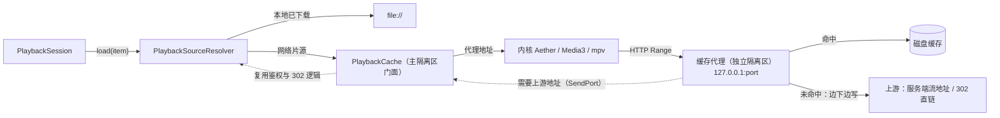

# 播放缓存任务文档（续播秒开）

> 状态：**Stage 0、0.4、1 完成；Stage 2 模拟器部分通过，等待用户真机验证（2.3）；D1、D2、D7 已决策，Stage 3 可以开始（真机结果不达标时回到 D5）**
> 最后更新：2026-10-22
> 适用范围：`client/lib/playback/`（新增 `cache/`）、`client/packages/native_player/`、`client/lib/screens/settings/`、iOS / macOS 工程配置
>
> **后续会话必读顺序**：§0 → §1 → §4 → §5 → §9（进度记录）→ 当前要做的阶段（§6）。
> 本任务会改播放内核契约，动手前还必须阅读 `doc/playback_engine_plan.md`（AGENTS.md 要求），接口变化同步更新那份文档的 §4.4，完成步骤后同时更新其 §12。
> 动手前确认该阶段依赖的“待决策事项”（§7）已有结论；没有结论就先问用户。
> 预研过程与方案对比见 `doc/playback_cache_research.md`，结论以本文为准。

---

## 0. 一句话说明

给播放器加一层**可设置总大小的持久化磁盘缓存**：App 内起一个只监听本机回环地址的缓存代理，所有内核都通过它取数据；同时把起播位置直接交给内核。目标是打开上次没看完的视频时，不用等网络就能直接从续播点出画面。

**平台顺序：先 iOS（Aether）落地并验证（2026-10-22 用户确认），再推到 macOS → Android → Windows / Linux。**

---

## 1. 背景结论（已核实，勿重复调研）

### 1.1 续播慢的原因

`PlaybackSession.load()` 的起播是串行的，每一步都要等网络：

| # | 步骤 | 代码位置 |
|---|---|---|
| 1 | 请求流地址 API | `PlaybackSourceResolver.resolve` → `fetchStreamInfo` |
| 2 | HEAD 解析 302（302 模式下服务端还要去网盘取直链） | `PlaybackSourceResolver._resolveRedirect` |
| 3 | 内核从 0 开始打开并探测封装（MKV 要读头部和末尾的 Cues，MP4 可能要读末尾的 moov） | `engine.open(source)` |
| 4 | 先从 0 播放一小段 | — |
| 5 | 时长就绪后才 seek 到续播点，重新请求、重新缓冲 | `PlaybackSession._onDuration` |

### 1.2 现有缓存都不能跨会话

- mpv：只有 demux 内存缓存（`MpvOptions.streamCache`）；`cache-on-disk` 存的也只是本次播放的临时文件。
- Media3：没有接入 `CacheDataSource`。
- Aether 7.22.2：`AetherEngine.prewarm(url:)` 只把文件开头 8MB 放在内存里，按精确 URL 匹配，App 退出就失效。
- “本地缓存播放”指的是已下载的完整文件，与本任务无关，仍然优先使用。

### 1.3 各内核能力

| 内核 | 从指定位置起播 | 持久化缓存 |
|---|---|---|
| Aether | `load(url:startPosition:options:)` | 无；可传自定义 `IOReader`，但会丢掉自带 `AVIOReader` 的预取、限速和重连 |
| Media3 | `setMediaSource(source, startPositionMs)` | `SimpleCache` + `CacheDataSource`（成熟） |
| mpv（media_kit 1.2.6） | `Media(uri, start:)` | 无 |

### 1.4 选型

**统一本地缓存代理**（预研中的方案 A）：一套实现覆盖三种内核，配额只有一份。缓存键不依赖 URL，所以不受签名直链过期影响。缓存命中时还可以延迟解析上游地址（§1.1 的步骤 1、2 不再阻塞起播），原生缓存方案做不到这一点。

### 1.5 已有实现：`feature/playback-cache-settings` 分支（2026-10-22 补充）

提交 `6247f04`（2026-03-13，“增加本地视频缓存与缓存管理”）已经实现了一版本机缓存代理。它基于播放内核重构之前的 `player_screen.dart`，比 `feat/playback-engine` 落后 80 个提交，**没有合并**。

| 文件 | 内容 |
|---|---|
| `lib/data/services/local_playback_proxy_service.dart`（653 行） | 监听 `127.0.0.1` 的代理（主隔离区）、GET / HEAD、Range 转发并写入缓存、上游返回 403 / 429 时退避重试 |
| `lib/data/services/video_cache_service.dart`（736 行） | 每个条目一个文件 + 已缓存区间列表；元数据存在 SharedPreferences；按 LRU 整条淘汰；可选后台整文件下载 |
| `playback_settings_screen.dart`、`video_cache_detail_screen.dart`、`storage_management_screen.dart` | 缓存开关、容量上限（默认关闭、5GB）、缓存明细页、存储管理入口 |
| `test/playback_cache_services_test.dart` 等 | 服务与设置持久化测试 |

可以直接复用：缓存键的组成（服务器 + 类型 + 媒体 ID + 存储 + 路径，不含签名 URL）、设置项和缓存明细 / 存储管理 UI、上游 403 / 429 退避重试。

与本任务目标冲突、需要重做的部分（代码阅读结论）：

1. **部分缓存基本命中不了**：只有请求的区间**整段**都已缓存时才读盘。播放器发的通常是 `bytes=N-`（一直到文件末尾），对部分缓存的条目几乎总是回源，续播起不到作用。需要改成“已缓存部分读盘、缺失部分回源”拼接返回（§4.6）。
2. **同一条目只允许一路上游请求**：新请求会取消其他正在进行的请求（`cancelStaleRequests`）。Aether 会同时开主 demuxer 和独立 reader，两路会互相取消。
3. **没有背压**：转发时 `response.add(chunk)` 不等待写出，播放器暂停读取（缓冲已满）时，上游数据会在内存里无限堆积。
4. **缓存目录在 `getTemporaryDirectory()`**：iOS 的 `tmp/` 会被系统频繁清理，缓存很难保留到下次打开。
5. 代理运行在主隔离区，大码率时可能影响 UI；没有 `NSAllowsLocalNetworking`（当时 iOS 用的是 mpv，FFmpeg 自带 HTTP，不经过 ATS）；淘汰只能整条删除，没有续播集瘦身；签名直链过期后没有重新解析。

结论见 D7。

---

## 2. 目标与非目标

### 2.1 目标

1. 续播命中缓存时，从点击到第一帧的耗时明显下降（Stage 0 先测基线，验收指标见 §8）。
2. 设置页可以设置缓存总大小（含关闭），查看占用，一键清理。
3. 看过的部分再次播放（回看、重看）不走网络。
4. 零回归：续播、进度保存、选集、外挂 / 内嵌字幕、倍速、拖动、错误恢复、本地文件播放、302 + 鉴权头、Aether 前后台切换重建。

### 2.2 非目标

- 不做离线下载（已有下载功能）。缓存不会在 UI 上显示为“已下载”。
- 不改后端。
- 本期不做后台播放。
- 不缓存字幕文本和图片（各有自己的路径）。

---

## 3. 现状代码地图

| 文件 | 与本任务的关系 |
|---|---|
| `lib/playback/domain/playback_engine.dart:17` | `open(PlaybackSource, {autoPlay})`：Stage 1 增加起播位置 |
| `lib/playback/session/playback_session.dart:135` `load` | 起播链路；`_startAt` 当前在 `_onDuration`（`:340` 起）里 seek |
| `lib/playback/session/playback_source_resolver.dart` | 本地文件 → 流地址 → 鉴权头 → 302；Stage 4 改为产出代理地址 |
| `lib/playback/session/playback_gateways.dart` / `riverpod_playback_gateway.dart` | 数据访问接口，代理隔离区解析上游地址时复用 |
| `lib/playback/engines/native/native_playback_engine.dart:71` | Pigeon `open` 调用 |
| `packages/native_player/pigeons/native_player_api.dart:91` | `open(playerId, NativeSource, autoPlay)`；`NativeSource` 在 `:28` |
| `packages/native_player/darwin/.../AetherPlayerBackend.swift:60–80` | `engine.load(url:options:)`；`:279` `resumeFromBackground` 用原 URL 调 `reloadAtCurrentPosition` |
| `packages/native_player/android/.../Media3PlayerBackend.kt:125` `open` | `setMediaSource` + `prepare` |
| `lib/playback/engines/mpv/mpv_engine_base.dart:68` `open` | 构造 `Media` |
| `lib/providers/playback_settings_provider.dart` / `lib/data/models/playback_settings.dart` | 播放设置：Stage 5 新增缓存配额 |
| `lib/screens/settings/storage_management_screen.dart` | 存储空间页：Stage 5 新增“播放缓存”分类和清理 |
| `lib/data/services/download_service.dart:1023` `getAvailableSpace` | 剩余空间查询（仅 iOS / Android） |
| `ios/Runner/Info.plist` | 没有 `NSAppTransportSecurity`：Stage 4 需要加（见 §5.1） |
| `test/playback/fakes/` | `FakePlaybackEngine`、假网关；Stage 1 需要更新 |
| `integration_test/playback_session_native_test.dart` | iOS 端到端测试（模拟器，`--dart-define=NATIVE_PLAYER_SAMPLE`） |
| `lib/playback/session/playback_startup_timeline.dart` | Stage 0 起播计时；`PlaybackSession.lastStartup` 和 `startup` 日志 |
| `test/playback/cache/support/range_test_server.dart` | Stage 0 测试源站（Range、首字节延迟、限速、302、请求统计） |
| `integration_test/playback_startup_benchmark_test.dart` | Stage 0 起播基准（用法见 §6 Stage 0 结论；`BENCH_PROXY=true` 时经过代理） |
| `lib/playback/cache/cache_proxy_server.dart` | Stage 2 代理隔离区：回环监听、Range 透传、手动跟随重定向、同端口重新绑定、统计 |
| `lib/playback/cache/playback_proxy.dart` | Stage 2 代理门面：启动隔离区、登记上游（等待确认）、回到前台自检、`PLAYBACK_PROXY` 开关 |
| `lib/playback/cache/proxied_source_resolver.dart` | Stage 2 解析器装饰器：网络片源改为代理地址；播放页通过 `wrapIfEnabled` 接入 |
| `integration_test/playback_proxy_native_test.dart` | Stage 2 功能验证；前后台切换用 `build/np_bench/run_proxy_bg.sh` 驱动 |

---

## 4. 目标架构

### 4.1 数据流



### 4.2 目录结构

```
lib/playback/cache/
├── playback_cache.dart            # 门面（主隔离区）：启动代理、注册条目、配额、清理、统计
├── cache_entry_key.dart           # 缓存键
├── cache_store.dart               # 磁盘存储：块位图、元数据、读写、淘汰（纯 Dart，可单测）
├── cache_eviction.dart            # 两级淘汰策略（纯函数，可单测）
├── cache_proxy_server.dart        # 代理（独立隔离区）：Range 解析、命中 / 未命中拼接、上游拉取
└── upstream_resolution.dart       # 隔离区间协议：请求上游地址、强制刷新
test/playback/cache/…              # 单测 + 本地可限速的 Range 测试源站
```

依赖规则（在 `playback_engine_plan.md` §4.1 基础上补充）：

- `cache/` 只依赖 `domain/` 和 `dart:io`，**不依赖任何引擎实现**；引擎也不知道缓存的存在，只拿到一个 http 地址。
- UI 只通过 Provider 读取配额和占用，不直接操作 `cache_store`。

### 4.3 契约草案（实现时可以微调，但必须同步更新本节）

```dart
// domain：起播位置交给内核（Stage 1）
Future<void> open(PlaybackSource source, {bool autoPlay = true, Duration? startPosition});

// Pigeon（Stage 1）
class NativeSource { String url; Map<String, String> httpHeaders; bool isLocalFile; int? startPositionMs; }

// 缓存键：同一个媒体文件在不同签名直链下保持不变
final class CacheEntryKey {
  final String serverId;           // 服务器地址的规范化值
  final String itemKey;            // movie:<id> / episode:<tvShowId>/<seasonId>/<episodeId>
  final String? filePath;          // 片源在存储中的路径（同一集可能有多个片源）
  String get id;                   // sha1，用作目录名和代理路径
}

abstract interface class PlaybackCache {
  Future<void> start();                                    // 幂等；启动代理隔离区
  bool get enabled;                                        // 配额为 0 时关闭，直接返回上游地址
  Future<Uri> proxyUri(CacheEntryKey key, UpstreamResolver upstream);
  Future<CachedEntryInfo?> lookup(CacheEntryKey key);      // Stage 6：命中判断，返回大小、filePath、storageId
  void reportPlayback(CacheEntryKey key, Duration position, Duration duration);  // 用于记录续播点
  Future<CacheUsage> usage();
  Future<void> setQuota(int bytes);
  Future<void> clear();
}

typedef UpstreamResolver = Future<UpstreamSource> Function({required bool forceRefresh});
final class UpstreamSource { final Uri url; final Map<String, String> headers; }
```

- 代理隔离区不能直接调用 Riverpod / Dio 闭包：需要上游地址时，通过 SendPort 发消息给主隔离区，由主隔离区调用 `UpstreamResolver` 后回复。
- 代理地址格式：`http://127.0.0.1:<port>/<launchToken>/e/<entryId>`。`launchToken` 是每次启动随机生成的，防止本机其他 App 借代理读取需要鉴权的内容。

### 4.4 磁盘结构

```
<应用缓存目录>/playback_cache/
├── index.json                       # 条目列表：最后访问时间、已用字节（启动时可从各条目重建）
└── <entryId>/
    ├── data                         # 稀疏文件，按源文件偏移写入
    └── meta.json                    # 见下
```

`meta.json`：

- `size`、`contentType`、`etag`、`lastModified`（第一次拿到上游响应时写入）
- `blockSize`（默认 1MiB）和已缓存块的位图（base64）
- `pinnedRanges`：打开阶段（`open` 到第一帧之间）读取的字节区间，也就是封装头和索引。这样不需要解析 MKV / MP4，就能知道哪些区间是起播必需的。
- `resume`：最后播放位置，以及“位置 → 字节偏移”的采样点（每次打开或 seek 后第一次读取的偏移，与当时的播放位置配对），用来估算续播点对应的字节区间。
- `filePath`、`storageId`（Stage 6 延迟解析上游时，供字幕和媒体信息使用）

规则：

- 块写完并刷盘后才在位图里置位；`meta.json` 先写临时文件再改名，保证原子性。
- 上游返回的 `size` 或 ETag 与 `meta` 不一致：整条作废并重建。
- 正在被代理连接使用的条目不参与淘汰。

### 4.5 配额与淘汰（两级）

1. **瘦身**：按最后访问时间从旧到新，把条目裁成“续播集” = `pinnedRanges` + 续播点估算偏移前 16MiB 到后 64MiB（参数可调）。
2. **整条删除**：瘦身后仍超出配额，按 LRU 删除整条。

- 实际上限 = min(配额, 剩余空间 − 1GiB)。剩余空间不足时停止写入，只做透传。
- 淘汰在写入路径上增量触发（超过上限 105% 时开始，降到 95% 为止），不阻塞读取。

### 4.6 代理行为

- 支持 `GET` / `HEAD`、单段 `Range`（`bytes=a-`、`bytes=a-b`）；多段 Range 返回 416（目前三种内核都不发多段 Range）。
- 响应时，已缓存的块直接读盘返回，遇到缺失块就从这个偏移向上游发 Range 请求，边转发边写入，直到连接断开或遇到下一段已缓存区间（遇到后切回读盘）。
- 同一条目可以有多路并发连接（Aether 的独立 reader、拖动预览）。各连接各自拉取上游；块写入加锁，重复下载可以接受。
- 上游返回 401 / 403 / 410 或连接失败：用 `forceRefresh: true` 重新解析一次上游地址再重试；仍然失败就返回 502，交给内核走现有的网络错误映射。
- 没有缓存配额时完全透传（只转发不写盘），行为与直连一致。

---

## 5. iOS 平台约束（Stage 2–4 必须处理）

### 5.1 ATS

- 苹果文档：**iOS 17 / macOS 14 起，ATS 默认不再允许连接 IP 地址**。项目最低版本是 iOS 18 / macOS 15，Info.plist 里没有 `NSAppTransportSecurity`，所以 Aether 内部 `URLSession` 访问 `http://127.0.0.1` 会被拦截。
- 处理：在 iOS 和 macOS 的 Info.plist 中加 `NSAppTransportSecurity` → `NSAllowsLocalNetworking = YES`（只放开本机 / 局域网，不影响其他域名）。Stage 2 Spike 实测确认。
- 访问回环地址不会触发 iOS“本地网络”权限弹窗；Stage 2 在真机上确认。

### 5.2 前后台切换

- iOS 挂起期间，App 的监听 socket 可能被系统回收（TN2277）。
- `AetherPlayerBackend.resumeFromBackground`（原生 `didBecomeActive`）会用**原 URL** 调 `reloadAtCurrentPosition`，所以代理必须在**同一个端口**恢复监听。
- 处理：
  - 端口在 App 进程内固定：首次绑定端口 0，之后记住端口号，重新绑定时用同一个端口，并设置 `shared: true`。
  - Flutter 收到 `AppLifecycleState.resumed` 时做一次自检（向自己发 HEAD），失败就重新绑定。
  - 原生的 `didBecomeActive` 和 Dart 的 `resumed` 谁先谁后不确定：如果 reload 先到、连接被拒绝，依赖 Aether 自身的重连；Stage 4 实测，不行就让原生层在 reload 前等代理就绪（例如通过 Pigeon 增加 `notifyProxyReady`）。

### 5.3 其他

- 缓存目录用 `getApplicationCacheDirectory()`（iOS 对应 `Library/Caches`）：不进 iCloud 备份；系统空间紧张时可能被清理，对缓存来说可以接受。
- Aether 的 `prewarm` 与本方案不冲突。“下一集预热”以后可以对代理地址调用 prewarm，属于本文范围外。
- Aether 播放中会有多路读取（主 demuxer + 独立 reader），代理必须支持并发（§4.6）。
- macOS（推广阶段）：`Release.entitlements` 缺少 `com.apple.security.network.server`，只有 `DebugProfile` 有，所以 Release 版代理无法监听；推到 macOS 时补上。

---

## 6. 实施阶段

### Stage 0：基线测量（iOS）

**前置**：无。

- [x] 0.1 起播耗时打点：在 `PlaybackSession` 记录 `load` 开始、地址解析完成、`open` 返回、第一次 `playing == true`、位置到达起播点这几个时间，用 `LogService` 输出一行 `startup` 汇总（只记日志，不进 UI）。
- [x] 0.2 测试源站：`test/playback/cache/support/range_test_server.dart`，支持 Range，可以注入首字节延迟和限速；可选模拟 302 跳转。单测和 Spike 共用。
- [x] 0.3 在 iOS 模拟器上测基线（局域网服务器 + 模拟的慢速网盘直链各一组），结果写进 §9。

#### Stage 0 结论（2026-10-22，iPhone 17 Pro Max 模拟器，iOS 26.3）

**指标**：`ready` = 从 `load` 开始，到在起播位置（没有起播位置时为开头）**不缓冲地前进 300ms** 的耗时。seek 之后内核会立刻报告目标位置，所以必须看到位置继续前进才算真正开始播放；300ms 计入了 `ready`。位置事件有约 250ms 的节流，精度大约在 ±250ms。

**场景**：测试源站跑在 App 进程内（`127.0.0.1`）。
- `lan`：API 和每个请求延迟 5ms，不限速。
- `netdisk`：API 和每个请求延迟 300ms，单连接限速 6MiB/s（约 50 Mbps），流地址经过一次 302。

**样片**：《九门》10 分钟片段，转码为 1080p HEVC（约 14 Mbps，1.07GB）。MKV 由 ffmpeg 封装，Cues 在末尾；MP4 的 moov 在末尾（没有 faststart）。续播点为 400 秒。每组 3 次，取中位数。

| 封装 | 场景 | 起播 | resolve | open | ready | 请求数 |
|---|---|---|---|---|---|---|
| MKV | lan | 从头 | 17ms | 72ms | 770ms | 7 |
| MKV | lan | 续播 400s | 18ms | 52ms | 770ms | 9 |
| MKV | netdisk | 从头 | 615ms | 1310ms | 1811ms | 5 |
| MKV | netdisk | 续播 400s | 617ms | 1326ms | **2084ms** | 6 |
| MP4 | lan | 从头 | 16ms | 83ms | 778ms | 10 |
| MP4 | lan | 续播 400s | 17ms | 91ms | 778ms | 11 |
| MP4 | netdisk | 从头 | 616ms | 4794ms | 5296ms | 11 |
| MP4 | netdisk | 续播 400s | 611ms | 4784ms | **5537ms** | 12 |

**结论**：

1. ~~局域网的下限约 770ms~~（**已被 Stage 0.4 更正**：这是 `ready` 指标本身造成的。局域网的真实首帧约 100ms，见 Stage 0.4 结论）。
2. **网盘续播的 2.1 秒（MKV）**拆开看：
   - resolve ≈ 2 个往返（API + HEAD 302）：Stage 6 可以省掉；
   - open ≈ 2 个往返 + 数据：命中缓存后可以省掉；
   - 续播比从头多约 270ms：多了一轮 seek，Stage 1 可以省掉。
3. **MP4（moov 在末尾）在网盘场景要 5 秒以上**：Aether 先探测、再正式打开，**同一组请求会发两遍**。每遍都是“末尾 64KiB + 开头 32MiB + 末尾约 1MB 的 moov + 开头 4MB”，后来的请求要等前面的数据读完。缓存固定保留打开阶段读取的区间（§4.4 的 `pinnedRanges`）后收益最大；而且首次播放时，第二遍打开就能命中第一遍写入的缓存。
4. **Aether 的请求模式**：都是闭区间（一次最多 32MiB），不是 `bytes=N-`；打开时先读末尾 `bytes=-65536`；续播时直接按估算偏移读（例如 `bytes=709712249-743266680`）。代理的回源粒度要按请求区间裁剪，播放器断开连接时要立刻停止回源。
5. **ATS**：模拟器上 Aether 访问 `http://127.0.0.1` 没有被拦截（Info.plist 没有任何 ATS 配置）。真机是否一样，留到 Stage 2.3 确认。
6. **理论收益**：命中缓存 + Stage 6 后，网盘续播应该能接近 `lan`。按首帧计算，MKV 从约 1.7 秒、MP4 从约 5.2 秒降到约 0.1–0.3 秒（见 Stage 0.4 结论）。

**复现**：
- 样片放在 `client/build/np_bench/`（已被 gitignore）。不要放在 `/tmp`：本轮测试期间 `/tmp` 下的样片被外部清理过一次。
- 生成样片：`ffmpeg -hwaccel videotoolbox -t 600 -i <九门原片> -map 0:v:0 -map 0:a:2 -vf scale=1920:-2 -c:v hevc_videotoolbox -b:v 15M -maxrate 25M -bufsize 30M -tag:v hvc1 -c:a copy sample_1080p.mkv`，再用 `ffmpeg -i sample_1080p.mkv -c copy sample_1080p.mp4` 得到 MP4。
- 运行：`flutter test integration_test/playback_startup_benchmark_test.dart -d <模拟器> --dart-define=NATIVE_PLAYER_SAMPLE=<样片> --dart-define=BENCH_TARGET_SECONDS=400 --dart-define=BENCH_RUNS=3`（需要 `DEVELOPER_DIR` 指向 Xcode 26.3）；结果是以 `NP_BENCH` 开头的行，请求序列是以 `NP_BENCH_REQUESTS` 开头的行。
- 杜比视界 P5 样片在模拟器上无法解码，不要拿来测。

### Stage 1：起播位置交给内核（P0，不依赖缓存）

**前置**：Stage 0.1。会改内核契约：先读 `playback_engine_plan.md` §4.4，完成后更新其 §4.4 和 §12。

- [x] 1.1 `PlaybackEngine.open` 增加 `startPosition`；`FakePlaybackEngine` 同步修改。
- [x] 1.2 Pigeon：`NativeSource` 增加 `startPositionMs`，重新生成 Dart / Swift / Kotlin。
- [x] 1.3 Aether：`engine.load(url:startPosition:options:)`；验证普通 MKV / MP4 走这条路径时是否真的从续播点开始（`startPosition` 的注释提到 loopback HLS 场景，需要实测）。
- [x] 1.4 Media3：`setMediaSource(source, startPositionMs)`；mpv：`Media(uri, start:)`。Pigeon 是共用的，两端一起改。
- [x] 1.5 会话层：`load` 把 `_startAt` 传给 `open`；`_onDuration` 只负责倍速，不再 seek；进度跟踪器仍然用 `markControlledSeek` 标记起播位置（可疑结束判断依赖它）；`reload()` 和换内核回退仍然带上位置。更新 `playback_session_test.dart`。
- [x] 1.6 iOS 模拟器：集成测试 `playback_session_native_test.dart` 的“起播位置”用例通过，开头不再出现 0 秒画面；与 Stage 0 对比起播耗时。
- [ ] 1.7 真机（用户手动）：iPhone 上续播一部 HEVC 片子（硬解，走 AVPlayer 路径），确认开头不再闪现 0 秒画面、续播位置正确；Android 上 Media3 同样确认。

#### Stage 1 结论（2026-10-22）

- **实现**：会话在 `load` 开头把起播位置存进局部变量，交给 `open`。不能在 `open` 返回后再读 `_startAt`，因为 Aether 的 `open` 要等加载完成，时长事件会先到，`_onDuration` 会先把 `_startAt` 清掉。
- **模拟器上 HEVC 不能硬解**（`VTProbe canHardwareDecode -> false`），Aether 走的是软件解码路径（SWHost），不是真机上的 AVPlayer / HLS 路径。所以：
  - 模拟器上旧做法本来就不会先显示 0 秒画面：seek 发生在第一帧之前（日志 `seek#1 programmatic began` 早于 `first video frame enqueued`）；
  - Stage 4.8 记录的“开头先从 0 播放一瞬间”出现在真机的 AVPlayer 路径上，只能在真机确认（1.7）。
- **基准结果**：网盘续播的 `ready` 反而变慢了约 250ms（MKV 2084 → 2318ms，MP4 5537 → 5815ms），局域网没有变化（约 775ms）。用 Aether 日志（OSLog，subsystem `de.superuser404.AetherEngine`）逐段对比后确认**不是退化**：

  | 网盘续播，MKV | 旧做法（时长就绪后 seek） | 新做法（`load(startPosition:)`） |
  |---|---|---|
  | 续播点请求发出（相对 `startup 7/8 ready`） | +5ms | +1ms |
  | 续播点第一帧上屏（`8/8 presenting`） | +386ms | +384ms |
  | 音频时钟开始走 | seek 时（第一帧之前约 380ms） | 第一帧之后 |

  两条路径的请求序列完全一样，第一帧上屏时间也一样。差别在于：旧做法 seek 时音频时钟就已经在走，位置在画面出来之前就在前进，`ready` 就提前触发了。

- **结论**：`ready`（位置 + 250ms 节流）不足以比较几百毫秒的差异。后续阶段的验收依赖这个指标，所以需要先做 0.4。

#### Stage 0.4（新增）：准确的首帧指标

- [x] 0.4.1 契约：`PlaybackSnapshot` / `PlaybackStreams` 增加 `firstFrameRendered`（每次 `open` 后第一帧上屏时置位，`resetForNewMedia` 清零）。Pigeon 事件增加 `onFirstFrame`。
- [x] 0.4.2 Aether：订阅 `hasFirstFrameReadyForDisplay`（比 `startupProgress` 更直接，同样按单次加载锁存，AVPlayer 路径和软件路径都会置位）；Media3：`onRenderedFirstFrame`。两端都用 `firstFrameReported` 保证每次 open 只上报一次，因为 Aether 后台重建、Media3 的 seek 和换渲染目标都会再次触发。**mpv 暂不实现**，见 8.2 / 8.3。
- [x] 0.4.3 `PlaybackStartupReport` 增加 `firstFrame`，以它为准；`ready` 保留作参考。只认 `markResolved` 之后的首帧：切换剧集时，解析期间快照里还是上一集的 `firstFrameRendered = true`；解析完成后会同步调用 `open` 重置。
- [x] 0.4.4 重新测一遍 Stage 0 / Stage 1 基线，见下表。

#### Stage 0.4 结论（2026-10-22，同 Stage 0 的环境、样片和场景）

`firstFrame` 中位数（3 次）。“旧做法”是临时把会话改回 Stage 0 的行为（从 0 打开，时长就绪后 seek）测得的，测完已恢复：

| 封装 | 场景 | 起播 | 旧做法 | Stage 1 | 旧做法的 `ready` |
|---|---|---|---|---|---|
| MKV | lan | 从头 | 99ms | 91ms | 775ms |
| MKV | lan | 续播 400s | 103ms | 107ms | 778ms |
| MKV | netdisk | 从头 | 1361ms | 1340ms | 1828ms |
| MKV | netdisk | 续播 400s | **1715ms** | **1737ms** | 2080ms |
| MP4 | lan | 从头 | 146ms | 148ms | 773ms |
| MP4 | lan | 续播 400s | 138ms | 155ms | 774ms |
| MP4 | netdisk | 从头 | 4831ms | 4838ms | 5298ms |
| MP4 | netdisk | 续播 400s | **5197ms** | **5214ms** | 5560ms |

- **局域网首帧约 0.1 秒**：Stage 0 说的“下限 770ms”是 `ready` 指标造成的（Aether 的时钟在上屏后才开始走，再加上 300ms 前进和 250ms 节流）。缓存命中后可以期待的上限比原来估计的好得多。
- **Stage 1 在模拟器上没有影响**（±20ms 内），符合 Stage 1 结论里的日志分析：软件解码路径下，两种做法都是续播点的第一帧最先上屏。
- **网盘续播首帧拆解（MKV）**：resolve 约 615ms（2 个往返）+ open 约 700ms（Aether 探测和打开，各读一遍末尾和开头）+ 续播点数据约 400ms（1 个往返 + 数据）。缓存能省掉后两段，Stage 6 能省掉第一段。
- 每个测试文件的第一次运行有约 250ms 的冷启动（例如 MKV lan 第 1 次 338ms），所以取中位数。
- 首帧之后，网盘场景的 `ready` 比 `firstFrame` 晚约 350–600ms，局域网晚约 670ms。也就是说，即使画面已经出来，`ready` 也不能代表用户看到画面的时间。

### Stage 2：iOS 代理 Spike

**前置**：Stage 0.2。只验证可行性，代码可以丢弃。

- [x] 2.1 最简透传代理（独立隔离区、`HttpServer` 绑定 `InternetAddress.loopbackIPv4`、Range 转发、不写盘），Info.plist 加 `NSAllowsLocalNetworking`。
- [x] 2.2 模拟器：Aether 通过代理播放 MKV / MP4，测试拖动、倍速、外挂字幕和前后台切换重建（§5.2）。外挂字幕以文本（`ExternalSubtitle.data`）传给内核，不经过代理，所以没有单独测。
- [ ] 2.3 真机（用户手动安装验证）：4K HDR REMUX（≥80 Mbps）通过代理播放 10 分钟，记录 CPU、发热和卡顿，与直连对比；确认没有本地网络权限弹窗。步骤见下方“真机验证清单”。
- [x] 2.4 模拟器部分的结论见下方；真机结果由用户补充。**不达标时**暂停，回到 §7 的 D5 重新决策（例如 iOS 改用 Swift 实现代理，或用自定义 `IOReader`）。

#### Stage 2 结论（2026-10-22，模拟器部分）

**实现**（`lib/playback/cache/`）：
- 代理跑在独立隔离区，只监听 `127.0.0.1`，地址为 `/<启动令牌>/e/<条目>`；登记条目时等代理隔离区确认后才返回。
- GET / HEAD、单段 Range 透传；转发 Content-Type / Content-Range / Accept-Ranges / ETag / Last-Modified / Content-Length。
- 用 `addStream` 转发，有背压。
- 重定向手动跟随：`dart:io` 的 `HttpClient` 自动跟随时会**丢掉自定义请求头**。跳到其他源时去掉 `Authorization`，避免 WebDAV 凭据泄露给直链所在的主机。
- 回到前台时自检，在同一端口重新绑定（§5.2）。
- 统计 requests / bytes / active / cancelledUpstreams / rebinds。
- 解析器装饰器 `ProxiedSourceResolver`：条目到 `dispose` 时才注销，因为切换剧集时上一个片源可能还有预读请求。
- 播放页通过 `ProxiedSourceResolver.wrapIfEnabled` 接入，只有 `--dart-define=PLAYBACK_PROXY=true` 构建时生效，正式构建行为不变。

**结果**：

| 首帧中位数 | 直连 | 代理 |
|---|---|---|
| MKV lan 从头 / 续播 | 87 / 120ms | 96 / 111ms |
| MKV netdisk 从头 / 续播 | 1364 / 1728ms | 1353 / 1726ms |
| MP4 lan 从头 / 续播 | 150 / 151ms | 148 / 162ms |
| MP4 netdisk 从头 / 续播 | 4855 / 5241ms | 4876 / 5234ms |

1. **代理没有可测出的开销**（±20ms 内，在噪声范围内）。局域网场景每轮约 95MB 经过代理，不到 1 秒，模拟器（Mac CPU）上的吞吐至少在 100MB/s 量级。真机吞吐看 2.3。
2. **功能**（`playback_proxy_native_test`，10 分钟 1080p MKV）：经过 302 的鉴权头从 120 秒起播；seek 到 400 秒和 30 秒；1.5 倍速；暂停后切到后台 20 秒（超过 Aether 15 秒的拆除宽限期），回到前台后 Aether 用**同一个代理地址**重新探测和打开（时间线上能看到又一组“末尾 64KiB + 开头 32MiB”），然后继续播放。全部通过，`rebinds: 0`（模拟器上监听 socket 没有被回收）。
3. **更正 Stage 1 的结论**：Aether 会在发出续播点请求之前取消两个开头请求（分别只读了 256KiB 和 2.4MiB），经过代理时取消也能传到上游。之前看到“一直在下载”，是因为测试源站用 `HttpResponse.add` + `flush` 写数据：对端断开后 `flush` 会一直挂起，结束事件永远记不下来。测试源站已改为接管 socket、监听读端 EOF。
4. **`dart:io` 的几个坑**（Stage 4 写缓存代理时要注意）：
   - 播放器断开后，`HttpResponse.addStream` 要到**下一次写入**时才会结束（本例约 160ms），不报错，但会取消上游订阅、关闭上游连接；`HttpResponse.flush` 则会一直挂起。如果需要更快发现断开，可以 `detachSocket()` 后监听读端（实测约 12ms），代价是不能复用连接。
   - `HttpClient` 默认读取环境变量 `HTTP_PROXY` / `HTTPS_PROXY`，**不会排除本机地址**。开发机上配置了 `HTTP_PROXY=http://127.0.0.1:7890`，之前的单测其实都经过了本机代理软件。代理访问回环上游时改为直连，测试客户端也改为直连。
   - `TestWidgetsFlutterBinding` 会把所有 HTTP 请求替换成返回 400 的 mock，所以涉及真实 HTTP 的单测不要初始化它（代理门面因此提供了 `watchLifecycle: false`）。

#### 真机验证清单（2.3，用户手动）

1. 构建并安装（Profile 模式，便于看性能）：
   ```bash
   cd client && DEVELOPER_DIR=/Applications/Xcode-26.3.app/Contents/Developer flutter run --profile -d <你的 iPhone> --dart-define=PLAYBACK_PROXY=true
   ```
2. 播放一部 4K HDR / 杜比视界 REMUX（≥80 Mbps）10 分钟。在“设置 → 应用日志”里确认有 `PlaybackProxy via proxy: http://127.0.0.1:...`，退出播放页后有 `PlaybackProxy stats: {...}`。
3. 观察：是否有“本地网络”权限弹窗；播放是否流畅（卡顿、掉帧）；机身温度。可以用 Xcode Instruments 的 CPU 和 Energy 模板，与不带 `PLAYBACK_PROXY` 的构建对比。
4. 续播一部 HEVC 片子：开头是否还会先闪一下 0 秒的画面（Stage 1.7）；日志里 `PlaybackSession startup ... firstFrame=` 的数值。
5. 暂停后切到后台超过 15 秒再回来，继续播放是否正常；退出后看 `stats` 里的 `rebinds`（大于 0 说明系统回收过监听 socket，重新绑定生效）。
6. 拖动进度条到未播放过的位置，以及切换剧集，各试几次。

### Stage 3：缓存存储（纯 Dart）

**前置**：Stage 2 通过；D1、D2 已决策。

- [ ] 3.1 `CacheEntryKey`、`meta.json` 读写（原子替换）、块位图。
- [ ] 3.2 `cache_store`：按偏移读写块、查询缺失区间、条目作废、占用统计、启动时重建索引。
- [ ] 3.3 `cache_eviction`：两级淘汰（§4.5），纯函数。
- [ ] 3.4 续播集：记录 `pinnedRanges` 和“位置 → 偏移”采样，估算续播区间。
- [ ] 3.5 单测：区间合并、块边界、并发写、ETag 或大小不一致时作废、淘汰顺序、空间不足时降级为透传。

### Stage 4：代理接入（iOS 先跑通）

**前置**：Stage 1、3。

- [ ] 4.1 `cache_proxy_server`：§4.6 的全部行为；隔离区间的上游解析协议；`launchToken`。
- [ ] 4.2 `PlaybackCache` 门面和 Provider；App 启动时延迟启动代理（第一次播放网络片源时再启动）。
- [ ] 4.3 `PlaybackSourceResolver`：网络片源产出代理地址，上游解析逻辑抽成 `UpstreamResolver`；本地文件和缓存关闭时保持原样。
- [ ] 4.4 会话层：打开阶段通知缓存记录 `pinnedRanges`（`open` 到第一帧之间）；定期把播放位置报给 `reportPlayback`。
- [ ] 4.5 iOS 前后台：同端口重新绑定和自检（§5.2）。
- [ ] 4.6 iOS 集成测试：同一样片第二次续播时命中缓存（代理统计显示上游字节数接近 0）；拖动到未缓存区间正常；回看不走网络；断网时已缓存区间可以播放，未缓存区间按现有网络错误处理。
- [ ] 4.7 真机验证（用户手动）：按 §8 的验收清单执行。

### Stage 5：设置与存储管理 UI

**前置**：Stage 4。遵守 AGENTS.md 的 UI 规范（shadcn / Cupertino、深浅色、移动端与桌面端、空状态和错误状态）。

- [ ] 5.1 `PlaybackSettings` 增加 `cacheQuotaBytes`（默认值见 D2），持久化到 SharedPreferences；修改后立即调用 `setQuota`。
- [ ] 5.2 播放设置页增加“播放缓存”选项：关闭 / 1 / 2 / 5 / 10 / 20 GB，并显示当前占用。
- [ ] 5.3 存储空间页增加“播放缓存”分类，可以单独清理；“清除所有缓存”同时清理播放缓存（说明文案同步修改：已下载的视频不受影响）。

### Stage 6：命中缓存时延迟解析上游地址（P2）

**前置**：Stage 4。

- [ ] 6.1 `PlaybackCache.lookup` 命中（`size` 已知且续播集完整）时，会话直接用代理地址 `open`，上游解析（API + 302）放到后台；字幕和媒体信息用 `meta` 里的 `filePath` / `storageId`。
- [ ] 6.2 后台解析失败或文件已变化（大小 / ETag 不一致）：作废缓存，按现有失败流程处理或重新加载。
- [ ] 6.3 iOS 测试：断网状态下续播已缓存的片子，能播放到已缓存区间结束为止。

### Stage 7（可选，D3）：“继续观看”预取（P3）

- [ ] 7.1 Wi-Fi 下，为“继续观看”前 N 部（默认 3 部）预取续播集；不和当前播放抢带宽（播放中暂停预取）。
- [ ] 7.2 尊重配额，预取的数据优先被淘汰。

### Stage 8：推广到其他平台

- [ ] 8.1 macOS：同样的 Aether 路径；Info.plist ATS；`Release.entitlements` 补 `network.server`。
- [ ] 8.2 Android：Media3 + mpv 兜底；中端机吞吐压测，不达标时 Android 退到 Media3 原生 `SimpleCache`（预研中的方案 C）。mpv 实现首帧事件（候选：observe `vo-configured`；需要确认连续打开文件时它会重新变化），并在真机上验证。
- [ ] 8.3 Windows / Linux：mpv；绑定回环地址，确认不触发防火墙弹窗；mpv 的 `cache-pause-wait` 在命中缓存时调小。

---

## 7. 待决策事项

| # | 问题 | 选项 | 建议 | 影响阶段 | 结论 |
|---|---|---|---|---|---|
| D1 | 缓存目标 | A. 只保留续播集（占用小）；B. 看过的部分尽量都留着（占用大）；C. 两级淘汰兼顾 | C | 3 | **C（2026-10-23 用户确认）**：两级淘汰，超出配额时先把久未访问的条目瘦身为续播集，仍超出再按 LRU 整条删除 |
| D2 | 默认配额 | 移动端 2GB / 桌面端 10GB；或默认关闭 | 移动端 2GB、桌面端 10GB | 5 | **移动端 2GB、桌面端 10GB，默认开启（2026-10-23 用户确认）**；可在播放设置中改为关闭 / 1 / 2 / 5 / 10 / 20 GB，实际上限受剩余空间限制（至少保留 1GB） |
| D3 | 是否做“继续观看”预取 | 做（只在 Wi-Fi 下）/ 不做 | 先不做，Stage 6 验收后再定 | 7 | 待定 |
| D4 | 首个落地平台 | iOS / Android | — | 全部 | **iOS（2026-10-22 用户确认）** |
| D5 | 代理用什么实现 | A. Dart 隔离区（跨平台一套）；B. iOS 用 Swift 原生实现 | A，Stage 2 压测不达标再考虑 B | 2, 4 | 待 Stage 2 结论 |
| D6 | 移动网络下是否写缓存 | 写（不额外消耗流量，只是把看过的数据留下）/ 不写 | 写 | 4 | 待定 |
| D7 | 如何对待 `feature/playback-cache-settings` 的已有实现（§1.5） | A. 合并后修补；B. 缓存核心（存储、代理）按 §4 重写，设置 / 明细 / 存储管理 UI、缓存键规则、403 / 429 重试从分支移植；C. 完全重写 | B（核心问题是结构性的：区间命中、并发、背压、目录；UI 部分基本可以直接用） | 3, 4, 5 | **B（2026-10-23 用户确认）**：存储与代理按 §4 重写；设置项、缓存明细页、存储管理入口、缓存键规则、403 / 429 退避重试从分支移植。分支本身不合并 |

---

## 8. 验收清单（iOS）

**耗时**（同一网络、同一样片，与 Stage 0 基线对比）：

以 Stage 0.4 起的 `firstFrame` 指标衡量（基线见 Stage 0.4 结论）：

- [ ] 网盘场景续播命中缓存（Stage 6 完成后）：`firstFrame` ≤ 同一样片 `lan` 场景 + 200ms（目前约 0.3 秒以内）；MKV 和 MP4 都要满足
- [x] Stage 1 完成后：续播的首帧不比旧做法慢（模拟器上已满足；真机见 1.7）
- [ ] 未命中缓存、首次播放：`firstFrame` 不比 Stage 0.4 基线慢超过 100ms
- [ ] 真机上用真实服务器和网盘片源各测一次（用户手动），对比日志里的 `startup` 行

**功能回归**：

- [ ] 续播位置正确，开头没有 0 秒画面闪现
- [ ] 进度保存、可疑结束判断、播完上报
- [ ] 选集快速切换（`open` 被打断）
- [ ] 外挂字幕、内嵌字幕（ASS / libass）
- [ ] 倍速、长按倍速、拖动到已缓存区间和未缓存区间
- [ ] 暂停后切后台 15 秒以上再回来（Aether 重建）
- [ ] 断网后恢复网络、签名直链过期后重新解析
- [ ] 已下载的本地文件仍然直接播放，不经过代理
- [ ] 配额调小后立即淘汰；关闭缓存后完全透传；清理后占用归零
- [ ] HDR / 杜比视界片源的颜色和 HDR 输出不受影响

---

## 9. 进度记录

| 日期 | 阶段 / 事项 | 状态 | 说明 |
|---|---|---|---|
| 2026-10-22 | 技术预研 | 完成 | 见 `doc/playback_cache_research.md`；选型：统一本地缓存代理 + 起播位置交给内核 |
| 2026-10-22 | 决策 D4 | 完成 | 先在 iOS 平台落地测试 |
| 2026-10-22 | 发现已有实现 | 记录 | `feature/playback-cache-settings`（`6247f04`）已经有一版本机缓存代理和缓存设置 UI，评估见 §1.5，新增决策 D7 |
| 2026-10-22 | Stage 0.1 起播计时 | 完成 | 新增 `PlaybackStartupTimeline` / `PlaybackStartupReport`，`PlaybackSession` 记录 resolve / open / playing / ready，输出 `startup` 日志并暴露 `lastStartup`。会话单测新增 3 项 |
| 2026-10-22 | Stage 0.2 测试源站 | 完成 | `RangeTestServer`：GET / HEAD、单段 Range（含后缀、416）、ETag / Last-Modified、首字节延迟、单连接限速、`/redirect` 302 到带签名参数的地址、请求统计；出错时返回 500，不让连接一直挂着（样片被删时曾导致客户端等到超时）。单测 9 项 |
| 2026-10-22 | Stage 0.3 iOS 基线 | 完成 | 结果见 §6 Stage 0 结论；`test/playback` 89 项全部通过 |
| 2026-10-22 | Stage 1 起播位置交给内核 | 完成，待真机确认 | 见 §6 Stage 1 结论。单测：会话新增 3 项（打开时带起播位置、起播位置防止网络错误后的异常片尾进度、非正数从头播放；反向验证：去掉 `markControlledSeek` 后用例失败），原生引擎新增 1 项（毫秒数透传），全量 108 项通过；`flutter analyze` 无问题；Android `:native_player:compileDebugKotlin` 通过；iOS 模拟器 `playback_session_native_test` 通过。测试源站新增 `timeline`（每个请求的开始 / 结束时间和已发送字节数），基准新增 `BENCH_SCENARIO` 过滤和 `NP_BENCH_TIMELINE` 输出。~~另一个发现：Aether 两次打开时各发出的 `bytes=0-33554431` 请求会一直下载~~（**已被 Stage 2 更正**：是测试源站的假象，见 §6 Stage 2 结论第 3 条） |
| 2026-10-22 | Stage 0.4 首帧指标 | 完成 | 见 §6 Stage 0.4。单测新增 4 项（hub 重置首帧标志、原生事件映射、会话记录首帧、上一集的首帧不计入；反向验证：去掉 `markResolved` 前提后用例失败），全量 111 项通过；`flutter analyze` 无问题；Android Kotlin 编译通过；iOS 模拟器 `native_player_channel_test` 通过（首帧到达，seek 后不重复）。基准第一次跑 MP4 时测试 App 连不上调试连接（`The log reader failed unexpectedly`，当时 Claude 应用的模拟器面板也在监听这台模拟器），重跑通过 |
| 2026-10-22 | Stage 2 iOS 代理 Spike（模拟器） | 通过，待真机 | 见 §6 Stage 2 结论。iOS Info.plist 加了 `NSAppTransportSecurity` → `NSAllowsLocalNetworking`（正式构建也生效；它同时放开了对局域网 IP 的 http 访问，iOS 17 起默认会拦截）。单测：代理 10 项（Range / HEAD / 鉴权头 / 重定向保留头 / 未知条目 / 并发 / 播放器断开时取消上游 / 同端口重新绑定 / 解析器装饰器），测试源站 9 项。iOS 模拟器：代理功能测试（含前后台切换）通过；直连 / 代理基准各 2 组。更正了 Stage 1 关于开头请求的结论 |
| 2026-10-23 | 决策 D1 / D2 / D7 | 完成 | D1 = C（两级淘汰）；D2 = 移动端 2GB、桌面端 10GB，默认开启；D7 = B（核心重写，从分支移植 UI、缓存键规则和 403 / 429 重试） |
| 2026-10-22 | 任务文档 | 完成 | 本文；补充 iOS 约束：iOS 17+ ATS 默认拦截 IP 地址，需要 `NSAllowsLocalNetworking`；回前台时 Aether 用原 URL 重建，代理必须在同一端口恢复；macOS Release 版缺少 `network.server` 权限 |
