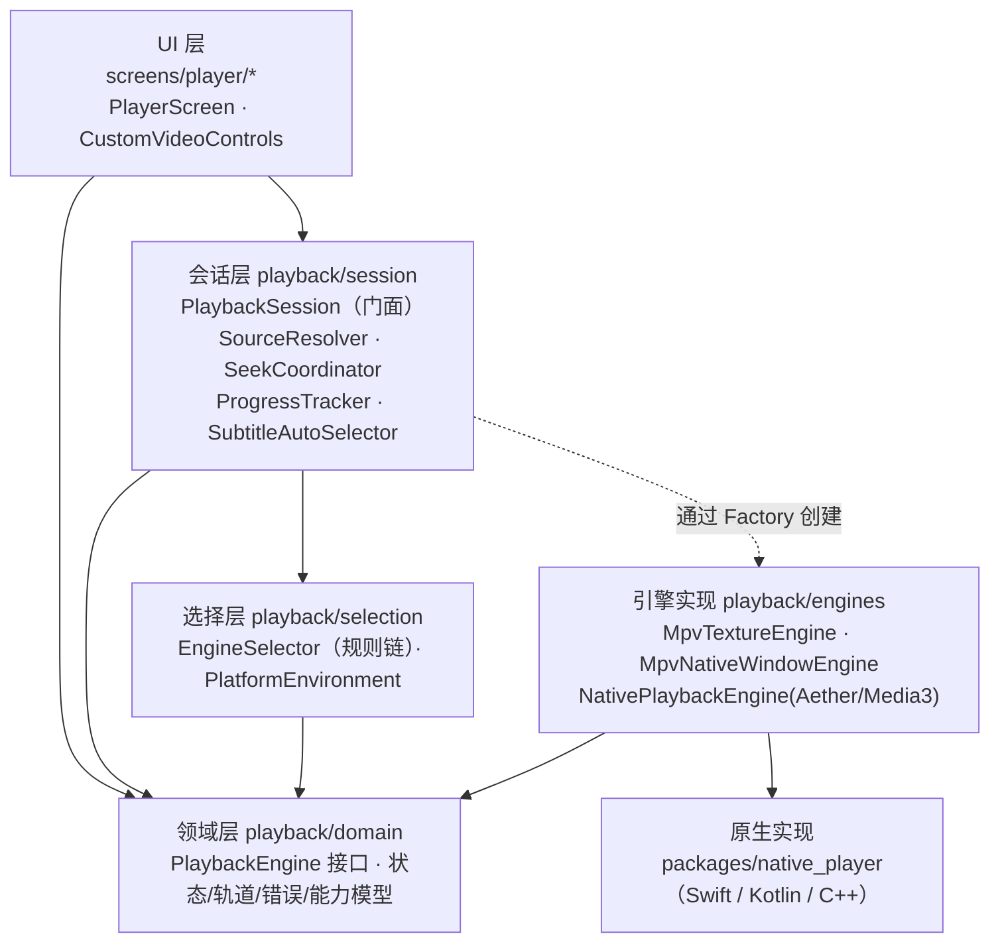

# 播放内核多端改造任务文档（杜比视界 / HDR）

> 状态：**Stage 1 已完成，待真机回归**（Stage 0.1 设备基线已跳过；下一步按主力平台选择 Stage 2 或 Stage 3+4）
> 最后更新：2026-10-13
> 适用范围：`client/lib/screens/player/`、`client/lib/playback/`（新增）、`client/packages/native_player/`（新增）、各平台原生工程
>
> **后续会话必读顺序**：§0 → §1 → §4 → §6 → §12（进度记录）→ 当前要做的阶段（§7）。
> 动手前先确认该阶段依赖的“待决策事项”（§8）已有结论；没有结论就先问用户。
> 每完成一个阶段或步骤，必须更新 §12 进度记录；接口有变化时同步更新 §4。

---

## 0. 一句话说明

当前播放器基于 `media_kit`（libmpv）+ Flutter 纹理，在所有平台上都**无法正确显示杜比视界 Profile 5（画面偏绿/偏紫），也无法输出真正的 HDR**。本任务把播放器重构为“**统一播放内核接口 + 按平台选择内核**”的架构：

| 平台 | 目标内核 | 画面承载 |
|---|---|---|
| iOS | AetherEngine（FFmpeg 解封装 + AVPlayer） | `UiKitView` |
| macOS | AetherEngine | `AppKitView` |
| Android | Media3 / ExoPlayer（libmpv 兜底） | PlatformView（Hybrid Composition + SurfaceView） |
| Windows | libmpv（`wid` 原生窗口 + `vo=gpu-next`） | 位于 Flutter 窗口后方的原生 HWND |
| Linux | libmpv 纹理（保持现状） | Flutter 纹理 |

---

## 1. 背景与根因（已核实，结论勿重复调研）

### 1.1 根因

1. **render API 不支持 libplacebo**：mpv 只有基于 libplacebo 的 `gpu-next` 渲染器会对杜比视界做 RPU 色彩重建（reshaping）。media_kit 在 iOS / macOS / Windows / Linux 上通过 libmpv **render API** 渲染，而 render API 只实现了旧的 `gpu` 渲染器。上游 PR [mpv-player/mpv#16818](https://github.com/mpv-player/mpv/pull/16818) 截至 2026-09-16 仍未合并，没有时间表。
2. **纹理只有 8-bit SDR**：media_kit 输出的纹理是 8-bit BGRA。iOS/macOS 是 `kCVPixelFormatType_32BGRA`，Windows 是 `DXGI_FORMAT_B8G8R8A8_UNORM`。Flutter 纹理在任何平台都没有 HDR 能力，HDR 只能压成 SDR。
3. **打包的 libmpv 没开 libplacebo**：

| 平台 | 包 | libmpv | 关键编译参数 |
|---|---|---|---|
| iOS | `media_kit_libs_ios_video 1.1.4` | mpv 0.36.0 | `-Dlibplacebo=disabled -Dvideotoolbox-gl=disabled` |
| macOS | `media_kit_libs_macos_video 1.1.4` | mpv 0.36.0 | `-Dlibplacebo=disabled` |
| Android | `media_kit_libs_android_video 1.3.8` | media-kit 构建 v1.1.7（FFmpeg 6.0） | `-Dlibplacebo=disabled -Dvulkan=disabled` |
| Windows | `media_kit_libs_windows_video 1.0.11` | media-kit 构建 2023-09-24 | 构建脚本**包含** libplacebo（瓶颈只在 render API） |

### 1.2 各平台约束要点

- **Android**：media_kit 在 Android 上通过 `--wid` 走普通 VO，**不走 render API**，换成带 libplacebo 的 libmpv 后可以用 `gpu-next`。但 FFmpeg 的 MediaCodec 是完整的硬件解码器，会丢弃 DV RPU，所以 **Profile 5 只有在软解时才能还原颜色**（[mpv-player/mpv#10287](https://github.com/mpv-player/mpv/issues/10287)、[mpv-android/mpv-android#1081](https://github.com/mpv-android/mpv-android/issues/1081)）。
- **Windows**：d3d11va 是硬件加速器（hwaccel），会保留 RPU。用 `wid` 原生窗口 + `gpu-next` 可以**在硬解下得到正确颜色**，并通过 `target-colorspace-hint` 输出真 HDR。Flutter Windows 不支持 PlatformView（[flutter/flutter#31713](https://github.com/flutter/flutter/issues/31713) 未关闭），只能用原生窗口叠放。
- **Apple**：系统的杜比视界能力只通过 AVFoundation 开放；AVPlayer 不认 MKV。AetherEngine 在设备端把 MKV 实时转封装成 HLS-fMP4 交给 AVPlayer，支持 DV P5/P8.x，并把 P7 实时转成 8.1。**后端无需改动。**
- **Media3**：真杜比视界依赖机型有杜比视界硬件解码器。无解码器时，P8.1/P7 会回退为 HDR10，**P5 没有可回退的兼容层，无法播放**。

### 1.3 参考实现（遇到同类问题先看它们）

- **Moonfin**（Flutter，Jellyfin/Emby 客户端）架构与本方案一致：<https://github.com/Moonfin-Client/Moonfin-Core>
  - iOS 桥接：`ios/Runner/Playback/AetherVideoPlatformView.swift`
  - macOS 桥接：`macos/Runner/Playback/MacosAetherVideoPlatformView.swift`
  - Windows HDR 窗口：`windows/runner/hdr_video_window.{h,cpp}`、`lib/playback/hdr_video_window.dart`
  - Dart 侧 mpv 后端：`lib/playback/media_kit_player_backend.dart`
  - 平台/内核说明：Wiki “Playback and Codecs”
- **AetherEngine**：<https://github.com/superuser404notfound/AetherEngine>（LGPL-3.0 + App Store 例外，仅支持 SPM，**要求 iOS 18 / macOS 15**，迭代很快，必须锁定精确版本）
- **DreamPlayer**：Flutter + Media3（Android）/ AetherEngine（iOS）的 PlatformView 实现
- **Kazumi**：Android 用 Predidit 的 media-kit fork + [Predidit/libmpv-android-video-build](https://github.com/Predidit/libmpv-android-video-build)（带 libplacebo），Android 14 及以上默认 `gpu-next`
- 相关 issue：[media-kit/media-kit#1354](https://github.com/media-kit/media-kit/issues/1354)、[#615](https://github.com/media-kit/media-kit/issues/615)、[#777](https://github.com/media-kit/media-kit/issues/777)、[#1093](https://github.com/media-kit/media-kit/issues/1093)

---

## 2. 目标与非目标

### 2.1 目标

1. 杜比视界 P5/P7/P8.x 在 iOS、macOS、Windows 上颜色正确；Android 在有杜比视界解码器的机型上颜色正确，无解码器的机型给出明确提示或兜底。
2. 在支持的硬件上输出真正的 HDR / 杜比视界：iPhone/iPad、XDR Mac、开启 HDR 的 Windows 显示器、HDR Android 机型。
3. 播放器 UI 与业务逻辑**与具体内核解耦**。新增或替换内核时不改 UI，只新增一个引擎实现、注册一条选择规则。
4. 现有功能零回归：续播、进度保存、选集、外挂/内嵌字幕、倍速、长按倍速、音量/亮度手势、全屏、媒体信息、网络错误恢复、本地缓存播放、302 跳转 + 鉴权头。

### 2.2 非目标

- 不改后端（不做服务端转码、转封装）。后端媒体探测见 D5，作为独立任务。
- 不改播放器 UI 的视觉设计；只做能力驱动的显隐（例如某引擎不支持网速显示就隐藏）。
- Linux 不追求杜比视界和 HDR。
- 本期不做画中画、后台播放、投屏（只需保证架构不阻碍以后加入）。

---

## 3. 现状代码地图（重构的输入）

### 3.1 关键文件

| 文件 | 行数 | 职责 / 与 media_kit 的耦合点 |
|---|---|---|
| `lib/main.dart:36` | — | `MediaKit.ensureInitialized()` |
| `lib/screens/player/player_screen.dart` | 1458 | 页面 + 全部播放业务逻辑（上帝类） |
| ├ `:100` | | 创建 `Player(PlayerConfiguration(bufferSize: 256MB))` 和 `VideoController` |
| ├ `:116` `_configurePlayerNetwork` | | 通过 `NativePlayer.setProperty` 设置重连、超时、cache |
| ├ `:371` `_setupPlayerListeners` | | 订阅 error / position / buffering / duration / completed / tracks |
| ├ `:483–700` | | 进度定时器、seek 串行化、受控 seek、网络错误识别（字符串匹配 mpv 错误）、可疑结束位置判断、进度保存 |
| ├ `:838–870` | | 全屏（移动端 `SystemChrome`、桌面端 `WindowControls`） |
| ├ `:875` `_loadVideo` | | 本地缓存优先 → 获取流地址 → 解析 302 → 构建鉴权头 → `open(Media(url, httpHeaders))` |
| ├ `:1137–1200` | | 外挂字幕：Dio 下载文本后 `SubtitleTrack.data`；分数 ≥85 自动加载 |
| └ `:1219–1270` | | 内嵌中文字幕自动选择 |
| `lib/screens/player/widgets/custom_video_controls.dart` | 2219 | 控制层；构造参数直接接收 `Player` 和 `VideoController`（`:40`） |
| ├ `:225` / `:233` | | 读取轨道状态；订阅 position / duration / playing / buffering / volume / tracks / track / rate |
| ├ `:298` | | 每秒轮询 mpv `cache-speed` 显示网速 |
| ├ `:1006` `_fetchMediaInfo` | | 读取十几个 mpv 属性组成媒体信息面板 |
| ├ `:1264` | | `Video(controller, controls: NoVideoControls, fit)` |
| └ `:1625` / `:1725` / `:1812` / `:1831` | | setRate / setAudioTrack / setSubtitleTrack |
| `lib/screens/player/speed_frame_limiter.dart` | 83 | 倍速时通过 mpv `vf` 抽帧（mpv 专属），有测试 `test/speed_frame_limiter_test.dart` |
| `lib/screens/player/widgets/player_top_bar.dart` 等 | — | 纯 UI，与内核无关 |

### 3.2 约定与现状事实

- 状态管理：Riverpod 3，手写 `NotifierProvider`，不用 codegen。播放设置在 `lib/providers/playback_settings_provider.dart`。
- 路由：`lib/core/router/` 中 `/player/movie/:id` 和 `/player/episode/:tvShowId/:seasonId/:episodeId` 创建 `PlayerScreen`。
- 音量语义：控制层的 `_maxVolume = 2.0`，调用 `setVolume(volume * 100)`（mpv 支持 0–200）。
- 原生通道：已有 `media_player/orientation`（iOS/Android）、存储、下载器通道。窗口控制统一走 `lib/core/window/window_controls.dart`。
- 最低系统版本：iOS App 13.4（扩展 16.2），macOS 10.15，Android `flutter.minSdkVersion`。
- Flutter 版本：项目通过 FVM 固定为 **3.38.5**（`client/.fvmrc`，2026-10-20 从 3.35.7 升级）。本机全局 SDK `/Users/zhouquan/application/flutter` 也是 3.38.5，可以直接用；`fvm` 在 `~/.pub-cache/bin/fvm`（不在 PATH）。被 gitignore 的本地缓存 `client/.fvm/flutter_sdk` 在执行 `fvm use 3.38.5` 之前仍然指向 3.35.7，**不要用它**。
- **pub 镜像**：命令行执行 `pub get` 前必须先 `export PUB_HOSTED_URL=https://pub.flutter-io.cn FLUTTER_STORAGE_BASE_URL=https://storage.flutter-io.cn`（用户在 `~/.zshrc` 里配置了，但 agent 的 shell 不一定会加载）。漏掉的话，pub 会把所有依赖重新解析到 pub.dev，大面积改写 `pubspec.lock` 和生成的插件注册文件。
- `client/vendor/media_kit_libs_macos_video` **没有被 pubspec 引用**，不要依赖它。
- 后端**没有**媒体技术信息探测（无 ffprobe），客户端拿不到预先探测好的 HDR / DV 信息。

---

## 4. 目标架构

### 4.1 分层与依赖方向



**依赖规则（强制）**：

- UI 层只依赖 `PlaybackSession` 和 `domain`，**禁止**导入 `media_kit`、Pigeon 生成代码或任何引擎实现。
- `domain` 是纯 Dart（只允许依赖 `flutter/widgets.dart`，用于 `buildVideoView` 的返回类型），不依赖任何播放库。
- 引擎实现之间不互相依赖；mpv 系列可以共享 `engines/mpv/` 内部的基类和工具。
- `package:media_kit*` 只能出现在 `lib/playback/engines/mpv/**` 和 `lib/main.dart`（初始化）中。

### 4.2 目录结构

```
client/lib/playback/
├── domain/
│   ├── playback_engine.dart          # PlaybackEngine 接口 + 可选能力接口
│   ├── playback_engine_kind.dart
│   ├── engine_capabilities.dart
│   ├── playback_source.dart          # PlaybackSource / MediaHints / ExternalSubtitle
│   ├── playback_state.dart           # PlaybackSnapshot / PlaybackStreams
│   ├── playback_state_hub.dart       # 引擎共用的状态发布器（内部工具）
│   ├── media_track.dart              # VideoTrackInfo / AudioTrackInfo / SubtitleTrackInfo
│   ├── video_info.dart               # VideoInfo / VideoDynamicRange
│   └── playback_error.dart
├── selection/
│   ├── platform_environment.dart     # 平台、系统版本、设备能力（可注入假实现）
│   ├── engine_selection_rule.dart    # 规则接口 + 内置规则
│   └── engine_selector.dart
├── session/
│   ├── playback_session.dart         # 门面：引擎生命周期、打开、回退、对 UI 暴露状态
│   ├── playback_source_resolver.dart # 本地缓存 / 流地址 / 302 / 鉴权头
│   ├── seek_coordinator.dart         # seek 串行化、受控 seek、初始 / 续播 seek
│   ├── playback_progress_tracker.dart# 进度定时保存、可疑结束判断、完成上报
│   └── subtitle_auto_selector.dart   # 内嵌中文字幕、外挂最佳匹配
├── engines/
│   ├── playback_engine_factory.dart  # EngineKind → 构造器注册表
│   ├── mpv/
│   │   ├── mpv_engine_base.dart      # 模板方法：mpv 公共逻辑
│   │   ├── mpv_texture_engine.dart   # 现有 media_kit 纹理路径
│   │   ├── mpv_native_window_engine.dart # Windows wid + gpu-next
│   │   ├── mpv_options.dart          # mpv 属性构建器
│   │   ├── mpv_error_mapper.dart
│   │   ├── mpv_diagnostics.dart      # 媒体信息 / 网速
│   │   └── speed_frame_limiter.dart  # 从 screens/player 迁入
│   ├── native/
│   │   ├── native_playback_engine.dart # 基于 Pigeon，Aether 与 Media3 共用
│   │   └── native_video_view.dart      # UiKitView / AppKitView / PlatformViewLink
│   └── windows/
│       ├── native_video_window.dart    # 与原生 HWND 模块通信
│       └── native_video_surface.dart   # 透明占位 widget，上报矩形
└── playback_providers.dart           # Riverpod：environment / selector / factory

client/packages/native_player/        # 本地 Flutter 插件（见 D2）
├── pigeons/native_player_api.dart    # 唯一的跨语言契约
├── lib/src/generated/                # Pigeon 生成，禁止手改
├── darwin/                           # iOS + macOS 共享 Swift（sharedDarwinSource）+ Package.swift（依赖 AetherEngine）
├── android/                          # Kotlin + Media3
└── windows/                          # C++：视频 HWND 管理（Windows 引擎用）

client/test/playback/
├── fakes/fake_playback_engine.dart
├── selection/…  session/…  engines/mpv/…
```

### 4.3 设计模式一览

| 模式 | 落点 | 目的 |
|---|---|---|
| 策略 (Strategy) | `PlaybackEngine` 的多个实现 | 内核可替换，UI 无感知 |
| 适配器 (Adapter) | 每个引擎把 media_kit / Pigeon / mpv-wid 适配到统一接口 | 隔离第三方 API |
| 工厂 + 注册表 (Factory) | `PlaybackEngineFactory` | 集中创建；新增引擎只需注册一行 |
| 责任链 (Chain of Responsibility) | `EngineSelector` + `EngineSelectionRule` 列表 | 选择逻辑是纯函数，可单测、可扩展 |
| 模板方法 (Template Method) | `MpvEngineBase` | 两个 mpv 引擎共享配置、事件映射、诊断，只在视频输出上有差异 |
| 门面 (Facade) | `PlaybackSession` | UI 只面对一个入口；回退、重试对 UI 透明 |
| 观察者 (Observer) | `PlaybackStreams` + `PlaybackStateHub` | 状态推送，与现有流式写法保持一致 |
| 接口隔离 (ISP) | `MediaDiagnosticsProvider`、`NetworkThroughputProvider` 等可选能力接口 | 不强迫每个引擎实现所有功能 |
| 构建器 (Builder) | `MpvOptions` | 按场景组合 mpv 属性（网络 / 缓存 / 解码 / HDR） |
| 测试替身 (Fake) | `FakePlaybackEngine` | 不依赖原生库测试会话逻辑 |

### 4.4 核心契约（草案：实现时可以微调，但必须同步更新本节）

> 已实现的接口以 `lib/playback/domain/` 下的代码为准，与下方草案的差异见 §12 中 Stage 1.1–1.4 的记录。尚未实现的部分（Pigeon、原生引擎相关能力等）仍按草案执行。

```dart
enum PlaybackEngineKind { mpvTexture, mpvNativeWindow, aether, media3 }

enum VideoDynamicRange { sdr, hdr10, hdr10Plus, hlg, dolbyVision, unknown }

final class VideoInfo {
  final int? width, height;
  final double? fps;
  final String? codec;
  final VideoDynamicRange dynamicRange;
  final int? dolbyVisionProfile;     // 5 / 7 / 8 …
  final bool hdrOutputActive;        // 是否真正以 HDR 送显
  final String? decoder;             // 例如 d3d11va / videotoolbox / c2.qti.dv.decoder / software
}

final class EngineCapabilities {
  final bool dolbyVisionColor;       // 能否正确还原 DV 颜色（含 P5）
  final bool hdrOutput;              // 能否输出真 HDR
  final double maxVolume;            // 1.0 = 100%；mpv 为 2.0，原生引擎通常为 1.0
  final double maxRate;
  final bool audioTrackSelection;
  final bool embeddedSubtitleSelection;
  final bool externalSubtitleData;   // 支持直接传入字幕文本
  final bool externalSubtitleUrl;    // 支持传入 URL + headers
  final bool rendersViaPlatformView;
  final bool rendersBehindFlutter;   // Windows 原生窗口：页面需要透明
}

final class PlaybackSource {
  final Uri uri;
  final Map<String, String> httpHeaders;
  final bool isLocalFile;
  final MediaHints hints;            // 已知的容器 / 动态范围 / DV profile，可为空
}

sealed class ExternalSubtitle {}     // ExternalSubtitle.data(text, title) | ExternalSubtitle.url(uri, headers, title)

final class PlaybackError {
  final PlaybackErrorKind kind;      // network, http, unsupportedFormat, decoder, renderer, source, unknown
  final String message;
  final int? httpStatus;
  final bool recoverable;            // 可忽略或可自动恢复的临时错误
  final bool fallbackSuggested;      // 建议会话切换到下一个候选引擎
}

final class PlaybackStreams {
  final Stream<Duration> position, duration, buffered;
  final Stream<bool> playing, buffering, completed;
  final Stream<double> rate, volume;
  final Stream<MediaTracks> tracks;
  final Stream<SelectedTracks> selectedTracks;
  final Stream<VideoInfo> videoInfo;
  final Stream<PlaybackError> errors;
}

abstract interface class PlaybackEngine {
  PlaybackEngineKind get kind;
  EngineCapabilities get capabilities;
  PlaybackSnapshot get state;          // 最新快照，等价于 media_kit 的 player.state
  PlaybackStreams get streams;

  Future<void> initialize();
  Future<void> open(PlaybackSource source, {bool autoPlay = true});
  Future<void> play();
  Future<void> pause();
  Future<void> playOrPause();
  Future<void> seek(Duration position);
  Future<void> setRate(double rate);
  Future<void> setVolume(double volume);           // 0.0 – capabilities.maxVolume
  Future<void> selectAudioTrack(AudioTrackInfo track);
  Future<void> selectSubtitleTrack(SubtitleTrackInfo track);   // SubtitleTrackInfo.off 表示关闭
  Future<void> addExternalSubtitle(ExternalSubtitle subtitle, {bool select = true});
  Widget buildVideoView(BuildContext context, {required BoxFit fit});
  Future<void> dispose();                          // 幂等；之后所有流关闭
}

abstract interface class MediaDiagnosticsProvider {
  Future<Map<String, String>> fetchDiagnostics();  // 媒体信息面板：键为展示名
}

abstract interface class NetworkThroughputProvider {
  Future<int?> currentDownloadBytesPerSecond();
}

abstract interface class EngineSelectionRule {
  EngineDecision? evaluate(EngineSelectionContext context);  // 返回 null 表示交给下一条规则
}

final class EngineDecision {
  final List<PlaybackEngineKind> candidates;   // 按优先级排序，会话按顺序回退
  final String reason;                         // 写入日志和媒体信息面板
}
```

**语义约定**：

- 时间统一用 `Duration`；音量 1.0 = 100%；倍速为 `double`。
- `PlaybackStateHub`：每个引擎内部持有一个 hub，只需调用 `hub.update(...)`，由 hub 负责快照、广播和去重，避免各引擎重复写 StreamController。
- `open()` 必须能被新的 `open()` 打断（用代际计数丢弃过期回调），这对选集快速切换很重要。
- 引擎**不得**把底层原始异常抛给 UI，一律映射为 `PlaybackError`。`player_screen.dart` 里 `_isRecoverablePlaybackError` 那套 mpv 字符串匹配要迁到 `MpvErrorMapper`。
- 字幕在各引擎内部渲染（mpv 自绘；Aether / Media3 在原生视图内的字幕层绘制），Flutter 控制层不画字幕。

### 4.5 会话层职责划分（从 `PlayerScreen` 拆出）

| 组件 | 迁入的现有逻辑 | 是否依赖引擎 |
|---|---|---|
| `PlaybackSourceResolver` | `_loadVideo` 中的本地缓存判断、流地址获取、`_resolveRedirectTarget`、`_buildAuthHeadersForPlayUrl`、UA | 否（只产出 `PlaybackSource`） |
| `SeekCoordinator` | `_handleUserSeek`、`_awaitActiveSeekOperation`、`_markControlledSeek`、初始 / 续播 seek | 只依赖 `PlaybackEngine` 接口 |
| `PlaybackProgressTracker` | `_startProgressTimer`、`_saveProgress`、`_publishWatchProgress`、可疑结束和完成判断 | 只依赖接口 |
| `SubtitleAutoSelector` | `_findChineseSubtitleTrack`、外挂字幕分数 ≥85 自动加载 | 只依赖接口与领域模型 |
| `PlaybackSession`（门面） | 引擎创建与销毁、按 `EngineDecision.candidates` 回退、对外暴露会话状态（loading / ready / error）和当前 `engine` | 通过 Factory 创建 |

`PlaybackSession` 的生命周期跟随 `PlayerScreen`。引擎切换（回退）时会话发出 `engineChanged`，UI 用新引擎的 `buildVideoView` 重建画面，并从原位置继续播放。

**实际实现（Stage 1.5，2026-10-21）**：

- `PlaybackItem`（sealed：`MoviePlaybackItem` / `EpisodePlaybackItem`）是会话层的业务对象，由页面算好后交给 `session.load(item, startAt:)`。
- 数据访问收敛为两个接口（`session/playback_gateways.dart`）：
  - `PlaybackSourceGateway`：服务器地址、token、下载记录、流地址、存储信息、外挂字幕列表。
  - `WatchProgressGateway`：进度的上报和本地发布。
  - 页面通过 `RiverpodPlaybackGateway(ref)` 实现这两个接口；测试使用 `test/playback/fakes/` 下的假实现。
- 会话通过 `ChangeNotifier` 暴露 `status`（`PlaybackSessionLoading` / `Ready` / `Failed`）、`currentUrl`、`filePath`、`externalSubtitles`；Toast 文案走 `notices` 流。界面渲染始终由页面负责。
- 留在页面的逻辑：剧集列表与选集、“已观看 >90% 是否播下一集”的确认弹窗、读取剧集历史进度、全屏。
- 切换剧集的顺序：`session.prepareSwitch()`（等待 seek 结束 → 暂停 → 保存进度 → 进入加载态）→ 页面更新选集并读取该集进度 → `session.load()`。
- 起播位置在“时长就绪”事件中生效，用户 seek 会取消它；`reload()`（重试）会保留尚未生效的起播位置。
- 引擎在 `open()` 前调用 `PlaybackStateHub.resetForNewMedia()`。原因：hub 会对相同的值去重，如果不重置，重新打开同一个媒体（时长相同）时“时长就绪”事件会被吞掉。

### 4.6 原生跨语言契约（Pigeon，Apple 与 Android 共用）

```dart
// packages/native_player/pigeons/native_player_api.dart（草案）
@HostApi()
abstract class NativePlayerHostApi {
  NativeDeviceCapabilities getDeviceCapabilities();   // DV 解码器 / 支持的 profile / HDR 显示能力
  int create(NativePlayerConfig config);              // 返回 playerId
  @async void open(int playerId, NativeSource source, bool autoPlay);
  void play(int playerId);
  void pause(int playerId);
  void seek(int playerId, int positionMs);
  void setRate(int playerId, double rate);
  void setVolume(int playerId, double volume);
  void selectAudioTrack(int playerId, String trackId);
  void selectSubtitleTrack(int playerId, String? trackId);
  @async void addExternalSubtitle(int playerId, NativeExternalSubtitle subtitle);
  void dispose(int playerId);
}

@EventChannelApi()
abstract class NativePlayerEventApi {
  NativePlayerEvent playerEvents();   // sealed：Position / Duration / Playing / Buffering / Completed
                                      // Tracks / SelectedTracks / VideoInfo / Error，均带 playerId
}
```

- 画面承载用 PlatformView，`viewType = 'media_player/native_video'`，`creationParams = {playerId}`。原生侧按 `playerId` 从注册表取引擎实例并挂载视图。
- 原生侧用 `playerId → 引擎实例` 的注册表，为以后的迷你播放器 / 多实例留出空间。
- position 事件节流到约 250ms。
- 生成命令写进插件的 README，生成文件放在 `lib/src/generated/`，禁止手改。

### 4.7 引擎选择规则（责任链，按顺序评估）

| # | 规则 | 结果 |
|---|---|---|
| 1 | 用户偏好为“兼容模式”（Apple 不提供该选项，见 D1） | `[mpvTexture]` |
| 2 | iOS / macOS | `[aether]`（Apple 不打包 libmpv，见 D1） |
| 3 | Android | `[media3, mpvTexture]` |
| 4 | Windows | `[mpvNativeWindow, mpvTexture]` |
| 5 | 其他（Linux） | `[mpvTexture]` |

- 已失败的引擎（`failedKinds`）从候选中剔除。
- `PlaybackError.fallbackSuggested == true`（例如 Media3 在无 DV 解码器的机型上遇到 P5）时，会话切到下一个候选引擎，从原位置继续，并提示用户。
- 规则在实现各阶段逐条加入：Stage 1 只有第 5 条的等价规则（全部返回 `mpvTexture`）。

---

## 5. 平台能力矩阵（实施后的目标状态）

| | iOS | macOS | Android（有 DV 解码器） | Android（无 DV 解码器） | Windows | Linux |
|---|---|---|---|---|---|---|
| 内核 | Aether | Aether | Media3 | Media3 → mpv 回退 | mpv `wid` | mpv 纹理 |
| DV P5 颜色 | ✅ | ✅ | ✅ | ⚠️ 回退到 mpv（Stage 6 后软解可还原颜色） | ✅ 硬解 | ❌ |
| DV P7 / P8.1 | ✅（P7 → 8.1） | ✅ | ✅ | 按 HDR10 播放 | ✅ | ❌ |
| 真 HDR 输出 | ✅ EDR | ✅ XDR 屏 | ✅ | ✅（HDR10） | ✅（系统开启 HDR 时） | ❌ |
| MKV | ✅（设备端转封装） | ✅ | ✅ | ✅ | ✅ | ✅ |

### 5.1 DV / HDR 检测方式（Stage 0.2 结论，2026-10-13）

**验证环境**：macOS 上用 C 程序直接链接 media_kit 自带的 Mpv.framework（**mpv 0.36.0 + FFmpeg 6.0**，与 App 实际打包的版本一致），`vo=null`，分别用软解和 `videotoolbox-copy` 测试。

**样片**：
- media-kit#1434 的 `test.mkv`（DV，容器里**没有**配置记录，FFmpeg 6.0 / 7.0 都报 `RPU validation failed`）。
- ffmpeg 生成的对照片：SDR BT.709、HDR10、HLG、未标记 10-bit（有限范围）、未标记 10-bit（全范围）。

**实测结果**：

| 样片 | `video-params` (matrix / levels / prim / gamma / peak) | `video-dec-params` (matrix / gamma) | DOVI 相关日志 |
|---|---|---|---|
| DV `test.mkv` | bt.709 / full / bt.709 / bt.1886 / 1.0 | auto / auto | 有（`ffmpeg/video`：`RPU validation failed`、`Error parsing DOVI NAL unit`，每帧 2 条） |
| 未标记 10-bit 全范围 | bt.709 / full / bt.709 / bt.1886 / 1.0 | auto / auto | 无 |
| 未标记 10-bit 有限范围 | bt.709 / limited / bt.709 / bt.1886 / 1.0 | auto / auto | 无 |
| SDR BT.709 | bt.709 / limited / bt.709 / bt.1886 / 1.0 | bt.709 / bt.1886 | 无 |
| HDR10 | bt.2020-ncl / limited / bt.2020 / pq / 4.93 | bt.2020-ncl / pq | 无 |
| HLG | bt.2020-ncl / limited / bt.2020 / hlg / 4.93 | bt.2020-ncl / hlg | 无 |

**结论**：

1. **mpv 0.36 的属性检测不出 DV。** 色彩空间名称表里没有 `dolbyvision`，track-list 里也没有 DV 字段；P5 的属性和“未标记的 10-bit 全范围 SDR”完全一样（上表第 1、2 行），只靠属性判断会误判。mpv 把 IPT 当成 BT.709 YCbCr 显示，这就是偏绿/偏紫的直接原因。
2. **信号 A（确定，带 profile）**：verbose 级日志 `Found Dolby Vision config record: profile N level M`（`demux/demux_lavf.c:763`）。只有容器带 DOVI 配置记录（MP4 的 `dvcC` / `dvvC`、MKV 的 BlockAdditionMapping）时才会出现。需要 `PlayerConfiguration(logLevel: MPVLogLevel.v)` 并订阅 `player.stream.log`；正常播放时 5 秒约 6 条日志，开销可以忽略。（本次的样片没有配置记录，所以**信号 A 还没有用真实样片验证**。）
3. **信号 B（只能说明码流里有 RPU，不知道 profile）**：`ffmpeg/video` 前缀的 `Error parsing DOVI NAL unit` / `RPU validation failed`。只有 RPU 被当前 FFmpeg 判为非法时才会出现；规范的码流内 RPU **不会产生任何日志**。软解和 VideoToolbox 硬解下都会出现；Android MediaCodec 预计不会出现（待实测）。这类日志每帧都会打，检测到第一条后就应该停止处理。media_kit 不会把 `ffmpeg/video` 前缀的日志转成 `stream.error`，所以不会触发错误页。
4. **Stage 1.8 提示规则**：
   - 信号 A，profile = 5 → 提示颜色可能异常。
   - 信号 A，profile = 7 / 8 → 不提示颜色问题（有 HDR10 兼容层，只是被压成 SDR）。
   - 信号 B，且 `video-dec-params/colormatrix` 与 `gamma` 都是 `auto` → 判定为“疑似 P5”，提示。
   - 其他情况不提示。规范的码流内 P5（没有容器记录）会漏检，这是可以接受的。
5. **不做**纯属性启发式（已验证会误判）。播放前的预探测（例如提前选择引擎）不在 mpv 侧做，留给 D5（后端 ffprobe 能同时读到容器记录和码流内 RPU）。

**原生引擎**（接入时验证）：

| 引擎 | 检测来源 |
|---|---|
| AetherEngine | `AetherEngine.probe` / 已发布的 video format（会用 libdovi 读取 RPU 来纠正错误的容器记录） |
| Media3 | `Format.sampleMimeType == video/dolby-vision`、`Format.codecs`（`dvhe.05…`）、`ColorInfo` |

**遗留验证项**：
- 用**规范的 P5**（容器带记录）和 P8.1 样片验证信号 A。
- 在 Android 和 Windows 的 mpv 构建上验证信号 A / B（这两个构建的 FFmpeg 也是 6.x，但 mpv 提交不同）。

---

## 6. 编码规范与约束（所有阶段通用）

1. **遵守全局工作流**：每个阶段动手前给出该阶段的计划，询问 “Shall I proceed? (Y/N)”，确认后再改代码。
2. **最小改动**：只做当前阶段范围内的改动；代码风格精简，非必要不写注释（遵循用户全局规范），风格与周边代码一致。
3. **依赖方向**按 §4.1 执行。可以用以下命令自查：
   - `grep -rn "package:media_kit" client/lib | grep -v "lib/playback/engines/mpv/" | grep -v "lib/main.dart"` 应当为空
   - `grep -rn "playback/engines" client/lib/screens` 应当为空
4. **能力驱动 UI**：控制层根据 `engine.capabilities` 或 `engine is XxxProvider` 决定功能显隐，**禁止**在控制层用 `Platform.isXxx` 判断引擎功能（与 AGENTS.md 中“平台判断只用于系统能力差异”一致）。
5. **新增引擎检查清单**：实现 `PlaybackEngine` → 声明 `EngineCapabilities` → 错误映射 → 在 `PlaybackEngineFactory` 注册 → 在 `EngineSelector` 加规则 → 补测试 → 更新 §4.7、§5、§12。
6. **生命周期**：`dispose()` 幂等；dispose 后不再发出事件；页面退出时先保存进度再销毁引擎（保持现有顺序）。
7. **日志**统一用 `LogService.instance`，tag 用引擎名（如 `Engine.mpvTexture`）；引擎选择结果和回退原因必须打日志。
8. **Riverpod**：沿用手写 `NotifierProvider` / `Provider` 风格。`PlaybackSession` 是页面级对象，不做全局单例；`PlatformEnvironment`、`EngineSelector`、`PlaybackEngineFactory` 通过 provider 注入，便于测试替换。
9. **原生代码**：
   - 播放相关的原生代码一律放在 `packages/native_player`。
   - 跨语言调用只走 Pigeon，App 代码不新增手写播放 MethodChannel。
   - 第三方原生依赖锁定精确版本（AetherEngine 尤其要锁定）。
10. **UI 交付自查**（AGENTS.md）：浅色/深色、移动端/桌面端、加载/空/错误态、文本溢出、安全区与桌面标题栏。播放器控制层属于高影响改动，每个阶段都要在移动端和桌面端分别验证。
11. **测试**：会话层、选择层、错误映射、轨道映射是纯 Dart，必须有单元测试；`FakePlaybackEngine` 放在 `test/playback/fakes/`。每个阶段结束时 `flutter analyze` 无新增问题，`flutter test` 全部通过。**所有 flutter 命令都必须用 FVM 固定的 SDK**（见 §3.2），不要用全局 `flutter`。
12. **许可证**：AetherEngine 为 LGPL-3 + App Store 例外；media_kit libmpv 为 LGPL；Media3 为 Apache-2.0；FFmpeg 扩展必须是 LGPL 构建，**不得引入 GPL 组件**（见 D3）。

---

## 7. 实施阶段

> 推荐顺序：Stage 0 → 1 →（2 或 3+4，按主力平台决定）→ 5 → 6 / 7。
> 每个阶段都应能独立交付、可回滚；阶段内的步骤建议拆成独立提交。

### Stage 0：基线与验证（不改业务代码）

**目标**：建立回归基线，确认 mpv 侧 DV / HDR 检测方式。

- [ ] 0.1 按 §9 准备测试片源；在 iOS、Android、macOS、Windows 各跑一遍现状，把现象（颜色、HDR、性能、字幕、音轨）记录到 §12。
- [ ] 0.2 Spike：在 mpv 0.36 上分别打开 DV P5、P8.1、HDR10、HLG、SDR 样片，记录 `video-params/colormatrix`、`video-params/gamma`、`video-params/primaries`、`track-list` 各字段的取值，确定能否区分 P5，把结论填进 §5.1。可以临时加调试代码，结束后删除。
- [ ] 0.3 整理 §10 回归清单，作为后续每个阶段的验收依据。

**验收**：§12 中有基线记录，§5.1 有明确结论。

### Stage 1：播放内核抽象 + `MpvTextureEngine`（纯重构，行为不变）

**前置**：Stage 0。**风险**：重构约 3.7k 行，必须小步提交，每步保证可运行。

- [x] 1.1 新建 `lib/playback/domain/` 下的全部模型和 `PlaybackStateHub`（只新增，不接线）。
- [x] 1.2 定义 `PlaybackEngine` 与可选能力接口（§4.4）。
- [x] 1.3 `MpvEngineBase` + `MpvTextureEngine`：
  - 把 `_configurePlayerNetwork` 的属性迁入 `MpvOptions`。
  - 把 `speed_frame_limiter.dart` 移到 `engines/mpv/`，测试同步迁移。
  - mpv 错误字符串识别迁入 `MpvErrorMapper`。
  - `_fetchMediaInfo` 迁入 `MpvDiagnostics`（实现 `MediaDiagnosticsProvider`），`cache-speed` 迁入 `NetworkThroughputProvider`。
  - media_kit 轨道映射为领域轨道模型。
  - `buildVideoView` 返回 `Video(controller, controls: NoVideoControls, fit)`。
- [x] 1.4 `PlaybackEngineFactory`、`EngineSelector`（暂时只有一条规则返回 `[mpvTexture]`）、`PlatformEnvironment`、`playback_providers.dart`。
- [x] 1.5 从 `PlayerScreen` 拆出会话层组件（§4.5），`PlayerScreen` 只保留页面职责：路由参数、全屏、选集 UI 回调、加载/错误态展示。
- [x] 1.6 `CustomVideoControls` 改为接收 `PlaybackEngine`（或 `PlaybackSession`），去掉 `Player` / `VideoController` 参数；轨道类型换成领域模型；音量按 `capabilities.maxVolume` 计算；网速、媒体信息按能力接口显隐。
- [x] 1.7 测试：`FakePlaybackEngine`；为选择器、错误映射、`SubtitleAutoSelector`、`SeekCoordinator`、`PlaybackProgressTracker`（可疑结束判断）写单元测试。
- [x] 1.8 DV 提示（依赖 0.2 的结论）：mpv 引擎填充 `VideoInfo.dynamicRange` 和 `dolbyVisionProfile`；当 `!capabilities.dolbyVisionColor && dolbyVisionProfile == 5` 时，用 `PlayerOverlayNotice` 提示“当前播放内核无法正确显示杜比视界 Profile 5，画面颜色可能异常”；媒体信息面板增加“动态范围”“播放内核”两项。

**验收**：
- §6 第 3 条中的两条 grep 自查都为空。
- §10 回归清单在 iOS、Android、macOS、Windows 全部通过，行为与重构前一致。
- `flutter analyze` 无新增问题，`flutter test` 通过。

### Stage 2：Windows `MpvNativeWindowEngine`

**前置**：Stage 1；D2 已决策。

- [ ] 2.1 Spike：用当前 Windows libmpv 验证 `wid` + `vo=gpu-next` + `gpu-api=d3d11` + `hwdec=d3d11va` 能否工作、DV P5 颜色是否正确、`target-colorspace-hint` 能否输出 HDR。如果不行，评估更换 libmpv 构建（参考 Moonfin 使用的 fork），结论记录到 §12。
- [ ] 2.2 原生视频窗口模块（C++，放在 `packages/native_player/windows/`；插件拿不到所需窗口消息时退回 runner，参考 Moonfin `hdr_video_window.cpp`）：
  - 默认摆法：顶层窗口放在 runner 窗口**后面**，runner 窗口开启逐像素 DWM 透明。
  - 跟随移动、缩放、层级顺序、最小化、全屏。
  - 跨显示器时通知 Dart（mpv 只在创建时协商一次色彩空间，需要重建渲染器）。
  - 通过 MethodChannel 或 Pigeon 暴露 `create / setRect / setVisible / dispose` 和 `monitorChanged` 事件。
- [ ] 2.3 Dart：`NativeVideoWindowController`；`MpvNativeWindowEngine extends MpvEngineBase`（设置 `wid`、`vo`、`gpu-api`、`hwdec`，按设置决定是否开 `target-colorspace-hint`）；`buildVideoView` 返回 `NativeVideoSurface`（透明占位，布局变化时上报物理像素矩形）。
- [ ] 2.4 页面透明：`capabilities.rendersBehindFlutter` 为真时，播放页的 `Scaffold` 和视频区域背景透明；检查 `DesktopTitleBar`、`WindowBorder`、弹窗、菜单在透明窗口下的显示。
- [ ] 2.5 设置项：播放设置新增“Windows 原生 HDR 输出”和“播放内核：自动 / 兼容模式”；选择规则加入第 1、4 条。
- [ ] 2.6 回退：原生窗口创建失败或 `vo` 初始化失败时，返回 `fallbackSuggested` 错误，由会话切到 `mpvTexture`。

**验收**：
- DV P5 颜色正确，且 `hwdec-current` 为 d3d11va。
- 系统开启 HDR 时 HDR10 和杜比视界以 HDR 送显；SDR 显示器上压成 SDR 的效果正常。
- 控制层、弹窗、菜单正确叠加在视频上方。
- 拖动、缩放、最大化、全屏、最小化、多显示器都正常；离开播放页后没有残留窗口。
- §10 全部通过。

### Stage 3：原生播放插件骨架 + Pigeon 契约

**前置**：Stage 1；D2 已决策。

- [ ] 3.1 创建 `client/packages/native_player`（平台：android、ios、macos、windows；Apple 使用 `sharedDarwinSource: true`），在 `client/pubspec.yaml` 中以 path 依赖引入。
- [ ] 3.2 编写 Pigeon 契约（§4.6）并生成 Dart、Swift、Kotlin 代码；把生成命令写进插件 README。
- [ ] 3.3 Dart `NativePlaybackEngine`：基于 Pigeon 实现 `PlaybackEngine`；`kind` 由构造参数决定（`aether` / `media3`）；把事件映射到 `PlaybackStateHub`。
- [ ] 3.4 `NativeVideoView`：iOS 用 `UiKitView`，macOS 用 `AppKitView`，Android 用 `PlatformViewLink` + `initExpensiveAndroidView`（Hybrid Composition，保证 SurfaceView 能输出 HDR）。
- [ ] 3.5 原生侧先放桩实现，全部返回“不支持”；用 Dart 假 host 测试契约。

**验收**：插件在各平台都能编译；挂上桩实现后 App 行为不变（选择器仍然回退到 mpv）。

### Stage 4：Apple（iOS + macOS）接入 AetherEngine

**前置**：Stage 3；**D1 必须先决策**。

- [ ] 4.0 Spike：
  - (a) 在项目固定的 Flutter 版本（`.fvmrc`）上让插件通过 SPM 引入 AetherEngine（需要开启 Flutter 的 SPM 支持；如果当前版本不支持，评估是否升级 FVM 版本）。
  - (b) 确认与 media_kit libmpv 的 FFmpeg 冲突，确定 Apple 端去掉 libmpv 的方式。
  - (c) 在 iPhone 16 Pro Max 和一台 Mac 上验证 DV P5 / P8.1 / HDR10。
- [ ] 4.1 依赖调整：把 `media_kit_libs_video` 换成按平台引入的 `media_kit_libs_android_video`、`media_kit_libs_windows_video`、`media_kit_libs_linux`（Apple 不打包 libmpv，做法参考 Moonfin 的 pubspec 注释）；按 D1 提升部署版本；Apple 上 `MediaKit.ensureInitialized()` 要么条件化，要么确认无害。
- [ ] 4.2 Swift `AetherPlayerHost`：`playerId → 引擎包装` 注册表；实现 HostApi；把引擎发布的属性映射为事件（position 节流）。
- [ ] 4.3 PlatformView 工厂：iOS（UIView）和 macOS（NSView）分别承载 AetherPlayerView 和字幕层；视图跟随页面生命周期，引擎包装跟随 playerId 生命周期（参考 Moonfin 的分层）。
- [ ] 4.4 功能映射：请求头与 302、本地文件（下载缓存）、倍速、音量（`maxVolume = 1.0`，见 D8）、音轨、内嵌字幕、外挂字幕（优先用 URL + headers，`externalSubtitleUrl = true`）、缓冲、完成、错误映射。
- [ ] 4.5 字幕渲染（按 D7）：AetherEngine 只发布 `subtitleCues`，绘制由宿主负责，要覆盖文本 cue（样式与 `placement`）、PGS 图片 cue、外挂 ASS / SRT；选 B 时开启 `preserveASSMarkup` 并接入 libass 渲染器，字体使用 `fontAttachments`。
- [ ] 4.6 HDR / DV：iOS 自动开启 EDR。macOS 上不声明 `panelPresentsDolbyVision`，Profile 5 颜色也是正确的（作者在 16 寸 XDR 上实测），只是标签会显示为 HDR10，所以媒体信息里的动态范围以探测结果为准。
- [ ] 4.7 平台行为：iOS 全屏和横竖屏沿用现有方向通道；macOS 窗口和全屏沿用 `WindowControls`；确认 Flutter 控制层在 PlatformView 上方的手势正常。
- [ ] 4.8 选择规则加入第 2 条。

**验收**：在 iPhone 16 Pro Max 上 DV P5 / P7 / P8.1 颜色正确且以 HDR 显示，HDR10 为真 HDR；macOS 同理；§10 全部通过。

### Stage 5：Android 接入 Media3

**前置**：Stage 3；D3 已决策。

- [ ] 5.1 Kotlin `Media3PlayerHost`：每个 playerId 一个 ExoPlayer；`DefaultHttpDataSource` 带请求头；支持 MKV；轨道选择用 `TrackSelectionOverride`；错误映射（`ERROR_CODE_DECODING_FORMAT_UNSUPPORTED` 等映射为 `unsupportedFormat` + `fallbackSuggested`）。
- [ ] 5.2 PlatformView：SurfaceView + Hybrid Composition，验证 HDR 送显和 Flutter 控制层的叠加、手势、性能。
- [ ] 5.3 设备能力：通过 `MediaCodecList` 查询 `video/dolby-vision` 解码器和支持的 profile，再加上 `Display.HdrCapabilities`，通过 `getDeviceCapabilities` 返回。
- [ ] 5.4 音频：按 D3 接入 LGPL 构建的 FFmpeg 扩展（AC3 / EAC3 / DTS / TrueHD）。不支持的音频返回 `fallbackSuggested`。
- [ ] 5.5 字幕：内嵌字幕；外挂字幕用 `SubtitleConfiguration` + 带请求头的数据源。ASS 特效字幕支持有限，记为已知限制，用户可以在设置里切到兼容模式。
- [ ] 5.6 选择规则加入第 3 条；无 DV 解码器的设备遇到 P5 时回退到 mpv 并提示。
- [ ] 5.7 设置项“播放内核偏好”在 Android 上生效。

**验收**：有 DV 解码器的机型上 P5 / P8.1 为真杜比视界；无 DV 解码器的机型上 P8.1 按 HDR10 播放，P5 回退到 mpv 并提示；HDR10 为真 HDR；MKV / MP4、各音频格式、字幕正常；§10 全部通过。

### Stage 6（可选）：Android libmpv 加入 libplacebo

**前置**：Stage 5；D4 决策为“做”。

- [ ] 6.1 换成带 libplacebo 的 libmpv（Predidit fork 或自行构建），只影响 Android。
- [ ] 6.2 回退到 mpv 且识别为 DV P5 时，使用 `vo=gpu-next` + `hwdec=no` 还原颜色；在中低端机上验证性能、发热和掉帧，必要时只在设备性能足够时启用。

### Stage 7：诊断与收尾

- [ ] 7.1 统一媒体信息面板：播放内核、解码器、动态范围、DV profile、HDR 送显状态、引擎选择原因。
- [ ] 7.2 清理遗留代码和临时开关；更新本文档 §4、§5 为最终状态，状态改为“已完成”。
- [ ] 7.3 全平台完整回归。

---

## 8. 待决策事项（实施对应阶段前必须向用户确认）

| ID | 问题 | 选项 | 建议 | 影响阶段 | 结论 |
|---|---|---|---|---|---|
| D1 | Apple 最低系统版本：AetherEngine 自 2026-09-16（提交 `852b6a0`）起要求 iOS 18 / macOS 15，项目目前是 iOS 13.4 / macOS 10.15 | A. 提升到 iOS 18 / macOS 15，Apple 上只用 AetherEngine；B. 保留低版本，低版本继续用 media_kit（需要先验证两套 FFmpeg 能否共存，风险高） | A | 4 | **A（2026-10-13 用户确认）**。在 Stage 4.1 提升版本，之前保持现状；锁定 AetherEngine 最新的精确版本。后果：Apple 上没有 mpv 兜底，AetherEngine 打不开的片源直接报错 |
| D2 | 原生代码放在哪里 | A. 本地插件 `packages/native_player`；B. 直接写在各平台 Runner 里 | A（封装好、边界清晰）；SPM 或窗口消息受阻时，单个平台可以退回 B | 2, 3 | 待定。注意：AetherEngine 只支持 SPM，Apple 端选 A 时需要为整个项目开启 Flutter 的 SPM 集成（会改变所有插件在 iOS / macOS 上的集成方式，由 4.0 Spike 验证）；选 B 时可以在 Runner 的 Xcode 工程里直接添加 SPM 包，和 CocoaPods 共存 |
| D3 | Android 音频扩展 | A. 自行构建 LGPL 版 Media3 FFmpeg 扩展；B. 使用现成的 GPL 构建（会传染 GPL，不建议）；C. 不支持的音频回退到 mpv | A，C 作为兜底 | 5 | 待定 |
| D4 | 是否做 Stage 6 | 做 / 不做 | 看无 DV 解码器机型的用户占比再定 | 6 | 待定 |
| D5 | 后端是否新增媒体技术信息探测（ffprobe：动态范围、DV profile、音频编码） | 做（独立后端任务）/ 不做 | 暂不做；先靠客户端运行时检测和回退。以后用于提前选择引擎和在详情页展示 HDR 标识 | — | 待定 |
| D6 | 是否向用户开放“播放内核偏好”设置 | 开放 / 隐藏为调试项 | 开放（自动 / 兼容模式） | 2, 5 | 待定 |
| D7 | Apple 字幕渲染：AetherEngine 只发布字幕 cue（文本带粗体、斜体、颜色、位置等基础样式；PGS 为图片），由宿主绘制；完整 ASS 特效需要宿主开启 `preserveASSMarkup` 并自行接入 libass 渲染器 | A. 原生层绘制基础样式 cue（丢失卡拉 OK、动画、复杂定位等 ASS 特效）；B. 原生层接入 libass 渲染器（例如 swift-ass-renderer），效果与现在的 mpv 一致；C. cue 经 Pigeon 传回 Flutter 绘制（样式可跨引擎统一，同样丢失 ASS 特效） | 字幕组 ASS 是主要场景就选 B；否则先 A，再迭代到 B | 4 | **B（2026-10-13 用户确认）** |
| D8 | Apple 音量上限：AVPlayer 最大 100%，现在的 mpv 可到 200% | A. 接受，Apple 上音量最大 100%；B. 自行实现音频增益 | A | 4 | **A（2026-10-13 用户确认）** |
| D9 | 旧系统用户：iOS 18 以下 / macOS 15 以下的设备将无法安装新版本 | A. 不再支持；B. 保留旧版分支维护 | A（取决于 iOS / macOS 的实际用户和分发方式） | 4 | **A（2026-10-13 用户确认）** |

---

## 9. 测试片源集合

每类至少准备一个，标注容器和来源，存放位置记录在 §12：

| 类别 | 要验证的点 |
|---|---|
| SDR H.264 MP4 | 基础回归 |
| SDR HEVC MKV + 多音轨 + 内嵌 ASS / SRT / PGS | 轨道选择、字幕 |
| HDR10 HEVC MKV | 压成 SDR 的效果 / 真 HDR |
| HLG | 同上 |
| DV Profile 5 MKV（**容器带 DOVI 配置记录的规范样片**） | 偏色问题的核心样本，用于颜色正确性验收。注意：media-kit#1434 的 `test.mkv`（25.7 MB，sha256 `0496c97c…795edc`）RPU 不规范、容器里也没有记录，FFmpeg 6/7 都解析失败，**只能用作检测和健壮性样片，不能用于颜色验收** |
| DV Profile 8.1 MKV | 兼容层回退 |
| DV Profile 7（UHD 原盘 Remux） | Aether 7 → 8.1 转换 |
| AC3 / EAC3 / DTS / TrueHD 音轨 | Media3 音频扩展 |
| 外挂字幕（后端字幕接口，带鉴权） | 外挂字幕加载 |
| 302 跳转源（redirect 模式的存储） | 跳转与鉴权头 |
| 本地已下载文件 | 本地缓存播放 |

---

## 10. 回归清单（每个阶段的验收依据）

- [ ] 电影 / 剧集打开、续播位置正确
- [ ] 退出时进度保存；后台、杀进程后进度不丢
- [ ] 选集（上一集 / 下一集 / 列表），切集时先保存上一集进度
- [ ] 外挂字幕：分数 ≥85 自动加载，手动切换正常
- [ ] 内嵌简体中文字幕自动选择
- [ ] 音轨切换
- [ ] 倍速菜单、长按倍速（移动端）、倍速抽帧（mpv）
- [ ] 拖动进度条 seek、快速连续 seek、seek 中的提示
- [ ] 音量（含超过 100%，mpv）、亮度手势（移动端）
- [ ] 全屏：移动端横屏沉浸、桌面端窗口全屏
- [ ] 媒体信息面板、缓冲网速显示
- [ ] 网络抖动恢复：断网后恢复，误报的“播放完成”被忽略
- [ ] 本地缓存播放提示
- [ ] 302 跳转 + 鉴权头
- [ ] 错误态页面、加载态
- [ ] 浅色 / 深色，移动端 / 桌面端，安全区与桌面标题栏

---

## 11. 风险清单

| 风险 | 应对 |
|---|---|
| 会话层重构引入回归 | Stage 1 小步提交，每步跑 §10；先补测试再迁移逻辑 |
| Apple 上两套 FFmpeg 符号冲突导致崩溃 | 按 D1 在 Apple 上完全去掉 libmpv；4.0 先做 Spike |
| AetherEngine 单人维护、发版频繁 | 锁定精确版本；升级前看 CHANGELOG；契约层隔离，必要时可以替换 |
| Windows DWM 透明合成与驱动、系统版本的兼容性 | 保留子窗口在上方的备选摆法；失败时回退到纹理引擎 |
| Android Hybrid Composition 的性能和手势问题 | 5.2 专项验证；问题严重时允许用户切兼容模式 |
| 各引擎字幕样式不一致 | 记为已知限制；后续可以统一字幕样式配置 |
| Media3 音频许可证 | D3 规避 GPL |

---

## 12. 进度记录（每完成一步都要更新）

| 日期 | 阶段 / 步骤 | 状态 | 说明 / 结论 / 提交 |
|---|---|---|---|
| 2026-10-13 | 调研与方案 | 完成 | 根因与各平台方案见 §1；本文档创建 |
| 2026-10-13 | 决策 D1 | 完成 | 选 A：Apple 最低版本提到 iOS 18 / macOS 15（在 Stage 4.1 执行）；由此新增 D7–D9 |
| 2026-10-13 | 决策 D7 / D8 / D9 | 完成 | D7 = B（Apple 接入 libass 渲染 ASS）；D8 = A（Apple 音量上限 100%）；D9 = A（不支持旧系统） |
| 2026-10-13 | Stage 0.2 DV 检测验证 | 完成 | 结论见 §5.1：属性检测不出 DV；用日志信号 A / B；遗留：规范 P5 / P8.1 样片、Android / Windows 构建待验证。临时程序和样片已删除 |
| 2026-10-13 | Stage 0.1 设备基线 | 跳过 | 2026-10-20 用户决定跳过。§13 留空，Stage 1 的验收只按 §10 回归清单进行，没有改造前的实测数据可以对比 |
| 2026-10-13 | Stage 0.3 回归清单 | 完成 | 沿用 §10 |
| 2026-10-20 | Flutter 升级 | 完成 | `.fvmrc` 改为 3.38.5，`pubspec.lock` 保持 `ae0134c` 的版本；在 3.38.5 下全项目 analyze 无问题、16 个测试通过 |
| 2026-10-21 | Stage 1.1–1.2 领域层 | 完成 | 提交 `c1f1f18`。接口相比 §4.4 草案的变化：`EngineCapabilities` 只保留 `dolbyVisionColor` 和 `maxVolume`（其余能力等接入对应引擎时再加）；`selectSubtitleTrack(null)` 表示关闭字幕；`addExternalSubtitle` 会加载并选中字幕；暂不定义 `VideoTrackInfo` / `MediaHints` |
| 2026-10-21 | Stage 1.3–1.4 mpv 引擎与选择层 | 完成 | 提交 `72697ec`。`SelectedTracks` 新增 `subtitleOff`，用来区分 mpv 的“自动选择”和“关闭”；以文本加载的外挂字幕使用 `external:<标题>` 作为稳定 id |
| 2026-10-21 | Stage 1.6 控制层切换 | 完成，待真机回归 | `CustomVideoControls` 和 `PlayerScreen` 不再依赖 media_kit，`PlayerScreen` 暂时直接持有引擎。可见变化：音轨、字幕菜单不再显示 mpv 的 “auto” 伪轨道；错误页标题由 “MPV错误” 改为 “mpv 错误” |
| 2026-10-21 | Stage 1.5 会话层拆分 | 完成，待真机回归 | `PlayerScreen` 从 1413 行减到 577 行，逻辑迁入 `lib/playback/session/`；全量 66 个测试通过。用户要求继续推进，1.6 与 1.5 合并到 Stage 1 结束后统一做真机回归。相对原逻辑的差异：① 重试会保留尚未生效的起播位置（原来剧集续播加载失败后，重试会从头播放）；② 地址解析完成后，加载提示会正确切换为“正在加载视频”；③ 加载期间暂停进度定时保存，避免把上一集的位置记到新一集上 |
| 2026-10-21 | Stage 1.8 杜比视界提示 | 完成，待真机回归 | mpv 日志级别改为 `v`；`DolbyVisionLogDetector` 加上解码器色彩参数推断填充 `VideoInfo`；识别到 P5 时在顶部提示 6 秒（每次加载一次）；媒体信息新增“动态范围”“播放内核”。注意：推断 P5 依赖 `video-dec-params`，信号 A（容器配置记录）仍缺少规范样片验证 |
| 2026-10-21 | Stage 1 收尾 | 完成 | §6 第 3 条的两条依赖自查为空；全量 72 个测试通过；`flutter analyze` 无问题。待用户按 §10 做真机回归 |

---

## 13. 设备基线记录（Stage 0.1，改造前的现状）

记录方式：颜色 ✅ 正常 / ❌ 偏色；HDR ✅ 真 HDR / SDR 已压缩；流畅度 ✅ / ⚠️ 掉帧；备注写解码器（媒体信息面板里的“硬解”）、字幕和音轨问题。

| 平台 / 设备 | 片源 | 颜色 | HDR | 流畅度 | 备注 |
|---|---|---|---|---|---|
| iOS / iPhone 16 Pro Max | DV P5 | | | | |
| iOS / iPhone 16 Pro Max | DV P8.1 | | | | |
| iOS / iPhone 16 Pro Max | HDR10 | | | | |
| iOS / iPhone 16 Pro Max | SDR | | | | |
| Android / （机型） | DV P5 | | | | |
| Android / （机型） | DV P8.1 | | | | |
| Android / （机型） | HDR10 | | | | |
| Android / （机型） | SDR | | | | |
| macOS / （机型） | DV P5 | | | | |
| macOS / （机型） | HDR10 | | | | |
| macOS / （机型） | SDR | | | | |
| Windows / （显卡 + 显示器是否开启 HDR） | DV P5 | | | | |
| Windows / （显卡 + 显示器是否开启 HDR） | HDR10 | | | | |
| Windows / （显卡 + 显示器是否开启 HDR） | SDR | | | | |
