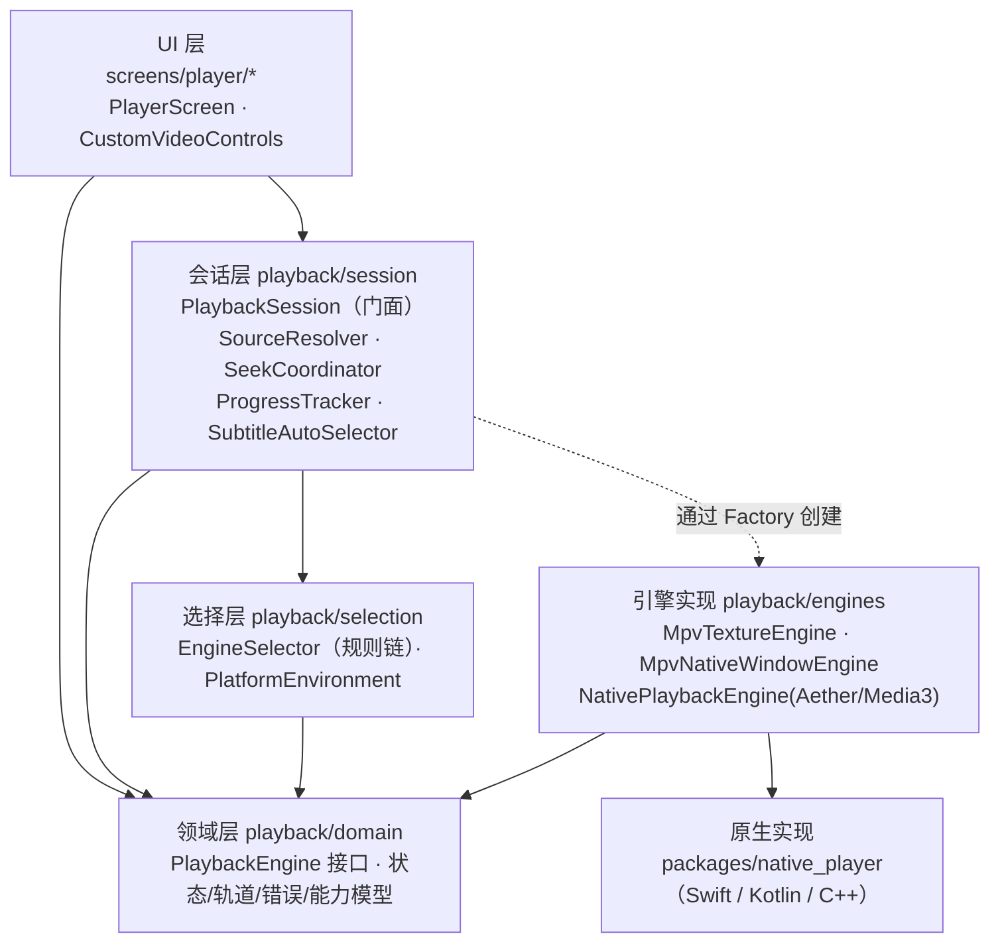

# 播放内核多端改造任务文档（杜比视界 / HDR）

> 状态：**Stage 1、3、4、5、8 完成，Stage 7.1 / 7.2 完成（Windows 部分随 Stage 2 补齐）；Stage 6 不做（D4）；待完成：Stage 2（Windows，暂缓）、7.3 全平台回归（真机部分由用户自行测试）；Stage 1、4 仍待真机与 macOS 运行验证**
> 最后更新：2026-10-22
> 适用范围：`client/lib/screens/player/`、`client/lib/playback/`（新增）、`client/packages/native_player/`（新增）、各平台原生工程
>
> **后续会话必读顺序**：§0 → §1 → §4 → §6 → §12（进度记录）→ 当前要做的阶段（§7）。
> 动手前先确认该阶段依赖的“待决策事项”（§8）已有结论；没有结论就先问用户。
> 每完成一个阶段或步骤，必须更新 §12 进度记录；接口有变化时同步更新 §4。
> 相关任务：播放缓存（续播秒开）见 `doc/playback_cache_plan.md`，会修改 `PlaybackEngine.open` 与 Pigeon `NativeSource`。

---

## 0. 一句话说明

当前播放器基于 `media_kit`（libmpv）+ Flutter 纹理，在所有平台上都**无法正确显示杜比视界 Profile 5（画面偏绿/偏紫），也无法输出真正的 HDR**。本任务把播放器重构为“**统一播放内核接口 + 按平台选择内核**”的架构：

| 平台 | 目标内核 | 画面承载 |
|---|---|---|
| iOS | AetherEngine（FFmpeg 解封装 + AVPlayer） | `UiKitView` |
| macOS | AetherEngine | `AppKitView` |
| Android | Media3 / ExoPlayer（libmpv 兜底） | PlatformView（Hybrid Composition + SurfaceView） |
| Windows | libmpv（`wid` 原生窗口 + `vo=gpu-next`） | 位于 Flutter 窗口后方的原生 HWND |
| Linux | libmpv 纹理（保持现状） | Flutter 纹理 |

---

## 1. 背景与根因（已核实，结论勿重复调研）

### 1.1 根因

1. **render API 不支持 libplacebo**：mpv 只有基于 libplacebo 的 `gpu-next` 渲染器会对杜比视界做 RPU 色彩重建（reshaping）。media_kit 在 iOS / macOS / Windows / Linux 上通过 libmpv **render API** 渲染，而 render API 只实现了旧的 `gpu` 渲染器。上游 PR [mpv-player/mpv#16818](https://github.com/mpv-player/mpv/pull/16818) 截至 2026-09-16 仍未合并，没有时间表。
2. **纹理只有 8-bit SDR**：media_kit 输出的纹理是 8-bit BGRA。iOS/macOS 是 `kCVPixelFormatType_32BGRA`，Windows 是 `DXGI_FORMAT_B8G8R8A8_UNORM`。Flutter 纹理在任何平台都没有 HDR 能力，HDR 只能压成 SDR。
3. **打包的 libmpv 没开 libplacebo**：

| 平台 | 包 | libmpv | 关键编译参数 |
|---|---|---|---|
| iOS | `media_kit_libs_ios_video 1.1.4` | mpv 0.36.0 | `-Dlibplacebo=disabled -Dvideotoolbox-gl=disabled` |
| macOS | `media_kit_libs_macos_video 1.1.4` | mpv 0.36.0 | `-Dlibplacebo=disabled` |
| Android | `media_kit_libs_android_video 1.3.8` | media-kit 构建 v1.1.7（FFmpeg 6.0） | `-Dlibplacebo=disabled -Dvulkan=disabled` |
| Windows | `media_kit_libs_windows_video 1.0.11` | media-kit 构建 2023-09-24 | 构建脚本**包含** libplacebo（瓶颈只在 render API） |

### 1.2 各平台约束要点

- **Android**：media_kit 在 Android 上通过 `--wid` 走普通 VO，**不走 render API**，换成带 libplacebo 的 libmpv 后可以用 `gpu-next`。但 FFmpeg 的 MediaCodec 是完整的硬件解码器，会丢弃 DV RPU，所以 **Profile 5 只有在软解时才能还原颜色**（[mpv-player/mpv#10287](https://github.com/mpv-player/mpv/issues/10287)、[mpv-android/mpv-android#1081](https://github.com/mpv-android/mpv-android/issues/1081)）。
- **Windows**：d3d11va 是硬件加速器（hwaccel），会保留 RPU。用 `wid` 原生窗口 + `gpu-next` 可以**在硬解下得到正确颜色**，并通过 `target-colorspace-hint` 输出真 HDR。Flutter Windows 不支持 PlatformView（[flutter/flutter#31713](https://github.com/flutter/flutter/issues/31713) 未关闭），只能用原生窗口叠放。
- **Apple**：系统的杜比视界能力只通过 AVFoundation 开放；AVPlayer 不认 MKV。AetherEngine 在设备端把 MKV 实时转封装成 HLS-fMP4 交给 AVPlayer，支持 DV P5/P8.x，并把 P7 实时转成 8.1。**后端无需改动。**
- **Media3**：真杜比视界依赖机型有杜比视界硬件解码器。无解码器时，P8.1/P7 会回退为 HDR10，**P5 没有可回退的兼容层，无法播放**。

### 1.3 参考实现（遇到同类问题先看它们）

- **Moonfin**（Flutter，Jellyfin/Emby 客户端）架构与本方案一致：<https://github.com/Moonfin-Client/Moonfin-Core>
  - iOS 桥接：`ios/Runner/Playback/AetherVideoPlatformView.swift`
  - macOS 桥接：`macos/Runner/Playback/MacosAetherVideoPlatformView.swift`
  - Windows HDR 窗口：`windows/runner/hdr_video_window.{h,cpp}`、`lib/playback/hdr_video_window.dart`
  - Dart 侧 mpv 后端：`lib/playback/media_kit_player_backend.dart`
  - 平台/内核说明：Wiki “Playback and Codecs”
- **AetherEngine**：<https://github.com/superuser404notfound/AetherEngine>（LGPL-3.0 + App Store 例外，仅支持 SPM，**要求 iOS 18 / macOS 15**，迭代很快，必须锁定精确版本）
- **DreamPlayer**：Flutter + Media3（Android）/ AetherEngine（iOS）的 PlatformView 实现
- **Kazumi**：Android 用 Predidit 的 media-kit fork + [Predidit/libmpv-android-video-build](https://github.com/Predidit/libmpv-android-video-build)（带 libplacebo），Android 14 及以上默认 `gpu-next`
- 相关 issue：[media-kit/media-kit#1354](https://github.com/media-kit/media-kit/issues/1354)、[#615](https://github.com/media-kit/media-kit/issues/615)、[#777](https://github.com/media-kit/media-kit/issues/777)、[#1093](https://github.com/media-kit/media-kit/issues/1093)

---

## 2. 目标与非目标

### 2.1 目标

1. 杜比视界 P5/P7/P8.x 在 iOS、macOS、Windows 上颜色正确；Android 在有杜比视界解码器的机型上颜色正确，无解码器的机型给出明确提示或兜底。
2. 在支持的硬件上输出真正的 HDR / 杜比视界：iPhone/iPad、XDR Mac、开启 HDR 的 Windows 显示器、HDR Android 机型。
3. 播放器 UI 与业务逻辑**与具体内核解耦**。新增或替换内核时不改 UI，只新增一个引擎实现、注册一条选择规则。
4. 现有功能零回归：续播、进度保存、选集、外挂/内嵌字幕、倍速、长按倍速、音量/亮度手势、全屏、媒体信息、网络错误恢复、本地缓存播放、302 跳转 + 鉴权头。

### 2.2 非目标

- 不改后端（不做服务端转码、转封装）。后端媒体探测见 D5，作为独立任务。
- 不改播放器 UI 的视觉设计；只做能力驱动的显隐（例如某引擎不支持网速显示就隐藏）。
- Linux 不追求杜比视界和 HDR。
- 本期不做画中画、后台播放、投屏（只需保证架构不阻碍以后加入）。

---

## 3. 现状代码地图（重构的输入）

### 3.1 关键文件

| 文件 | 行数 | 职责 / 与 media_kit 的耦合点 |
|---|---|---|
| `lib/main.dart:36` | — | `MediaKit.ensureInitialized()` |
| `lib/screens/player/player_screen.dart` | 1458 | 页面 + 全部播放业务逻辑（上帝类） |
| ├ `:100` | | 创建 `Player(PlayerConfiguration(bufferSize: 256MB))` 和 `VideoController` |
| ├ `:116` `_configurePlayerNetwork` | | 通过 `NativePlayer.setProperty` 设置重连、超时、cache |
| ├ `:371` `_setupPlayerListeners` | | 订阅 error / position / buffering / duration / completed / tracks |
| ├ `:483–700` | | 进度定时器、seek 串行化、受控 seek、网络错误识别（字符串匹配 mpv 错误）、可疑结束位置判断、进度保存 |
| ├ `:838–870` | | 全屏（移动端 `SystemChrome`、桌面端 `WindowControls`） |
| ├ `:875` `_loadVideo` | | 本地缓存优先 → 获取流地址 → 解析 302 → 构建鉴权头 → `open(Media(url, httpHeaders))` |
| ├ `:1137–1200` | | 外挂字幕：Dio 下载文本后 `SubtitleTrack.data`；分数 ≥85 自动加载 |
| └ `:1219–1270` | | 内嵌中文字幕自动选择 |
| `lib/screens/player/widgets/custom_video_controls.dart` | 2219 | 控制层；构造参数直接接收 `Player` 和 `VideoController`（`:40`） |
| ├ `:225` / `:233` | | 读取轨道状态；订阅 position / duration / playing / buffering / volume / tracks / track / rate |
| ├ `:298` | | 每秒轮询 mpv `cache-speed` 显示网速 |
| ├ `:1006` `_fetchMediaInfo` | | 读取十几个 mpv 属性组成媒体信息面板 |
| ├ `:1264` | | `Video(controller, controls: NoVideoControls, fit)` |
| └ `:1625` / `:1725` / `:1812` / `:1831` | | setRate / setAudioTrack / setSubtitleTrack |
| `lib/screens/player/speed_frame_limiter.dart` | 83 | 倍速时通过 mpv `vf` 抽帧（mpv 专属），有测试 `test/speed_frame_limiter_test.dart` |
| `lib/screens/player/widgets/player_top_bar.dart` 等 | — | 纯 UI，与内核无关 |

### 3.2 约定与现状事实

- 状态管理：Riverpod 3，手写 `NotifierProvider`，不用 codegen。播放设置在 `lib/providers/playback_settings_provider.dart`。
- 路由：`lib/core/router/` 中 `/player/movie/:id` 和 `/player/episode/:tvShowId/:seasonId/:episodeId` 创建 `PlayerScreen`。
- 音量语义：控制层的 `_maxVolume = 2.0`，调用 `setVolume(volume * 100)`（mpv 支持 0–200）。
- 原生通道：已有 `media_player/orientation`（iOS/Android）、存储、下载器通道。窗口控制统一走 `lib/core/window/window_controls.dart`。
- 最低系统版本：iOS 18（灵动岛扩展 16.2）、macOS 15（Stage 4.1 起，D1），Android `flutter.minSdkVersion`。
- Flutter 版本：项目通过 FVM 固定为 **3.38.5**（`client/.fvmrc`，2026-10-20 从 3.35.7 升级）。本机全局 SDK `/Users/zhouquan/application/flutter` 也是 3.38.5，可以直接用；`fvm` 在 `~/.pub-cache/bin/fvm`（不在 PATH）。被 gitignore 的本地缓存 `client/.fvm/flutter_sdk` 在执行 `fvm use 3.38.5` 之前仍然指向 3.35.7，**不要用它**。
- **pub 镜像**：命令行执行 `pub get` 前必须先 `export PUB_HOSTED_URL=https://pub.flutter-io.cn FLUTTER_STORAGE_BASE_URL=https://storage.flutter-io.cn`（用户在 `~/.zshrc` 里配置了，但 agent 的 shell 不一定会加载）。漏掉的话，pub 会把所有依赖重新解析到 pub.dev，大面积改写 `pubspec.lock` 和生成的插件注册文件。
- **Xcode**：系统默认仍是 `/Applications/Xcode.app`（16.3），另装了 `/Applications/Xcode-26.3.app`（Swift 6.2.4，iOS / macOS 26.2 SDK）。macOS 15.7.2 最高只能装 Xcode 26.3，26.4 及以后需要 macOS 26.2。**Stage 4 起所有 Apple 构建都要加上** `export DEVELOPER_DIR=/Applications/Xcode-26.3.app/Contents/Developer`，不要改 `xcode-select`。iOS 26.2 平台组件已用 `xcodebuild -downloadPlatform iOS -architectureVariant arm64` 安装。
- 后端**没有**媒体技术信息探测（无 ffprobe），客户端拿不到预先探测好的 HDR / DV 信息。

---

## 4. 目标架构

### 4.1 分层与依赖方向



**依赖规则（强制）**：

- UI 层只依赖 `PlaybackSession` 和 `domain`，**禁止**导入 `media_kit`、Pigeon 生成代码或任何引擎实现。
- `domain` 是纯 Dart（只允许依赖 `flutter/widgets.dart`，用于 `buildVideoView` 的返回类型），不依赖任何播放库。
- 引擎实现之间不互相依赖；mpv 系列可以共享 `engines/mpv/` 内部的基类和工具。
- `package:media_kit*` 只能出现在 `lib/playback/engines/mpv/**` 和 `lib/main.dart`（初始化）中。

### 4.2 目录结构

```
client/lib/playback/
├── domain/                           # 纯 Dart，统一由 playback_domain.dart 导出
│   ├── playback_engine.dart          # PlaybackEngine 接口、MediaDiagnostics 与可选能力接口
│   ├── playback_engine_kind.dart
│   ├── engine_capabilities.dart
│   ├── engine_preference.dart        # 播放内核偏好：自动 / 兼容模式
│   ├── playback_source.dart          # PlaybackSource / ExternalSubtitle
│   ├── playback_state.dart           # PlaybackSnapshot / PlaybackStreams
│   ├── playback_state_hub.dart       # 引擎共用的状态发布器（内部工具）
│   ├── media_track.dart              # AudioTrackInfo / SubtitleTrackInfo / MediaTracks / SelectedTracks
│   ├── video_info.dart               # VideoInfo / VideoDynamicRange
│   └── playback_error.dart
├── selection/
│   ├── platform_environment.dart     # 运行平台（可直接构造用于测试）
│   ├── engine_selection_rule.dart    # 规则接口 + 内置规则（§4.7）
│   └── engine_selector.dart
├── session/
│   ├── playback_session.dart         # 门面：引擎生命周期、加载、回退、对 UI 暴露状态
│   ├── playback_item.dart            # MoviePlaybackItem / EpisodePlaybackItem
│   ├── playback_gateways.dart        # PlaybackSourceGateway / WatchProgressGateway
│   ├── riverpod_playback_gateway.dart
│   ├── playback_source_resolver.dart # 本地缓存 / 流地址 / 302 / 鉴权头
│   ├── seek_coordinator.dart         # seek 串行化、受控 seek、初始 / 续播 seek
│   ├── playback_progress_tracker.dart# 进度定时保存、可疑结束判断、完成上报
│   └── subtitle_auto_selector.dart   # 内嵌中文字幕、外挂最佳匹配
├── engines/
│   ├── playback_engine_factory.dart  # EngineKind → 构造器注册表
│   ├── mpv/
│   │   ├── mpv_engine_base.dart      # 模板方法：mpv 公共逻辑
│   │   ├── mpv_texture_engine.dart   # media_kit 纹理路径
│   │   ├── mpv_options.dart          # mpv 属性构建器
│   │   ├── mpv_error_mapper.dart
│   │   ├── mpv_track_mapper.dart
│   │   ├── mpv_diagnostics.dart      # 媒体信息 / 网速
│   │   ├── mpv_video_info.dart       # 动态范围推断
│   │   ├── dolby_vision_log_detector.dart # 杜比视界日志信号（§5.1）
│   │   └── speed_frame_limiter.dart
│   └── native/
│       └── native_playback_engine.dart # 基于 Pigeon，Aether 与 Media3 共用
└── playback_providers.dart           # Riverpod：environment / selector / factory

client/lib/screens/player/widgets/media_info_rows.dart  # 媒体信息面板的行（Stage 7.1）

client/packages/native_player/        # 本地 Flutter 插件（见 D2）
├── pigeons/native_player_api.dart    # 唯一的跨语言契约（§4.6）
├── lib/src/generated/                # Pigeon 生成，禁止手改
├── lib/src/native_video_view.dart    # UiKitView / AppKitView / PlatformViewLink
├── lib/src/native_player_event_dispatcher.dart # 按 playerId 分发原生事件
├── darwin/native_player/             # iOS + macOS 共用 Swift（SPM：AetherEngine 7.22.2、libass-build 0.17.5）
└── android/                          # Kotlin + Media3 1.10.1；maven/ 为 FFmpeg 音频扩展，dovi/ + rust/dovi_jni 为 P5 GPU 重建

client/test/playback/                 # fakes/、selection/、session/、engines/
client/test/screens/player/           # 媒体信息面板
```

Stage 2 将新增：`engines/mpv/mpv_native_window_engine.dart`（Windows `wid` + `gpu-next`）、`engines/windows/`（`native_video_window.dart` 与原生 HWND 模块通信，`native_video_surface.dart` 透明占位并上报矩形）、`packages/native_player/windows/`（C++ 视频 HWND 管理）。

### 4.3 设计模式一览

| 模式 | 落点 | 目的 |
|---|---|---|
| 策略 (Strategy) | `PlaybackEngine` 的多个实现 | 内核可替换，UI 无感知 |
| 适配器 (Adapter) | 每个引擎把 media_kit / Pigeon / mpv-wid 适配到统一接口 | 隔离第三方 API |
| 工厂 + 注册表 (Factory) | `PlaybackEngineFactory` | 集中创建；新增引擎只需注册一行 |
| 责任链 (Chain of Responsibility) | `EngineSelector` + `EngineSelectionRule` 列表 | 选择逻辑是纯函数，可单测、可扩展 |
| 模板方法 (Template Method) | `MpvEngineBase` | 两个 mpv 引擎共享配置、事件映射、诊断，只在视频输出上有差异 |
| 门面 (Facade) | `PlaybackSession` | UI 只面对一个入口；回退、重试对 UI 透明 |
| 观察者 (Observer) | `PlaybackStreams` + `PlaybackStateHub` | 状态推送，与现有流式写法保持一致 |
| 接口隔离 (ISP) | `MediaDiagnosticsProvider`、`NetworkThroughputProvider` 等可选能力接口 | 不强迫每个引擎实现所有功能 |
| 构建器 (Builder) | `MpvOptions` | 按场景组合 mpv 属性（网络 / 缓存 / 解码 / HDR） |
| 测试替身 (Fake) | `FakePlaybackEngine` | 不依赖原生库测试会话逻辑 |

### 4.4 核心契约（以 `lib/playback/domain/`、`lib/playback/selection/` 的代码为准，接口变化时同步更新本节）

```dart
enum PlaybackEngineKind { mpvTexture, mpvNativeWindow, aether, media3 }   // 带展示名 label；mpvNativeWindow 待 Stage 2
enum VideoDynamicRange { unknown, sdr, hdr10, hdr10Plus, hlg, dolbyVision }
enum EnginePreference { auto, compatibility }                          // 用户设置：自动 / 兼容模式

class VideoInfo {                    // 按片源报告
  final VideoDynamicRange dynamicRange;
  final int? dolbyVisionProfile;     // 5 / 7 / 8 …
}

class EngineCapabilities {
  final bool dolbyVisionColor;       // 能否正确还原 DV 颜色（含 P5）
  final double maxVolume;            // 1.0 = 100%；mpv 为 2.0，原生引擎为 1.0
  final double maxRate;              // mpv 100，Aether 2.0，Media3 3.0
  final bool reportsVideoView;       // 画面在原生视图里并上报挂载状态（Aether / Media3）：会话先暂停打开，视图挂载后再播放
  final bool subtitleDelay;          // 支持对所有字幕设置偏移（mpv、Aether）；Media3 为 false，会话改为平移外挂字幕时间轴后重新加载
  final Duration bufferingTarget;    // 卡顿/跳转后前方缓冲到多长才恢复播放，UI 据此估算缓冲百分比：默认 3s（mpv cache-pause-wait=3），Media3 2.5s（DefaultLoadControl）；reportsBufferingProgress 为 true 时缓冲中改用内核上报的进度
  final bool reportsBufferingProgress; // 内核自己上报 PlaybackSnapshot.bufferingProgress（mpv、Aether）；Media3 为 false
}

class PlaybackSource {               // PlaybackSource.network(url, httpHeaders:) / PlaybackSource.localFile(path)
  final String url;
  final Map<String, String> httpHeaders;
  final bool isLocalFile;
}

sealed class ExternalSubtitle {}     // 目前只有 ExternalSubtitleData(text, title:, formatHint:)

class PlaybackError {
  final PlaybackErrorKind kind;      // network, http, audioOutput, source, decoder, unknown
  final String message;
  final int? httpStatus;
  final bool recoverable;            // 临时错误，通常会自动恢复
  final bool fallbackSuggested;      // 当前内核放不了，会话换下一个候选内核
}

class PlaybackSnapshot { position, duration, bufferedPosition, playing, buffering, bufferingProgress, completed, firstFrameRendered, videoViewAttached, rate, volume, tracks, selectedTracks, videoInfo }
// bufferedPosition：不用再取数据就能播到的位置（与 position 同一时间轴），resetForNewMedia 时清零；进度条据此画缓冲段
// bufferingProgress：缓冲中恢复播放的进度 0~1。mpv 取 cache-buffering-state（只在 paused-for-cache 期间有意义）；Aether 见 §4.6 onBufferingProgress
// firstFrameRendered：本次 open 后第一帧已上屏（原生首帧 + 画面视图已创建），内核不支持时始终为 false
// videoViewAttached：原生画面视图（PlatformView）已挂载，NativeVideoView 的 onCreated / onDisposed 驱动
class PlaybackStreams  { 上述各项对应的 Stream，另加 Stream<PlaybackError> errors }
class SelectedTracks   { AudioTrackInfo? audio; SubtitleTrackInfo? subtitle; bool subtitleOff; }  // subtitleOff 区分“关闭”和“引擎自动选择”

abstract interface class PlaybackEngine {
  PlaybackEngineKind get kind;
  EngineCapabilities get capabilities;
  PlaybackSnapshot get state;          // 最新快照
  PlaybackStreams get streams;

  Future<void> initialize();
  Future<void> open(PlaybackSource source, {bool autoPlay = true, Duration? startPosition});  // 起播位置由内核打开时直接定位
  Future<void> play();
  Future<void> pause();
  Future<void> playOrPause();
  Future<void> seek(Duration position);
  Future<void> setRate(double rate);
  Future<void> setVolume(double volume);                       // 0.0 – capabilities.maxVolume
  Future<void> selectAudioTrack(AudioTrackInfo track);
  Future<void> selectSubtitleTrack(SubtitleTrackInfo? track);  // null 表示关闭
  Future<void> addExternalSubtitle(ExternalSubtitle subtitle); // 加载并选中
  Future<void> setSubtitleStyle(SubtitleStyle style);          // 字号倍率 / 颜色 / 底框不透明度 / 底部距离（占画面高度比例）
  Future<void> setSubtitleDelay(Duration delay);               // 正值表示字幕延后；capabilities.subtitleDelay 为 false 时无效
  Widget buildVideoView(BuildContext context, {required BoxFit fit});
  Future<void> dispose();                                      // 幂等；之后所有流关闭
}

class MediaDiagnostics {
  final String? videoDecoder;
  final VideoDynamicRange? outputDynamicRange;  // 实际送显的动态范围，SDR 表示 HDR 片源已映射为 SDR；未知为 null
  final Map<String, String> details;            // 内核专属项，键为展示名
}

abstract interface class MediaDiagnosticsProvider {
  Future<MediaDiagnostics> fetchDiagnostics();
}

abstract interface class NetworkThroughputProvider {   // 目前只有 mpv 实现
  Future<double?> currentDownloadBytesPerSecond();
}

// selection/
class EngineSelectionContext { PlatformEnvironment environment; Set<PlaybackEngineKind> failedKinds; EnginePreference preference; }
class EngineDecision { List<PlaybackEngineKind> candidates; String reason; }  // 候选按优先级排序；reason 写日志并显示在媒体信息“选择原因”
abstract interface class EngineSelectionRule {
  EngineDecision? evaluate(EngineSelectionContext context);  // 返回 null 表示交给下一条规则
}
```

草案中没有实现的部分：`MediaHints` / `VideoTrackInfo`（客户端拿不到预先探测的信息，见 D5）、`ExternalSubtitle.url`（外挂字幕统一由 Dart 下载后传文本）、`EngineCapabilities` 的其余能力位（目前没有功能需要按它们显隐）。`rendersBehindFlutter` 等 Windows 相关能力随 Stage 2 加入。

**语义约定**：

- 时间统一用 `Duration`；音量 1.0 = 100%；倍速为 `double`。
- `PlaybackStateHub`：每个引擎内部持有一个 hub，只需调用 `hub.update(...)`，由 hub 负责快照、广播和去重，避免各引擎重复写 StreamController。
- `open()` 必须能被新的 `open()` 打断（用代际计数丢弃过期回调），这对选集快速切换很重要。
- 引擎**不得**把底层原始异常抛给 UI，一律映射为 `PlaybackError`（mpv 的错误字符串识别在 `MpvErrorMapper`）。
- 字幕在各引擎内部渲染（mpv 由引擎自带的 Flutter 叠加层 `MpvSubtitleOverlay` 绘制；Aether / Media3 在原生视图内的字幕层绘制），Flutter 控制层不画字幕。
- 字幕样式（`SubtitleStyle`）由 `subtitleSettingsProvider` 持久化，会话在内核初始化后下发、设置变化时实时下发。字号对所有文本字幕生效（含 ASS，原生侧用 libass font scale）；颜色、底框、位置只作用于非 ASS 文本字幕；位图字幕不受影响。三端统一不描边、不加阴影，字体为 HarmonyOS Sans Medium（Android 的 ASS 仍用系统字体）。
- 字幕偏移按剧集（整部剧所有季、所有集共用）或电影保存在本机（SharedPreferences，键 `subtitle_delay_<服务器ID>_tv_<tvShowId>` / `_movie_<movieId>`，毫秒，为零时删除）：会话通过 `SubtitleDelayStore`（`RiverpodPlaybackGateway` 实现）在 `load` 换 item 时读取，调整停止 500ms 后写入，换片和销毁时补写；未注入 store 时只对当前视频生效。
- 媒体信息面板（`buildMediaInfoRows`）各内核统一：播放内核 → 选择原因（`PlaybackSession.engineReason`，回退后为“X 无法播放：原因”）→ 视频解码 → 动态范围（含 DV Profile，来自 `VideoInfo`）→ HDR 送显（来自 `MediaDiagnostics.outputDynamicRange`）→ 内核专属项（按固定键序，未知键排在最后）→ 倍速、屏幕刷新率、音量、源路径。HDR 送显的判定：mpv 纹理固定为 SDR；Aether 取 `AetherEngine.videoFormat`（屏幕实际呈现的格式）；Media3 在 GPU 重建时为 HDR10，杜比视界片源没用 DV 解码器时取基础层，屏幕不支持 HDR 时为 SDR。

### 4.5 会话层职责划分（从 `PlayerScreen` 拆出）

| 组件 | 迁入的现有逻辑 | 是否依赖引擎 |
|---|---|---|
| `PlaybackSourceResolver` | `_loadVideo` 中的本地缓存判断、流地址获取、`_resolveRedirectTarget`、`_buildAuthHeadersForPlayUrl`、UA | 否（只产出 `PlaybackSource`） |
| `SeekCoordinator` | `_handleUserSeek`、`_awaitActiveSeekOperation`、`_markControlledSeek`、初始 / 续播 seek | 只依赖 `PlaybackEngine` 接口 |
| `PlaybackProgressTracker` | `_startProgressTimer`、`_saveProgress`、`_publishWatchProgress`、可疑结束和完成判断 | 只依赖接口 |
| `SubtitleAutoSelector` | `_findChineseSubtitleTrack`、外挂字幕分数 ≥85 自动加载 | 只依赖接口与领域模型 |
| `PlaybackSession`（门面） | 引擎创建与销毁、按 `EngineDecision.candidates` 回退、对外暴露会话状态（loading / ready / error）和当前 `engine` | 通过 Factory 创建 |

`PlaybackSession` 的生命周期跟随 `PlayerScreen`。引擎切换（回退）时会话发出 `engineChanged`，UI 用新引擎的 `buildVideoView` 重建画面，并从原位置继续播放。

**实际实现（Stage 1.5，2026-10-21）**：

- `PlaybackItem`（sealed：`MoviePlaybackItem` / `EpisodePlaybackItem`）是会话层的业务对象，由页面算好后交给 `session.load(item, startAt:)`。
- 数据访问收敛为两个接口（`session/playback_gateways.dart`）：
  - `PlaybackSourceGateway`：服务器地址、token、下载记录、流地址、存储信息、外挂字幕列表。
  - `WatchProgressGateway`：进度的上报和本地发布。
  - 页面通过 `RiverpodPlaybackGateway(ref)` 实现这两个接口；测试使用 `test/playback/fakes/` 下的假实现。
- 会话通过 `ChangeNotifier` 暴露 `status`（`PlaybackSessionLoading` / `Ready` / `Failed`）、`currentUrl`、`filePath`、`externalSubtitles`；Toast 文案走 `notices` 流。界面渲染始终由页面负责。
- 留在页面的逻辑：剧集列表与选集、“已观看 >90% 是否播下一集”的确认弹窗、读取剧集历史进度、全屏。
- 切换剧集的顺序：`session.prepareSwitch()`（等待 seek 结束 → 暂停 → 保存进度 → 进入加载态）→ 页面更新选集并读取该集进度 → `session.load()`。
- 起播位置在“时长就绪”事件中生效，用户 seek 会取消它；`reload()`（重试）会保留尚未生效的起播位置。
- 引擎在 `open()` 前调用 `PlaybackStateHub.resetForNewMedia()`。原因：hub 会对相同的值去重，如果不重置，重新打开同一个媒体（时长相同）时“时长就绪”事件会被吞掉。

### 4.6 原生跨语言契约（Pigeon，Apple 与 Android 共用）

以 `packages/native_player/pigeons/native_player_api.dart` 为准（pigeon 固定 27.3.0）：

```dart
@HostApi()
abstract class NativePlayerHostApi {
  NativeCapabilities capabilities();                   // dolbyVisionColor / maxVolume / maxRate / subtitleDelay
  void configureSubtitleFonts(List<String> assetKeys); // 字幕字体（Flutter 资源名，第一个为默认字体），在 create 之前调用
  int create();                                        // 返回 playerId
  @async void open(int playerId, NativeSource source, bool autoPlay);  // NativeSource.startPositionMs：起播位置，可为空
  void play(int playerId);
  void pause(int playerId);
  void playOrPause(int playerId);
  @async void seek(int playerId, int positionMs);
  void setRate(int playerId, double rate);
  void setVolume(int playerId, double volume);         // 1.0 = 100%
  void selectAudioTrack(int playerId, String trackId);
  void selectSubtitleTrack(int playerId, String? trackId);  // null 表示关闭
  @async void addExternalSubtitle(int playerId, String text, String title, String? formatHint);
  void setVideoFit(int playerId, NativeVideoFit fit);
  void setSubtitleStyle(int playerId, NativeSubtitleStyle style);  // scale / color(ARGB) / backgroundOpacity / bottomMargin
  void setSubtitleDelay(int playerId, int delayMs);    // Media3 忽略
  NativeDiagnostics diagnostics(int playerId);         // videoDecoder / outputDynamicRange / details
  void dispose(int playerId);
}

@FlutterApi()
abstract class NativePlayerEventsApi {                // 每类事件一个方法，均带 playerId
  void onPosition(int playerId, int positionMs);
  void onDuration(int playerId, int durationMs);
  void onBufferedPosition(int playerId, int bufferedMs); // Aether 250ms 节流、Media3 每 500ms，值变化才上报
  void onPlaying(int playerId, bool playing);
  void onBuffering(int playerId, bool buffering);       // Aether：isBuffering 或 state 为 loading / seeking
  void onBufferingProgress(int playerId, double progress); // 只在缓冲期间上报。Aether：跳转后缓存从目标点前的关键帧按段生成，进度 = 包含该关键帧的缓存段长度 ÷（目标点 + 4s − 段起点），段起点早于目标点 30s 以上时按目标点算；Media3 不上报
  void onCompleted(int playerId, bool completed);
  void onFirstFrame(int playerId);                    // 每次 open 后第一帧上屏时一次（后台重建、seek 不再上报）
  void onRate(int playerId, double rate);
  void onVolume(int playerId, double volume);
  void onTracks(int playerId, List<NativeTrack> audio, List<NativeTrack> subtitle);
  void onSelectedTracks(int playerId, String? audioTrackId, String? subtitleTrackId, bool subtitleOff);
  void onVideoInfo(int playerId, NativeVideoInfo info);
  void onError(int playerId, NativeError error);      // 带 recoverable / fallbackSuggested
}
```

- 画面承载用 PlatformView，`viewType = 'native_player/video'`，`creationParams = {playerId}`：iOS `UiKitView`、macOS `AppKitView`、Android `PlatformViewLink` + Hybrid Composition。原生侧按 `playerId` 从注册表取引擎实例并挂载视图，为以后的迷你播放器 / 多实例留出空间；Dart 侧由 `NativePlayerEventDispatcher` 按 playerId 分发事件。
- position 事件节流到约 250ms。
- `NativeError.fallbackSuggested` 为 true（无解码器、GPU 不支持杜比视界重建等）时，会话换下一个候选内核并从原位置继续。
- Pigeon 同时输出 Dart、Swift、Kotlin；生成命令写在插件 README，生成文件禁止手改。
- Windows 的原生窗口模块（Stage 2）不走这份契约，接口在 Stage 2 确定。

### 4.7 引擎选择规则（责任链，按顺序评估）

| # | 规则 | 结果 |
|---|---|---|
| 1 | iOS / macOS | `[aether]`（Apple 不打包 libmpv，见 D1；因此排在兼容模式之前，偏好对 Apple 无效） |
| 2 | 用户偏好为“兼容模式” | `[mpvTexture]` |
| 3 | Android | `[media3, mpvTexture]` |
| 4 | Windows | `[mpvNativeWindow, mpvTexture]`（Stage 2 加入，之前走第 5 条） |
| 5 | 其他（Linux） | `[mpvTexture]` |

- 已失败的引擎（`failedKinds`）从候选中剔除。
- `PlaybackError.fallbackSuggested == true`（例如 Media3 遇到无法解码的音视频、GPU 不支持杜比视界重建的机型遇到 P5）时，会话切到下一个候选引擎，从原位置继续，并提示用户。Stage 8 起，没有 DV 解码器但 GPU 支持重建的机型上 P5 留在 Media3，不再回退。
- 已实现第 1、2、3、5 条（`AppleAetherRule`、`CompatibilityModeRule`、`AndroidMedia3Rule`、`DefaultMpvTextureRule`，注册在 `playback_providers.dart`）；第 4 条随 Stage 2 加入。

---

## 5. 平台能力矩阵（实施后的目标状态）

| | iOS | macOS | Android（有 DV 解码器） | Android（无 DV 解码器） | Windows | Linux |
|---|---|---|---|---|---|---|
| 内核 | Aether | Aether | Media3 | Media3（GPU 重建 P5）；GPU 不支持时 → mpv | mpv `wid` | mpv 纹理 |
| DV P5 颜色 | ✅ | ✅ | ✅ | ✅ 硬解基础层 + GPU 按 RPU 重建（Stage 8）；GPU 不支持时回退到 mpv | ✅ 硬解 | ❌ |
| DV P7 / P8.1 | ✅（P7 → 8.1） | ✅ | ✅ | 按 HDR10 播放 | ✅ | ❌ |
| 真 HDR 输出 | ✅ EDR | ✅ XDR 屏 | ✅ | ✅（HDR10；P5 由 GPU 重建后以 HDR10 输出） | ✅（系统开启 HDR 时） | ❌ |
| MKV | ✅（设备端转封装） | ✅ | ✅ | ✅ | ✅ | ✅ |

Windows 列是 Stage 2 的目标；Stage 2 完成前 Windows 仍走 mpv 纹理，表现与 Linux 列相同。其余列为当前实现。

### 5.1 DV / HDR 检测方式（Stage 0.2 结论，2026-10-13）

**验证环境**：macOS 上用 C 程序直接链接 media_kit 自带的 Mpv.framework（**mpv 0.36.0 + FFmpeg 6.0**，与 App 实际打包的版本一致），`vo=null`，分别用软解和 `videotoolbox-copy` 测试。

**样片**：
- media-kit#1434 的 `test.mkv`（DV，容器里**没有**配置记录，FFmpeg 6.0 / 7.0 都报 `RPU validation failed`）。
- ffmpeg 生成的对照片：SDR BT.709、HDR10、HLG、未标记 10-bit（有限范围）、未标记 10-bit（全范围）。

**实测结果**：

| 样片 | `video-params` (matrix / levels / prim / gamma / peak) | `video-dec-params` (matrix / gamma) | DOVI 相关日志 |
|---|---|---|---|
| DV `test.mkv` | bt.709 / full / bt.709 / bt.1886 / 1.0 | auto / auto | 有（`ffmpeg/video`：`RPU validation failed`、`Error parsing DOVI NAL unit`，每帧 2 条） |
| 未标记 10-bit 全范围 | bt.709 / full / bt.709 / bt.1886 / 1.0 | auto / auto | 无 |
| 未标记 10-bit 有限范围 | bt.709 / limited / bt.709 / bt.1886 / 1.0 | auto / auto | 无 |
| SDR BT.709 | bt.709 / limited / bt.709 / bt.1886 / 1.0 | bt.709 / bt.1886 | 无 |
| HDR10 | bt.2020-ncl / limited / bt.2020 / pq / 4.93 | bt.2020-ncl / pq | 无 |
| HLG | bt.2020-ncl / limited / bt.2020 / hlg / 4.93 | bt.2020-ncl / hlg | 无 |

**结论**：

1. **mpv 0.36 的属性检测不出 DV。** 色彩空间名称表里没有 `dolbyvision`，track-list 里也没有 DV 字段；P5 的属性和“未标记的 10-bit 全范围 SDR”完全一样（上表第 1、2 行），只靠属性判断会误判。mpv 把 IPT 当成 BT.709 YCbCr 显示，这就是偏绿/偏紫的直接原因。
2. **信号 A（确定，带 profile）**：verbose 级日志 `Found Dolby Vision config record: profile N level M`（`demux/demux_lavf.c:763`）。只有容器带 DOVI 配置记录（MP4 的 `dvcC` / `dvvC`、MKV 的 BlockAdditionMapping）时才会出现。需要 `PlayerConfiguration(logLevel: MPVLogLevel.v)` 并订阅 `player.stream.log`；正常播放时 5 秒约 6 条日志，开销可以忽略。（本次的样片没有配置记录，所以**信号 A 还没有用真实样片验证**。）
3. **信号 B（只能说明码流里有 RPU，不知道 profile）**：`ffmpeg/video` 前缀的 `Error parsing DOVI NAL unit` / `RPU validation failed`。只有 RPU 被当前 FFmpeg 判为非法时才会出现；规范的码流内 RPU **不会产生任何日志**。软解和 VideoToolbox 硬解下都会出现；Android MediaCodec 预计不会出现（待实测）。这类日志每帧都会打，检测到第一条后就应该停止处理。media_kit 不会把 `ffmpeg/video` 前缀的日志转成 `stream.error`，所以不会触发错误页。
4. **Stage 1.8 提示规则**：
   - 信号 A，profile = 5 → 提示颜色可能异常。
   - 信号 A，profile = 7 / 8 → 不提示颜色问题（有 HDR10 兼容层，只是被压成 SDR）。
   - 信号 B，且 `video-dec-params/colormatrix` 与 `gamma` 都是 `auto` → 判定为“疑似 P5”，提示。
   - 其他情况不提示。规范的码流内 P5（没有容器记录）会漏检，这是可以接受的。
5. **不做**纯属性启发式（已验证会误判）。播放前的预探测（例如提前选择引擎）不在 mpv 侧做，留给 D5（后端 ffprobe 能同时读到容器记录和码流内 RPU）。

**原生引擎**（接入时验证）：

| 引擎 | 检测来源 |
|---|---|
| AetherEngine | `AetherEngine.probe` / 已发布的 video format（会用 libdovi 读取 RPU 来纠正错误的容器记录） |
| Media3 | `Format.sampleMimeType == video/dolby-vision`、`Format.codecs`（`dvhe.05…`）、`ColorInfo` |

**遗留验证项**：
- 用**规范的 P5**（容器带记录）和 P8.1 样片验证信号 A。
- 在 Android 和 Windows 的 mpv 构建上验证信号 A / B（这两个构建的 FFmpeg 也是 6.x，但 mpv 提交不同）。

---

## 6. 编码规范与约束（所有阶段通用）

1. **遵守全局工作流**：每个阶段动手前给出该阶段的计划，询问 “Shall I proceed? (Y/N)”，确认后再改代码。
2. **最小改动**：只做当前阶段范围内的改动；代码风格精简，非必要不写注释（遵循用户全局规范），风格与周边代码一致。
3. **依赖方向**按 §4.1 执行。可以用以下命令自查：
   - `grep -rn "package:media_kit" client/lib | grep -v "lib/playback/engines/mpv/" | grep -v "lib/main.dart"` 应当为空
   - `grep -rn "playback/engines" client/lib/screens` 应当为空
4. **能力驱动 UI**：控制层根据 `engine.capabilities` 或 `engine is XxxProvider` 决定功能显隐，**禁止**在控制层用 `Platform.isXxx` 判断引擎功能（与 AGENTS.md 中“平台判断只用于系统能力差异”一致）。
5. **新增引擎检查清单**：实现 `PlaybackEngine` → 声明 `EngineCapabilities` → 错误映射 → 在 `PlaybackEngineFactory` 注册 → 在 `EngineSelector` 加规则 → 补测试 → 更新 §4.7、§5、§12。
6. **生命周期**：`dispose()` 幂等；dispose 后不再发出事件；页面退出时先保存进度再销毁引擎（保持现有顺序）。
7. **日志**统一用 `LogService.instance`，tag 用引擎名（如 `Engine.mpvTexture`）；引擎选择结果和回退原因必须打日志。
8. **Riverpod**：沿用手写 `NotifierProvider` / `Provider` 风格。`PlaybackSession` 是页面级对象，不做全局单例；`PlatformEnvironment`、`EngineSelector`、`PlaybackEngineFactory` 通过 provider 注入，便于测试替换。
9. **原生代码**：
   - 播放相关的原生代码一律放在 `packages/native_player`。
   - 跨语言调用只走 Pigeon，App 代码不新增手写播放 MethodChannel。
   - 第三方原生依赖锁定精确版本（AetherEngine 尤其要锁定）。
10. **UI 交付自查**（AGENTS.md）：浅色/深色、移动端/桌面端、加载/空/错误态、文本溢出、安全区与桌面标题栏。播放器控制层属于高影响改动，每个阶段都要在移动端和桌面端分别验证。
11. **测试**：会话层、选择层、错误映射、轨道映射是纯 Dart，必须有单元测试；`FakePlaybackEngine` 放在 `test/playback/fakes/`。每个阶段结束时 `flutter analyze` 无新增问题，`flutter test` 全部通过。**所有 flutter 命令都必须用 FVM 固定的 SDK**（见 §3.2），不要用全局 `flutter`。
12. **许可证**：AetherEngine 为 LGPL-3 + App Store 例外；media_kit libmpv 为 LGPL；Media3 为 Apache-2.0；FFmpeg 扩展必须是 LGPL 构建，**不得引入 GPL 组件**（见 D3）。

---

## 7. 实施阶段

> 推荐顺序：Stage 0 → 1 →（2 或 3+4，按主力平台决定）→ 5 → 6 / 7。
> 每个阶段都应能独立交付、可回滚；阶段内的步骤建议拆成独立提交。

### Stage 0：基线与验证（不改业务代码）

**目标**：建立回归基线，确认 mpv 侧 DV / HDR 检测方式。

- [ ] 0.1 按 §9 准备测试片源；在 iOS、Android、macOS、Windows 各跑一遍现状，把现象（颜色、HDR、性能、字幕、音轨）记录到 §12。
- [ ] 0.2 Spike：在 mpv 0.36 上分别打开 DV P5、P8.1、HDR10、HLG、SDR 样片，记录 `video-params/colormatrix`、`video-params/gamma`、`video-params/primaries`、`track-list` 各字段的取值，确定能否区分 P5，把结论填进 §5.1。可以临时加调试代码，结束后删除。
- [ ] 0.3 整理 §10 回归清单，作为后续每个阶段的验收依据。

**验收**：§12 中有基线记录，§5.1 有明确结论。

### Stage 1：播放内核抽象 + `MpvTextureEngine`（纯重构，行为不变）

**前置**：Stage 0。**风险**：重构约 3.7k 行，必须小步提交，每步保证可运行。

- [x] 1.1 新建 `lib/playback/domain/` 下的全部模型和 `PlaybackStateHub`（只新增，不接线）。
- [x] 1.2 定义 `PlaybackEngine` 与可选能力接口（§4.4）。
- [x] 1.3 `MpvEngineBase` + `MpvTextureEngine`：
  - 把 `_configurePlayerNetwork` 的属性迁入 `MpvOptions`。
  - 把 `speed_frame_limiter.dart` 移到 `engines/mpv/`，测试同步迁移。
  - mpv 错误字符串识别迁入 `MpvErrorMapper`。
  - `_fetchMediaInfo` 迁入 `MpvDiagnostics`（实现 `MediaDiagnosticsProvider`），`cache-speed` 迁入 `NetworkThroughputProvider`。
  - media_kit 轨道映射为领域轨道模型。
  - `buildVideoView` 返回 `Video(controller, controls: NoVideoControls, fit)`。
- [x] 1.4 `PlaybackEngineFactory`、`EngineSelector`（暂时只有一条规则返回 `[mpvTexture]`）、`PlatformEnvironment`、`playback_providers.dart`。
- [x] 1.5 从 `PlayerScreen` 拆出会话层组件（§4.5），`PlayerScreen` 只保留页面职责：路由参数、全屏、选集 UI 回调、加载/错误态展示。
- [x] 1.6 `CustomVideoControls` 改为接收 `PlaybackEngine`（或 `PlaybackSession`），去掉 `Player` / `VideoController` 参数；轨道类型换成领域模型；音量按 `capabilities.maxVolume` 计算；网速、媒体信息按能力接口显隐。
- [x] 1.7 测试：`FakePlaybackEngine`；为选择器、错误映射、`SubtitleAutoSelector`、`SeekCoordinator`、`PlaybackProgressTracker`（可疑结束判断）写单元测试。
- [x] 1.8 DV 提示（依赖 0.2 的结论）：mpv 引擎填充 `VideoInfo.dynamicRange` 和 `dolbyVisionProfile`；当 `!capabilities.dolbyVisionColor && dolbyVisionProfile == 5` 时，用 `PlayerOverlayNotice` 提示“当前播放内核无法正确显示杜比视界 Profile 5，画面颜色可能异常”；媒体信息面板增加“动态范围”“播放内核”两项。

**验收**：
- §6 第 3 条中的两条 grep 自查都为空。
- §10 回归清单在 iOS、Android、macOS、Windows 全部通过，行为与重构前一致。
- `flutter analyze` 无新增问题，`flutter test` 通过。

### Stage 2：Windows `MpvNativeWindowEngine`（暂缓，待完成）

**前置**：Stage 1；D2 已决策。
**状态**：2026-10-22 用户决定暂缓，标记为待完成；在此之前 Windows 继续走 mpv 纹理（`mpvTexture`）。重新开始时先和用户确认测试方式（CI 构建 + Parallels Windows 11 ARM 虚拟机做窗口与交互验证，HDR / d3d11va / 多显示器只能在用户的 Windows 真机上验收）。

- [ ] 2.1 Spike：用当前 Windows libmpv 验证 `wid` + `vo=gpu-next` + `gpu-api=d3d11` + `hwdec=d3d11va` 能否工作、DV P5 颜色是否正确、`target-colorspace-hint` 能否输出 HDR。如果不行，评估更换 libmpv 构建（参考 Moonfin 使用的 fork），结论记录到 §12。
- [ ] 2.2 原生视频窗口模块（C++，放在 `packages/native_player/windows/`；插件拿不到所需窗口消息时退回 runner，参考 Moonfin `hdr_video_window.cpp`）：
  - 默认摆法：顶层窗口放在 runner 窗口**后面**，runner 窗口开启逐像素 DWM 透明。
  - 跟随移动、缩放、层级顺序、最小化、全屏。
  - 跨显示器时通知 Dart（mpv 只在创建时协商一次色彩空间，需要重建渲染器）。
  - 通过 MethodChannel 或 Pigeon 暴露 `create / setRect / setVisible / dispose` 和 `monitorChanged` 事件。
- [ ] 2.3 Dart：`NativeVideoWindowController`；`MpvNativeWindowEngine extends MpvEngineBase`（设置 `wid`、`vo`、`gpu-api`、`hwdec`，按设置决定是否开 `target-colorspace-hint`）；`buildVideoView` 返回 `NativeVideoSurface`（透明占位，布局变化时上报物理像素矩形）。
- [ ] 2.4 页面透明：`capabilities.rendersBehindFlutter` 为真时，播放页的 `Scaffold` 和视频区域背景透明；检查 `DesktopTitleBar`、`WindowBorder`、弹窗、菜单在透明窗口下的显示。
- [ ] 2.5 设置项：播放设置新增“Windows 原生 HDR 输出”和“播放内核：自动 / 兼容模式”；选择规则加入第 1、4 条。
- [ ] 2.6 回退：原生窗口创建失败或 `vo` 初始化失败时，返回 `fallbackSuggested` 错误，由会话切到 `mpvTexture`。

**验收**：
- DV P5 颜色正确，且 `hwdec-current` 为 d3d11va。
- 系统开启 HDR 时 HDR10 和杜比视界以 HDR 送显；SDR 显示器上压成 SDR 的效果正常。
- 控制层、弹窗、菜单正确叠加在视频上方。
- 拖动、缩放、最大化、全屏、最小化、多显示器都正常；离开播放页后没有残留窗口。
- §10 全部通过。

### Stage 3：原生播放插件骨架 + Pigeon 契约

**前置**：Stage 1；D2 已决策。

- [x] 3.1 创建 `client/packages/native_player`（平台：android、ios、macos、windows；Apple 使用 `sharedDarwinSource: true`），在 `client/pubspec.yaml` 中以 path 依赖引入。（本阶段只完成 iOS / macOS；Android、Windows 部分随 Stage 5 / Stage 2 补齐）
- [x] 3.2 编写 Pigeon 契约（§4.6）并生成 Dart、Swift、Kotlin 代码；把生成命令写进插件 README。（本阶段只完成 iOS / macOS；Android、Windows 部分随 Stage 5 / Stage 2 补齐）
- [x] 3.3 Dart `NativePlaybackEngine`：基于 Pigeon 实现 `PlaybackEngine`；`kind` 由构造参数决定（`aether` / `media3`）；把事件映射到 `PlaybackStateHub`。
- [x] 3.4 `NativeVideoView`：iOS 用 `UiKitView`，macOS 用 `AppKitView`，Android 用 `PlatformViewLink` + `initExpensiveAndroidView`（Hybrid Composition，保证 SurfaceView 能输出 HDR）。（本阶段只完成 iOS / macOS；Android、Windows 部分随 Stage 5 / Stage 2 补齐）
- [x] 3.5 原生侧先放桩实现，全部返回“不支持”；用 Dart 假 host 测试契约。

**验收**：插件在各平台都能编译；挂上桩实现后 App 行为不变（选择器仍然回退到 mpv）。

### Stage 4：Apple（iOS + macOS）接入 AetherEngine

**前置**：Stage 3；**D1 必须先决策**。

- [x] 4.0 前置（本机和发布 CI 均已切换，CI 见 §12 的 4.9 记录）：本机和发布 CI 都切换到 **Xcode 26.2 及以上**（本机已装 `/Applications/Xcode-26.3.app`，用法见 §3.2）。AetherEngine 自 2026-05 起调用了 iOS 26.2 SDK 的 API，并要求 Swift 6.2；作者 CI 只在 Xcode 27 上测试（7.38.1 才修复了 Xcode 26 下 Release 编译失败）。
- [x] 4.0 Spike（结论见 §12，锁定 AetherEngine 7.22.2）：
  - (a) 在项目固定的 Flutter 版本（`.fvmrc`）上让插件通过 SPM 引入 AetherEngine（需要开启 Flutter 的 SPM 支持；如果当前版本不支持，评估是否升级 FVM 版本）。
  - (b) 确认与 media_kit libmpv 的 FFmpeg 冲突，确定 Apple 端去掉 libmpv 的方式。
  - (c) 在 iPhone 16 Pro Max 和一台 Mac 上验证 DV P5 / P8.1 / HDR10。
- [x] 4.1 依赖调整：把 `media_kit_libs_video` 换成按平台引入的 `media_kit_libs_android_video`、`media_kit_libs_windows_video`、`media_kit_libs_linux`（Apple 不打包 libmpv，做法参考 Moonfin 的 pubspec 注释）；按 D1 提升部署版本；Apple 上 `MediaKit.ensureInitialized()` 要么条件化，要么确认无害。
- [x] 4.2 Swift `AetherPlayerHost`：`playerId → 引擎包装` 注册表；实现 HostApi；把引擎发布的属性映射为事件（position 节流）。
- [x] 4.3 PlatformView 工厂：iOS（UIView）和 macOS（NSView）分别承载 AetherPlayerView 和字幕层；视图跟随页面生命周期，引擎包装跟随 playerId 生命周期（参考 Moonfin 的分层）。
- [x] 4.4 功能映射：请求头与 302、本地文件（下载缓存）、倍速、音量（`maxVolume = 1.0`，见 D8）、音轨、内嵌字幕、外挂字幕（优先用 URL + headers，`externalSubtitleUrl = true`）、缓冲、完成、错误映射。
- [x] 4.5 字幕渲染（按 D7）：AetherEngine 只发布 `subtitleCues`，绘制由宿主负责，要覆盖文本 cue（样式与 `placement`）、PGS 图片 cue、外挂 ASS / SRT；选 B 时开启 `preserveASSMarkup` 并接入 libass 渲染器，字体使用 `fontAttachments`。
- [x] 4.6 HDR / DV：iOS 自动开启 EDR。macOS 上不声明 `panelPresentsDolbyVision`，Profile 5 颜色也是正确的（作者在 16 寸 XDR 上实测），只是标签会显示为 HDR10，所以媒体信息里的动态范围以探测结果为准。
- [x] 4.7 平台行为：iOS 全屏和横竖屏沿用现有方向通道；macOS 窗口和全屏沿用 `WindowControls`；确认 Flutter 控制层在 PlatformView 上方的手势正常。
- [x] 4.8 选择规则加入第 2 条。

**验收**：在 iPhone 16 Pro Max 上 DV P5 / P7 / P8.1 颜色正确且以 HDR 显示，HDR10 为真 HDR；macOS 同理；§10 全部通过。

### Stage 5：Android 接入 Media3

**前置**：Stage 3；D3 已决策。

- [x] 5.1 Kotlin `Media3PlayerHost`：每个 playerId 一个 ExoPlayer；`DefaultHttpDataSource` 带请求头；支持 MKV；轨道选择用 `TrackSelectionOverride`；错误映射（`ERROR_CODE_DECODING_FORMAT_UNSUPPORTED` 等映射为 `unsupportedFormat` + `fallbackSuggested`）。
- [x] 5.2 PlatformView：SurfaceView + Hybrid Composition，验证 HDR 送显和 Flutter 控制层的叠加、手势、性能。
- [x] 5.3 设备能力：通过 `MediaCodecList` 查询 `video/dolby-vision` 解码器和支持的 profile，再加上 `Display.HdrCapabilities`，通过 `getDeviceCapabilities` 返回。
- [x] 5.4 音频：按 D3 接入 LGPL 构建的 FFmpeg 扩展（AC3 / EAC3 / DTS / TrueHD）。不支持的音频返回 `fallbackSuggested`。
- [x] 5.5 字幕：内嵌字幕；外挂字幕用 `SubtitleConfiguration` + 带请求头的数据源。ASS 特效字幕支持有限，记为已知限制，用户可以在设置里切到兼容模式。（2026-10-22 起 ASS 改由 libass 渲染，PGS 改用自定义解析器，见 §12）
- [x] 5.6 选择规则加入第 3 条；无 DV 解码器的设备遇到 P5 时回退到 mpv 并提示。
- [x] 5.7 设置项“播放内核偏好”在 Android 上生效。

**验收**：有 DV 解码器的机型上 P5 / P8.1 为真杜比视界；无 DV 解码器的机型上 P8.1 按 HDR10 播放，P5 回退到 mpv 并提示；HDR10 为真 HDR；MKV / MP4、各音频格式、字幕正常；§10 全部通过。

### Stage 6（不做，见 D4）：Android libmpv 加入 libplacebo

**前置**：Stage 5；D4 决策为“做”。**结论：不做（2026-10-22）**，原因见 §8 D4。

- [ ] 6.1 换成带 libplacebo 的 libmpv（Predidit fork 或自行构建），只影响 Android。
- [ ] 6.2 回退到 mpv 且识别为 DV P5 时，使用 `vo=gpu-next` + `hwdec=no` 还原颜色；在中低端机上验证性能、发热和掉帧，必要时只在设备性能足够时启用。

### Stage 8：Android P5 → HDR10（Media3 + GPU 实时重建）

**前置**：Stage 5；D10 = A。代码在 `spike/dovi-hdr10` 分支，放在插件 `dovi/` 包内。8.1–8.4 为 Spike，8.5 为正式接入。

- [x] 8.1（止损点 1）自绘 HDR 管线：解码器输出到自建 SurfaceTexture，GL 线程用 `GL_EXT_YUV_target` 读原始 YUV，画到 SurfaceView，EGL 表面为 BT.2020 PQ 并带 HDR10 静态元数据；用 HDR10 样片对比直出。
- [x] 8.2 RPU 提取与解析：libdovi（MIT）经 Rust JNI 编进插件，解封装时按样本时间保存每帧 RPU；封装声明 dvhe 的片源强制用 HEVC 解码器。
- [x] 8.3（止损点 2）着色器重建：多项式 / MMR 重建 → L'M'S'（PQ）→ LMS → BT.2020 RGB → PQ；与 mpv（libplacebo）的 PQ 输出逐点对比。
- [x] 8.4（止损点 3）逐帧同步与性能：seek 后元数据对齐；真实 4K P5 连续播放的掉帧、GPU 耗时、CPU、温度。
- [x] 8.5 正式接入：`DoviSupport` 探测 GPU 能力（BT.2020 PQ 窗口表面、RGBA1010102、`GL_EXT_YUV_target`、libdovi）；没有 DV 解码器时封装声明的 P5 交给 HEVC 解码器；解析出第一个 P5 RPU 时播放中切到 GPU 重建、换片时切回直出；P8 等基础层可直接播放的 profile 停止捕获；一直解析失败或渲染器创建失败时回退 mpv；`tool/build_dovi_jni.sh` 构建三种架构；Rust 单元测试与 FFmpeg 对照；媒体信息显示处理方式和 HDR10 元数据。

### Stage 7：诊断与收尾

- [x] 7.1 统一媒体信息面板：播放内核、解码器、动态范围、DV profile、HDR 送显状态、引擎选择原因。（Windows 原生窗口引擎随 Stage 2 接入）
- [x] 7.2 清理遗留代码和临时开关；更新本文档 §4、§5 为最终状态，状态改为“已完成”。（§4 / §5 已按当前实现更新，Windows 部分随 Stage 2 补齐；总状态在 Stage 2 与 7.3 完成后改为“已完成”）
- [ ] 7.3 全平台完整回归（真机部分由用户自行测试，按 §10 清单）。

---

## 8. 待决策事项（实施对应阶段前必须向用户确认）

| ID | 问题 | 选项 | 建议 | 影响阶段 | 结论 |
|---|---|---|---|---|---|
| D1 | Apple 最低系统版本：AetherEngine 自 2026-09-16（提交 `852b6a0`）起要求 iOS 18 / macOS 15，项目目前是 iOS 13.4 / macOS 10.15 | A. 提升到 iOS 18 / macOS 15，Apple 上只用 AetherEngine；B. 保留低版本，低版本继续用 media_kit（需要先验证两套 FFmpeg 能否共存，风险高） | A | 4 | **A（2026-10-13 用户确认）**。在 Stage 4.1 提升版本，之前保持现状；锁定 AetherEngine 最新的精确版本。后果：Apple 上没有 mpv 兜底，AetherEngine 打不开的片源直接报错 |
| D2 | 原生代码放在哪里 | A. 本地插件 `packages/native_player`；B. 直接写在各平台 Runner 里 | A（封装好、边界清晰）；SPM 或窗口消息受阻时，单个平台可以退回 B | 2, 3 | **以插件为主（2026-10-21 用户确认）**：Pigeon 契约、Dart 侧、Android、Windows 放本地插件 `packages/native_player`；Apple 端先在 Stage 4.0 Spike 开启 Flutter SPM 并完整构建 iOS / macOS（重点确认不支持 SPM 的 `open_filex`、`auto_updater`、`screen_brightness_macos` 能否回退到 CocoaPods），通过则放进插件，不通过则 Apple 原生代码改放 Runner |
| D3 | Android 音频扩展 | A. 自行构建 LGPL 版 Media3 FFmpeg 扩展；B. 使用现成的 GPL 构建（会传染 GPL，不建议）；C. 不支持的音频回退到 mpv | A，C 作为兜底 | 5 | **第一批用 C（不支持的音频回退到 mpv），第二批做 A（自行构建 LGPL 扩展）（2026-10-21 用户确认）**。Jellyfin 的现成构建是 GPL-3.0 且落后 Media3 两个版本，本仓库公开但没有许可证，不能直接使用 |
| D4 | 是否做 Stage 6 | 做 / 不做 | 看无 DV 解码器机型的用户占比再定 | 6 | **不做（2026-10-22 用户确认）**：Stage 8 已让没有 DV 解码器但 GPU 支持重建的机型以 HDR10 正确播放 P5；剩下 GPU 也不支持重建的机型回退 mpv（颜色仍偏），Stage 6 在这些机型上也只能软解、以 SDR 输出，收益太小 |
| D5 | 后端是否新增媒体技术信息探测（ffprobe：动态范围、DV profile、音频编码） | 做（独立后端任务）/ 不做 | 暂不做；先靠客户端运行时检测和回退。以后用于提前选择引擎和在详情页展示 HDR 标识 | — | 待定 |
| D6 | 是否向用户开放“播放内核偏好”设置 | 开放 / 隐藏为调试项 | 开放（自动 / 兼容模式） | 2, 5 | **开放，“自动 / 兼容模式”（2026-10-21 用户确认）**，在 5.7 实现 |
| D7 | Apple 字幕渲染：AetherEngine 只发布字幕 cue（文本带粗体、斜体、颜色、位置等基础样式；PGS 为图片），由宿主绘制；完整 ASS 特效需要宿主开启 `preserveASSMarkup` 并自行接入 libass 渲染器 | A. 原生层绘制基础样式 cue（丢失卡拉 OK、动画、复杂定位等 ASS 特效）；B. 原生层接入 libass 渲染器（例如 swift-ass-renderer），效果与现在的 mpv 一致；C. cue 经 Pigeon 传回 Flutter 绘制（样式可跨引擎统一，同样丢失 ASS 特效） | 字幕组 ASS 是主要场景就选 B；否则先 A，再迭代到 B | 4 | **B（2026-10-13 用户确认）** |
| D8 | Apple 音量上限：AVPlayer 最大 100%，现在的 mpv 可到 200% | A. 接受，Apple 上音量最大 100%；B. 自行实现音频增益 | A | 4 | **A（2026-10-13 用户确认）** |
| D9 | 旧系统用户：iOS 18 以下 / macOS 15 以下的设备将无法安装新版本 | A. 不再支持；B. 保留旧版分支维护 | A（取决于 iOS / macOS 的实际用户和分发方式） | 4 | **A（2026-10-13 用户确认）** |
| D10 | 没有杜比视界解码器的 Android 机型上 P5 怎么处理（S23U 这类机型不向第三方 App 开放 DV 解码器） | A. Media3 硬解基础层 + GPU 着色器按 RPU 重建颜色，输出 HDR10；B. 服务器实时转码成 HDR10；C. 离线把文件转成 HDR10；另有 Stage 6（mpv 软解，颜色正确但只有 SDR） | A（唯一能在 App 内得到真 HDR 的方案）；HDR10+ 没有可用的公开接口，目标是 HDR10 | 8 | **A，先做 Spike（2026-10-22 用户确认）**；Spike 通过后正式接入（Stage 8.5） |

---

## 9. 测试片源集合

每类至少准备一个，标注容器和来源，存放位置记录在 §12：

| 类别 | 要验证的点 |
|---|---|
| SDR H.264 MP4 | 基础回归 |
| SDR HEVC MKV + 多音轨 + 内嵌 ASS / SRT / PGS | 轨道选择、字幕 |
| HDR10 HEVC MKV | 压成 SDR 的效果 / 真 HDR |
| HLG | 同上 |
| DV Profile 5 MKV（**容器带 DOVI 配置记录的规范样片**） | 偏色问题的核心样本，用于颜色正确性验收。注意：media-kit#1434 的 `test.mkv`（25.7 MB，sha256 `0496c97c…795edc`）RPU 不规范、容器里也没有记录，FFmpeg 6/7 都解析失败，**只能用作检测和健壮性样片，不能用于颜色验收** |
| DV Profile 8.1 MKV | 兼容层回退 |
| DV Profile 7（UHD 原盘 Remux） | Aether 7 → 8.1 转换 |
| AC3 / EAC3 / DTS / TrueHD 音轨 | Media3 音频扩展 |
| 外挂字幕（后端字幕接口，带鉴权） | 外挂字幕加载 |
| 302 跳转源（redirect 模式的存储） | 跳转与鉴权头 |
| 本地已下载文件 | 本地缓存播放 |

---

## 10. 回归清单（每个阶段的验收依据）

- [ ] 电影 / 剧集打开、续播位置正确
- [ ] 退出时进度保存；后台、杀进程后进度不丢
- [ ] 选集（上一集 / 下一集 / 列表），切集时先保存上一集进度
- [ ] 外挂字幕：分数 ≥85 自动加载，手动切换正常
- [ ] 内嵌简体中文字幕自动选择
- [ ] 音轨切换
- [ ] 倍速菜单、长按倍速（移动端）、倍速抽帧（mpv）
- [ ] 拖动进度条 seek、快速连续 seek、seek 中的提示
- [ ] 音量（含超过 100%，mpv）、亮度手势（移动端）
- [ ] 全屏：移动端横屏沉浸、桌面端窗口全屏
- [ ] 媒体信息面板、缓冲网速显示
- [ ] 网络抖动恢复：断网后恢复，误报的“播放完成”被忽略
- [ ] 本地缓存播放提示
- [ ] 302 跳转 + 鉴权头
- [ ] 错误态页面、加载态
- [ ] 浅色 / 深色，移动端 / 桌面端，安全区与桌面标题栏

---

## 11. 风险清单

| 风险 | 应对 |
|---|---|
| 会话层重构引入回归 | Stage 1 小步提交，每步跑 §10；先补测试再迁移逻辑 |
| Apple 上两套 FFmpeg 符号冲突导致崩溃 | 按 D1 在 Apple 上完全去掉 libmpv；4.0 先做 Spike |
| AetherEngine 单人维护、发版频繁 | 锁定精确版本；升级前看 CHANGELOG；契约层隔离，必要时可以替换 |
| AetherEngine 要求 Xcode 26.2+，作者 CI 只跑 Xcode 27 | 本机并行安装 Xcode 26.x；锁定版本前先在本机用 Release 配置编译一次 |
| 参考实现 Moonfin 是 GPL-2.0 | 只参考思路，不复制代码；字幕叠加层、桥接代码全部自行实现 |
| Windows DWM 透明合成与驱动、系统版本的兼容性 | 保留子窗口在上方的备选摆法；失败时回退到纹理引擎 |
| Android Hybrid Composition 的性能和手势问题 | 5.2 专项验证；问题严重时允许用户切兼容模式 |
| 各引擎字幕样式不一致 | 已统一为 `SubtitleStyle` 配置（2026-10-23）；ASS 在 Android 上仍用系统字体，PGS 不受样式影响 |
| Media3 音频许可证 | D3 规避 GPL |

---

## 12. 进度记录（每完成一步都要更新）

| 日期 | 阶段 / 步骤 | 状态 | 说明 / 结论 / 提交 |
|---|---|---|---|
| 2026-10-13 | 调研与方案 | 完成 | 根因与各平台方案见 §1；本文档创建 |
| 2026-10-13 | 决策 D1 | 完成 | 选 A：Apple 最低版本提到 iOS 18 / macOS 15（在 Stage 4.1 执行）；由此新增 D7–D9 |
| 2026-10-13 | 决策 D7 / D8 / D9 | 完成 | D7 = B（Apple 接入 libass 渲染 ASS）；D8 = A（Apple 音量上限 100%）；D9 = A（不支持旧系统） |
| 2026-10-13 | Stage 0.2 DV 检测验证 | 完成 | 结论见 §5.1：属性检测不出 DV；用日志信号 A / B；遗留：规范 P5 / P8.1 样片、Android / Windows 构建待验证。临时程序和样片已删除 |
| 2026-10-13 | Stage 0.1 设备基线 | 跳过 | 2026-10-20 用户决定跳过。§13 留空，Stage 1 的验收只按 §10 回归清单进行，没有改造前的实测数据可以对比 |
| 2026-10-13 | Stage 0.3 回归清单 | 完成 | 沿用 §10 |
| 2026-10-20 | Flutter 升级 | 完成 | `.fvmrc` 改为 3.38.5，`pubspec.lock` 保持 `ae0134c` 的版本；在 3.38.5 下全项目 analyze 无问题、16 个测试通过 |
| 2026-10-21 | Stage 1.1–1.2 领域层 | 完成 | 提交 `c1f1f18`。接口相比 §4.4 草案的变化：`EngineCapabilities` 只保留 `dolbyVisionColor` 和 `maxVolume`（其余能力等接入对应引擎时再加）；`selectSubtitleTrack(null)` 表示关闭字幕；`addExternalSubtitle` 会加载并选中字幕；暂不定义 `VideoTrackInfo` / `MediaHints` |
| 2026-10-21 | Stage 1.3–1.4 mpv 引擎与选择层 | 完成 | 提交 `72697ec`。`SelectedTracks` 新增 `subtitleOff`，用来区分 mpv 的“自动选择”和“关闭”；以文本加载的外挂字幕使用 `external:<标题>` 作为稳定 id |
| 2026-10-21 | Stage 1.6 控制层切换 | 完成，待真机回归 | `CustomVideoControls` 和 `PlayerScreen` 不再依赖 media_kit，`PlayerScreen` 暂时直接持有引擎。可见变化：音轨、字幕菜单不再显示 mpv 的 “auto” 伪轨道；错误页标题由 “MPV错误” 改为 “mpv 错误” |
| 2026-10-21 | Stage 1.5 会话层拆分 | 完成，待真机回归 | `PlayerScreen` 从 1413 行减到 577 行，逻辑迁入 `lib/playback/session/`；全量 66 个测试通过。用户要求继续推进，1.6 与 1.5 合并到 Stage 1 结束后统一做真机回归。相对原逻辑的差异：① 重试会保留尚未生效的起播位置（原来剧集续播加载失败后，重试会从头播放）；② 地址解析完成后，加载提示会正确切换为“正在加载视频”；③ 加载期间暂停进度定时保存，避免把上一集的位置记到新一集上 |
| 2026-10-21 | Stage 1.8 杜比视界提示 | 完成，待真机回归 | mpv 日志级别改为 `v`；`DolbyVisionLogDetector` 加上解码器色彩参数推断填充 `VideoInfo`；识别到 P5 时在顶部提示 6 秒（每次加载一次）；媒体信息新增“动态范围”“播放内核”。注意：推断 P5 依赖 `video-dec-params`，信号 A（容器配置记录）仍缺少规范样片验证 |
| 2026-10-21 | Stage 1 收尾 | 完成 | §6 第 3 条的两条依赖自查为空；全量 72 个测试通过；`flutter analyze` 无问题。待用户按 §10 做真机回归 |
| 2026-10-21 | 决策 D2 | 完成 | 以插件为主，Apple 端视 Stage 4.0 Spike 结果决定；下一步做 Stage 2（Windows） |
| 2026-10-21 | 优先级调整 | 完成 | 用户决定 Windows 推后测试，先做 iOS / macOS（Stage 3 + 4）。检索发现：本机 Xcode 16.3 无法编译 AetherEngine（需 Xcode 26.2+ / Swift 6.2）；Flutter 3.38 可以用 pubspec 的 `flutter: config: enable-swift-package-manager: true` 只对本项目开启 SPM；视频倍速上限 2.0（现有菜单有 3.0） |
| 2026-10-21 | 决策 | 完成 | 用户同意：并行安装 Xcode 26.x；Apple 端倍速上限 2.0（隐藏 3.0 档，长按倍速设置为 3.0 时按 2.0 执行）；libass 使用 `mpvkit/libass-build` 的 SPM 包并锁定精确版本 |
| 2026-10-21 | Stage 3.1 开启 SPM | 完成 | pubspec 中设置 `enable-swift-package-manager: true`（只对本项目生效）。Xcode 16.3 下 macOS 和 iOS 模拟器版都编译通过；支持 SPM 的插件改走 SPM，`open_filex`、`auto_updater`、`screen_brightness_macos` 和 media_kit 各包继续走 CocoaPods；模拟器冒烟测试 20 秒无崩溃、无插件缺失。D2 的 Apple 端 Spike 前半段通过 |
| 2026-10-21 | Stage 3.2 插件骨架 | 完成 | `packages/native_player`：iOS / macOS 共用源码目录（`darwin/native_player/Package.swift`，Flutter 3.38 在共用源码时按这个路径查找清单）；暂时只声明 iOS 和 macOS；pigeon 固定为 27.3.0（29.x 需要 Dart 3.11，Flutter 3.38.5 自带 Dart 3.10.4）；macOS、iOS 模拟器均编译通过 |
| 2026-10-21 | Stage 3.3 Pigeon 契约 | 完成 | `pigeons/native_player_api.dart`。相对 §4.6 草案的变化：事件改用 `@FlutterApi`（每类事件一个方法，带 playerId），没有用 `@EventChannelApi`；新增 `setVideoFit`、`diagnostics`；能力通过 `capabilities()` 查询（含 `maxRate`）；外挂字幕传文本加扩展名，由原生侧写临时文件。插件 Dart 侧提供 `NativePlayerEventDispatcher`（按 playerId 分发）和 `NativeVideoView`（`UiKitView` / `AppKitView`） |
| 2026-10-21 | Stage 3.4 Dart 原生引擎 | 完成 | `lib/playback/engines/native/native_playback_engine.dart`，已在工厂中注册 `aether`，选择规则未改，Apple 仍走 mpv。领域层变化：`EngineCapabilities.maxRate`（mpv 为 100）、`VideoDynamicRange.hdr10Plus`、`ExternalSubtitleData.formatHint`（会话按字幕路径扩展名填充）。控制层的倍速菜单按 `maxRate` 过滤，长按倍速按上限截断；会话设置倍速时同样截断。全量 81 个测试通过 |
| 2026-10-21 | Stage 3.5 原生桩实现 | 完成 | Swift 侧：`PlayerBackend` 协议（Stage 4 由 AetherEngine 实现）、`NativePlayerHost`（按 playerId 管理实例）、`PlayerEventSink`、`NativeVideoViewFactory`（viewType `native_player/video`）；当前注册 `PlayerBackendFactory.unsupported`。新增集成测试 `integration_test/native_player_channel_test.dart`（dev 依赖 `integration_test`），iOS 模拟器和 macOS 均通过。注意：macOS 上运行集成测试前，必须先关掉已经打开的 App，否则 `AppDelegate` 的单实例逻辑会让测试实例直接退出（表现为 “Connection closed before test suite loaded”） |
| 2026-10-21 | Xcode 26.3 安装 | 完成 | 用户从开发者网站下载 xip（签名已校验），解压到 `/Applications/Xcode-26.3.app`，用户执行了许可协议和首次运行组件安装；`-downloadPlatform iOS -architectureVariant arm64` 实际安装的是 iOS 26.3.1 模拟器运行时，可以正常使用 |
| 2026-10-21 | Stage 4.0 Spike | 完成，待决策 | ① **AetherEngine 7.44.0 无法用 Xcode 26.3 编译**：`AetherEngine.swift:5300` 报 `sending 'codecpar' risks causing data races`（Swift 6.2 与 6.4 的并发检查规则不同）。作者 CI 自 2026-09-30 起只测 Xcode 27（README 也写明要求 Xcode 27），而 Xcode 27 需要 macOS 26.6。② **7.22.2（CI 切换前最后一个版本）可以编译**：macOS Release、iOS 真机 Release（不签名）、iOS 模拟器全部通过；解析出的依赖为 FFmpegBuild 3.6.0、LibDovi 2.1.0、SMBClient 0.3.1、libass-build 0.17.5。③ 已把 App 最低系统版本临时提到 iOS 18 / macOS 15（D1）；App 内同时打包了两套 FFmpeg，按计划在 4.1 移除 media_kit。④ 备选方案调研：MPVKit（LGPL，mpv + libplacebo + MoltenVK，iOS 15 / macOS 12 起支持，示例使用 `vo=gpu-next` + `wid` 指向 CAMetalLayer + `target-colorspace-hint` 开 EDR；Metal 支持是 mpv 未合并的补丁）、KSPlayer（免费版 GPL-3.0，MKV / 杜比视界在付费 LGPL 版）、fvp（Flutter 用户免费，但只有 SDR）。用户选择锁定 AetherEngine 7.22.2 |
| 2026-10-21 | 决策：Apple 内核 | 完成 | 用户确认使用 **AetherEngine 7.22.2**（临时锁定，正式发布前升级 macOS 26 + Xcode 27 并换成最新版）；第一批先做 4.1–4.4、4.6、4.8（目标颜色正确，Apple 端暂不显示字幕），第二批做 4.5 字幕。最低系统版本 iOS 18 / macOS 15 |
| 2026-10-21 | Stage 4.1 依赖调整 | 完成 | `media_kit_libs_video` 换成按平台引入的 android / windows / linux 包，iOS / macOS 的 `media_kit_video` 自动改用 stub；`main.dart` 在 iOS / macOS 跳过 `MediaKit.ensureInitialized()`；App 最低系统版本提到 iOS 18 / macOS 15（灵动岛扩展保持 16.2）；插件锁定 AetherEngine 7.22.2（libass 推迟到 4.5 再加）；提交 Xcode 生成的 `Package.resolved`。清理构建目录后，iOS / macOS 包内只剩 AetherEngine 一套 FFmpeg |
| 2026-10-21 | Stage 4.2–4.4、4.6 AetherEngine 后端 | 完成 | `AetherPlayerBackend.swift`：`load(url:options:)` 透传请求头和 autoplay；状态通过 Combine 转成事件（位置 250ms 节流；buffering = `isBuffering` 或 loading；打开期间的错误只由 open 回调返回，不重复发事件）；轨道 id 为 `TrackInfo.id`；外挂字幕写临时文件后 `addExternalSubtitleTrack` 并选中，销毁时清理；`videoGravity` 实现铺满 / 保持比例；`VideoInfo` 按片源格式（`sourceVideoFormat` + `sourceDVProfile`）上报，实际输出格式放在媒体信息“输出格式”；错误按 `PlaybackErrorInfo.kind` 映射。宿主、后端协议、PlatformView 工厂限定在主线程（`@MainActor` + `@preconcurrency` 协议遵循）。`NativeVideoView` 包了 `IgnorePointer`，手势全部交给 Flutter 控制层。HDR：iOS 由 AVPlayerLayer 自动开启 EDR，没有额外代码。集成测试改为真实播放：用 `--dart-define=NATIVE_PLAYER_SAMPLE=<本地文件>` 传入样片；在 iOS 26.3 模拟器上用 ffmpeg 生成的 HDR10 HEVC MKV（AAC 音轨 + SRT 字幕）通过（时长、播放、进度、HDR10 识别、轨道、seek、倍速截断到 2.0、音量） |
| 2026-10-21 | Stage 4.8 内核选择 | 完成（第一批结束），待真机验证 | 新增 `AppleAetherRule`：iOS / macOS → `[aether]`，没有 mpv 兜底；其他平台仍走 `DefaultMpvTextureRule`。新增端到端集成测试 `integration_test/playback_session_native_test.dart`（真实选择器 + 工厂 + 会话，本地样片）：起播位置、倍速截断、HDR10 识别、内嵌中文字幕自动选择、本地缓存提示、退出保存进度全部通过（iOS 26.3 模拟器）；模拟器截图确认画面正常渲染在 PlatformView 中。macOS 本轮未跑集成测试（用户开着调试版 App）。**第一批已知限制**：Apple 端字幕不显示（4.5）；起播位置通过“时长就绪后 seek”实现，开头会先从 0 播一瞬间，以后可在契约里加 startPosition 交给 `load(startPosition:)` |
| 2026-10-21 | Stage 4.5 字幕渲染 | 完成，待真机与 macOS 运行验证 | 插件新增 `mpvkit/libass-build` 0.17.5（锁定精确版本）。`SubtitleOverlayView` 叠在 AetherPlayerView 上方（容器 `PassthroughView` 让子视图铺满且不拦截手势）：文字 cue 全部交给 libass（`LibassRenderer`），ASS 轨开启 `preserveASSMarkup` 直接送原始事件行，SRT / WebVTT / richText 由 `SubtitleCueConverter` 转成带样式和 `placement` 的 ASS 事件；PGS / VobSub / DVB 图片 cue 按画布坐标贴到视频区域；30Hz 定时器按 `sourceTime` 加播放速度插值，结果不变时不重绘。**字体**：iOS 系统中文字体位于私有目录，libass 的 FreeType 打不开，所以不用系统字体来源（`ASS_FONTPROVIDER_NONE`），改为 Flutter 通过新增的 Pigeon 方法 `configureSubtitleFonts` 传入 HarmonyOS Sans SC 资源（经 `lookupKeyForAsset` 定位）作为默认字体，再加上 MKV 内嵌字体（`fontAttachments`）；请求的字体找不到时回退到默认字体。另外需要关闭 libass 的 ReadOrder 去重（很多文件写死为 0），改为按内容去重；MKV CodecPrivate 里的 NUL 要去掉。集成测试 `native_player_channel_test.dart` 覆盖内嵌 ASS（颜色、斜体、Top 样式、卡拉 OK）、内嵌 SRT、外挂 ASS、PGS，iOS 26.3 模拟器全部通过并截图核对；模拟器无法解码 4K 杜比视界 + EAC3 样片（报 Cannot Decode），PGS 用例改用把该样片的 PGS 轨原样复制到 SDR 测试视频的样片。macOS 只做了编译验证（用户开着调试版 App，未跑集成测试）。样片通过 `--dart-define` 传入：`NATIVE_PLAYER_SUBTITLE_SAMPLE`、`NATIVE_PLAYER_EXTERNAL_ASS`、`NATIVE_PLAYER_PGS_SAMPLE`，`NATIVE_PLAYER_HOLD=true` 时在关键画面打印 `NP_HOLD` 并停留以便截图 |
| 2026-10-21 | Stage 4.7 平台行为 | 完成，待真机与 macOS 运行验证 | **全屏 / 横竖屏 / 窗口**沿用现有实现（`SystemChrome` + 方向通道；macOS 走 `WindowControls`），不用改；横屏下画面按比例缩放、字幕位置正确。**防熄屏**：AVPlayer 默认 `preventsDisplaySleepDuringVideoPlayback`，软解路径 AetherEngine 自己开启，不用接 wakelock。**iOS 前后台**（新问题）：AetherEngine 在 App 进入后台时会拆掉视频管线（播放中立即拆，暂停时宽限 15 秒），回到前台要由宿主调用 `reloadAtCurrentPosition` 重建，原来没处理，回来后会黑屏。现在 `AetherPlayerBackend` 设置 `backgroundPlaybackEnabled = false`（App 没有后台音频，与 mpv 时期一致），回到前台时如果会话已被拆除就以 `autoplay = false` 重建，保持暂停，音轨、字幕、倍速由引擎恢复；重建期间引擎时钟会归零（软解路径暂停时一直是 0），所以从进入后台起沿用当时的位置，直到回到前台且真正开始播放（用户 seek 或打开新片源时放弃），字幕时间同样冻结，避免界面显示 0、进度被保存为 0。**macOS**：`AppDelegate` 改用 `activate(from:options:)`，消除弃用警告；编译通过，运行验证待用户关闭调试版后按清单手测（悬停显示控制栏、单击暂停、双击全屏、快捷键、标题栏拖动）。**验证**：新增手动驱动的 `integration_test/player_gesture_probe_test.dart`（`--dart-define=NATIVE_PLAYER_GESTURE_SAMPLE=<不短于 60 秒的样片>`，开启 `shouldPropagateDevicePointerEvents` 让真实触摸进入 Flutter），按 `NP_STEP` 提示在模拟器上注入单击、长按、横滑、回主屏再切回，iOS 26.3 模拟器全部通过：真实触摸穿过 PlatformView 后单击、长按倍速、横滑 seek 都正常，回到前台保持暂停且位置不丢。**已知限制**：模拟器上 VideoToolbox 只硬解杜比视界，H.264 / 8 位和 10 位 HEVC 都走软解，所以硬解路径的前后台恢复要在真机上验证；软解路径下暂停时 seek 或回到前台，画面要到播放后才刷新，从新位置重建后还要等到下一个关键帧（AetherEngine 行为）。画中画、后台音频、锁屏控制列为后续可选项。**杜比视界解码失败提示**：模拟器（以及不支持杜比视界的旧 Mac）没有 dvh1 解码器，Profile 5 会报 AVFoundation -11833 `Cannot Decode`；AetherEngine 有意不退回软解（会绿紫偏色）。现在杜比视界片源解码失败（`nativeItemFailed` + 解码类错误码，或 `dolbyVisionRequiresHardware`）时改为中文提示“此设备无法解码杜比视界 Profile N 视频…” |
| 2026-10-21 | Stage 4.9 发布 CI | 完成，待首次运行 | `.github/workflows/release.yml`：四个构建任务改用 `flutter-version-file: .fvmrc`（`subosito/flutter-action` v2.23.0 起支持，以后升级只改 `.fvmrc`）；macOS / iOS 任务改用 `macos-26`（Apple Silicon）并通过 `DEVELOPER_DIR` 固定 `/Applications/Xcode_26.3.app`（镜像默认 26.6，未验证），先打印 `xcodebuild -version`；新增 `version` 任务统一计算版本（tag 触发取 tag，手动触发取 `pubspec.yaml`），新增 `workflow_dispatch` 手动触发，只构建四个平台，发布任务仅在 `v*` tag 上运行。注意：手动触发要求带 `workflow_dispatch` 的工作流文件已在默认分支上。本机用 CI 相同命令验证：`flutter build macos --release` 产出 arm64 + x86_64 通用包（FFmpeg、libass、Sparkle 都包含两种架构，字幕字体已打包），`flutter build ios --release --no-codesign` 通过（含灵动岛扩展，无 libmpv）。Android / Windows 本机无法构建（缺 Android cmdline-tools、需要 Windows），4.1 的按平台拆分 media_kit 依赖也还没在这两个平台构建过，以首次 CI 运行结果为准 |
| 2026-10-21 | Stage 4.9 首次手动运行 | 已修复 | 结果：iOS 通过，macOS / Android / Windows 失败。① Android / Windows 的 `pub get` 报 `native_player is only Swift Package Manager compatible`：flutter_tools 只在能读到 Xcode 版本时才认为工程启用了 SPM（`usesSwiftPackageManager`），非 macOS 主机没有 Xcode，只支持 SPM 的插件直接被拒（Windows 开发机本地 `pub get` 同样会失败）。修复：新增 `packages/native_player/darwin/native_player.podspec`，内容只是报错说明本插件只支持 SPM；macOS 上启用 SPM 时 `podhelper.rb` 会跳过有 `Package.swift` 的插件，不会被 CocoaPods 安装。② macOS 报 `.packages/FlutterFramework cannot be accessed`：`pubspec.lock` 记录的 hosted 地址是镜像 `pub.flutter-io.cn`，CI 用 pub.dev，地址不一致时 pub 会忽略 lockfile 重新解析（日志 Changed 180 dependencies），`path_provider_foundation` 升到 2.6.0，其 `Package.swift` 依赖只有更新版 Flutter 才会生成的 `FlutterFramework` 包。修复：CI 获取依赖前把 lockfile 地址换回 pub.dev，并改用 `flutter pub get --enforce-lockfile`。本机验证：全新克隆 + 无效 `DEVELOPER_DIR`（模拟无 Xcode 的主机）时，去掉 podspec 复现同样的错误，加上后通过；全新克隆按 CI 步骤 `--enforce-lockfile` 无版本变化，macOS / iOS Release 构建均通过，`Podfile.lock` 中没有 native_player |
| 2026-10-21 | Stage 4.9 第二次手动运行 | 通过 | run 39600500949：四个平台全部构建成功，发布任务按设计跳过。macOS / iOS 确认使用 Xcode 26.3（17C529）；四个平台 `--enforce-lockfile` 均无版本变化；macOS DMG 的 Sparkle 签名正常。产物：macOS 57 MB、Windows 99 MB、Android 69 MB、iOS 36 MB。Android / Windows 在去掉 Apple 端 libmpv、按平台拆分 media_kit 依赖后首次构建通过，运行时表现仍待真机验证 |
| 2026-10-21 | 决策 D3 / D6、Stage 5 分批 | 完成 | D3：第一批 C，第二批 A；D6：开放“自动 / 兼容模式”。Stage 5 分两批：第一批 5.1、5.2、5.3、5.5、5.6（含会话层自动回退、契约增加 `fallbackSuggested`、Pigeon 增加 Kotlin 输出，Android 音量上限同 D8 为 100%）；第二批 5.4、5.7。检索结论：Media3 最新稳定版 1.11.1（Kotlin 2.2，项目 Android Kotlin 插件为 2.1.0，可能需要升级）；本机原本没有 Android SDK，用户同意安装 |
| 2026-10-22 | Stage 5 第一批（5.1、5.2、5.3、5.5、5.6） | 完成 | **契约与会话层**：`NativeError` / `PlaybackError` 增加 `fallbackSuggested`；Pigeon 增加 Kotlin 输出；新增 `AndroidMedia3Rule`（Android → `[media3, mpvTexture]`）；`PlaybackSession` 支持运行中换内核：收到 `fallbackSuggested` 且有下一个候选时，记下位置、释放旧引擎、换新引擎并从原位置重新加载，提示“X 无法播放（原因），已切换到 Y”；`PlayerScreen` 的控制层以引擎为 key 随之重建。**Android 插件**（`packages/native_player/android`，Media3 **1.10.1**）：`Media3PlayerBackend`（ExoPlayer，请求头与 UA、跨协议重定向、音轨 / 字幕 `TrackSelectionOverride`、外挂字幕 `SubtitleConfiguration` 从当前位置重新准备、音频焦点与拔耳机暂停、倍速上限 3.0、音量上限 100%）；`NativeVideoView`（Hybrid Composition，SurfaceView 直接送显，字幕 `SubtitleView` 叠在 `AspectRatioFrameLayout` 视频区域内）；`DeviceCapabilities`（与 ExoPlayer 一致用 `ALL_CODECS` 查杜比视界解码器及 profile，屏幕 HDR 类型）。**主动回退**：没有解码器的轨道 ExoPlayer 不报错只是不播放，所以有视频 / 音频轨但一条都放不了时主动发 `fallbackSuggested`；另外很多 MKV 只在 HEVC 码流里带杜比视界 RPU、封装里没有 dvcC，Media3 会当普通 HEVC 解码（P5 偏色且不报错），新增 `DolbyVisionProbe`（在解封装输出上查看前 10 个视频样本里的 NAL 62），基础层不是 HDR10 / HLG 时判定为 P5 并请求回退；MKV 没有 Colour 元素时从 HEVC SPS 解析传输特性。**问题与处理**：① 准备阶段任意一次加载错误会走 Media3 的重试路径，MKV 轨道 format 被清掉后抛 NPE（`IO_UNSPECIFIED`），改为网络类错误最多重新准备 3 次；② Media3 1.11.x 有 MKV 嵌套章节 NPE（androidx/media#3438，修复未发布），所以用 1.10.1；③ Media3 走系统网络栈，受明文流量策略限制，App 增加 `usesCleartextTraffic`（以前 mpv / Dart 不受影响）。**真机验证（三星 S23U，Android 16）**：`integration_test/native_player_android_test.dart`（样片经 `adb reverse` 由电脑 HTTP 提供）6 项全部通过：HDR10 硬解（`c2.qti.hevc.decoder`）并识别为 HDR10、倍速 / 音量 / seek、内嵌 ASS / SRT、外挂 ASS、PGS、杜比视界 P5 请求回退、DTS 请求回退；`playback_session_native_test.dart` 新增用例验证 Media3 → mpv 端到端回退后继续播放；手势验证（`adb shell input` 注入单击、长按、横滑、回主屏）通过。**已知限制**：S23U 不向第三方 App 开放 `c2.qti.dv.decoder`，P5 在这台手机上只能回退到 mpv（颜色仍偏，Stage 6 解决）；有杜比视界解码器的机型上，封装未声明的 P5 也会回退（应改为改写 format 走 DV 解码器，待有设备验证）；Media3 的 ASS 不支持行内覆盖标签（颜色、斜体等）；PGS 一个显示集有多个对象时只显示一个且位置错误（可在第二批自定义 PGS 解析器）；Android 退到后台继续播放（与 mpv 一致）。**测试注意**：签名不同时 `flutter test` 会先卸载手机上已装的 App（本次误删了用户原有“观影”及数据，主用户和双开都被卸载）；Ruby WEBrick 对匹配的 If-Range 错误返回 304，测试服务器需忽略 If-Range |
| 2026-10-21 | 修复：iOS 缓冲提示常驻、进度条无法拖动 | 完成，待真机验证 | 原因：AetherEngine 的 `open` 要等加载完成才返回，缓冲 `true → false`、时长、倍速等事件在 `CustomVideoControls` 挂载前已发完，`PlaybackStateHub` 只在变化时广播，控制层停在写死的初值（缓冲 `true`、时长 0 导致进度条拖动后总跳到 0）。修复：挂载时 `_syncFromEngineState` 从 `engine.state` 读取位置、时长、播放、缓冲、倍速、轨道和视频信息的初值（缓冲为 `true` 时同步开始网速轮询），之后再靠事件更新。mpv 端若挂载时尚未开始加载，加载提示会稍晚出现 |
| 2026-10-22 | Stage 5.4 FFmpeg 音频扩展 | 完成 | `packages/native_player/android/tool/build_ffmpeg_extension.sh` 用 Media3 1.10.1 自带的 `build_ffmpeg.sh` 和 NDK 27 构建 FFmpeg n6.0.1（只开 ac3 / eac3 / dca / truehd 解码器，脚本校验 License 为 LGPL 2.1+），打成 AAR 放进插件内的本地 Maven 仓库 `android/maven/`（`com.mediaserver.media3:decoder-ffmpeg:1.10.1`，2.2 MB，四种架构，16KB 页对齐）并提交，CI 和 Windows 开发机不需要 NDK；插件把这个仓库加到所有工程（App 解析插件依赖时需要），`DefaultRenderersFactory` 开启 `EXTENSION_RENDERER_MODE_ON`（系统有解码器时仍优先用系统的）。构建脚本使用与 App 相同的腾讯 Maven 镜像（直连 Maven Central 时出现过 TLS 握手中断）。APK 每个架构增加约 1.1 MB；APK 里同时有 mpv 自带的 FFmpeg，`System.loadLibrary` 加载的库符号互不可见（arm64 另有 `-Bsymbolic`），不会串用。**真机验证（S23U）**：`native_player_android_test.dart` 7 项全部通过，原“DTS 请求回退”改为 AC3 / E-AC3 / DTS / TrueHD（5.1）都直接播放：AC3 / E-AC3 走系统的 `c2.dolby.eac3.decoder`，DTS / TrueHD 走 `ffmpegLavc60.3.100-dca` / `-truehd`；`playback_session_native_test.dart` 的端到端回退改用杜比视界 P5 样片，仍然通过。会话层“音频无法解码时回退到 mpv”的逻辑保留，但这台手机上已经没有能触发它的样片。**测试方式修正**：`flutter test` 和 `flutter drive` 结束时都会执行 `adb uninstall`（`integration_test_device.dart` 的 `kill()`，不带 `--user`，所有用户下的 App 都会被删），上一次 App 被删的真正原因是这个，而不是签名不同。改为 `flutter build apk -t <测试文件> --dart-define=...` → `adb install -r` → `am start`，从 logcat 的 `flutter` tag 读结果，测完再用 `adb install -r` 装回正常构建，数据保留 |
| 2026-10-22 | Stage 5.7 播放内核偏好 | 完成 | 领域层新增 `EnginePreference`（自动 / 兼容模式），`EngineSelectionContext` 增加 `preference`；新增 `CompatibilityModeRule`（→ `[mpvTexture]`），规则顺序为 Apple → 兼容模式 → Android → 默认（Apple 不打包 mpv，偏好对它无效，§4.7 已同步）；`PlaybackSettings.enginePreference` 持久化（`playback_engine_preference`），`PlaybackSession` 创建时读取，下次打开视频生效。播放设置页新增“播放内核”分组，是否显示由 `enginePreferenceAvailableProvider` 决定（两种偏好选出的内核不同时才显示，目前只有 Android；Stage 2 加入 Windows 规则后会自动出现）。新增选择器、可用性、会话层单元测试。真机（S23U）检查了浅色 / 深色、切换选项、重启后保持，检查完已恢复为“自动” |
| 2026-10-22 | Stage 8.1 自绘 HDR 管线（Spike） | 通过 | S23U 自带的 GPU（Adreno 740）具备所需的全部扩展：`EGL_EXT_gl_colorspace_bt2020_pq`、`EGL_EXT_surface_SMPTE2086_metadata` / `CTA861_3_metadata`、`GL_EXT_YUV_target`、半精度浮点渲染。`DoviGlRenderer`：Media3 输出到自建 SurfaceTexture，GL 线程用 `__samplerExternal2DY2YEXT` 读原始 YUV，画到 SurfaceView 的 RGBA1010102 窗口表面（BT.2020 PQ + HDR10 静态元数据）。HDR10 样片与系统直出相比：色条像素最多差 1/255；SurfaceFlinger 中图层为 `dataspace=BT2020_PQ`、`hdr metadata types=3`，显示进入 HDR（`numHdrLayers(1)`，HDR 余量 49.26，与直出相同） |
| 2026-10-22 | Stage 8.2 RPU 提取与解析（Spike） | 通过 | libdovi `dolby_vision` 3.4.0（MIT，要求 Rust 1.88，本机另装 1.88 工具链，`rust-toolchain.toml` 固定）经 `rust/dovi_jni`（jni 0.21.1）编成 arm64 `libdovi_jni.so`（447 KB），把 RPU 直接转成着色器参数（节点按 BL 位深归一化、系数 int + frac / 2^denom、YCC→L'M'S' 矩阵 /2^13、偏移 /2^28、LMS→RGB = HPE 矩阵 × RPU 的 rgb_to_lms /2^14，对齐 FFmpeg / libplacebo 的语义）。注意 libdovi 的节点是增量，需要累加；它对线性插值语法直接 `unimplemented!()`，所以 JNI 层用 `catch_unwind`，不能 `panic=abort`。`DolbyVisionProbe` 增加捕获模式，在解封装的 Annex-B 样本里切出 NAL 62 按样本时间保存；`SurfaceTexture.getTimestamp()` 是送显时间而不是 PTS，用 Media3 的 `VideoFrameMetadataListener` 建立“送显时间 → PTS”的对应。`test.mkv`（FFmpeg 6.0 报 RPU 校验失败的那份）能正常解析为 Profile 5，逐帧都找到自己的 RPU，4K 仍由 `c2.qti.hevc.decoder` 硬解 |
| 2026-10-22 | Stage 8.3 着色器重建（Spike） | 通过 | `DoviUniforms.RESHAPE_SHADER`：原始 YCbCr（全范围归一化）→ 分段多项式 / MMR → L'M'S' → PQ EOTF → LMS→RGB → PQ OETF。参考实现：mpv 0.41.0 + libplacebo v7.360.1（`vo=gpu-next`、目标 BT.2020 PQ、峰值 10000、不做色调映射）截 16 位 PNG；手机端加了调试读回（`debug.nativeplayer.dovi.dump=1`，48×27 网格的 10 位 PQ 码值）。三帧（2.0 s、6.0 s、8.5 s）在平坦区域与 libplacebo 的平均绝对误差 0.26–0.53（满量程 1023），最大 2–10，无系统偏差；整体最大误差出现在文字和标志的锐利边缘，是 4K 缩到 1440 宽后采样位置不同所致。为装 mpv 执行了 `brew update`：本机 Homebrew 原来跟踪清华镜像的 `master`，上游已把 `master` 改成迁移引导分支，第一次 update 后 Homebrew 代码只剩引导脚本，第二次 update 才迁移到 `main`（5.0.5 → 7.0.10）；装 mpv 时连带升级了约 30 个依赖（其中 ffmpeg 7.0 → 9.0.2） |
| 2026-10-22 | Stage 8.4 同步与性能（Spike，初步） | 初步通过，待真实片源 | 用 10 秒的 4K P5 样片（`test.mkv`）循环播放 10 分钟，对照组是同一码流去掉 RPU、标成 HDR10 后走系统直出（解码负载相同）；手机接 USB 充电、电量满，两组间等皮肤温度回落（对照组 31.4 °C 起，我们这组 32.0 °C 起）。结果：自绘管线 15069 帧全部画出（送显 = 绘制，0 丢帧），60 多次跳回开头后 `missingRpu=0`；GPU 每帧平均 1.77 ms、最大 4.40 ms，CPU 绘制 1.30 ms（24 fps 预算 41.7 ms）；两组解码器都没有丢帧，温控状态始终为 0。App CPU（`top` 每 30 秒采样，单核百分比）对照组平均 38.8%、我们 44.9%；10 分钟内皮肤温度都上升 1.4 °C，电池温度分别上升 1.2 / 1.0 °C。之前 40 秒内 6 次随机 seek 后同样没有缺失。**未覆盖**：真实片源（高码率、长片）、封装声明 dvhe 的 P5（会走自定义 `MediaCodecSelector`，还没有样片验证）、静态元数据目前固定 1000 nits（应改用 RPU 的 L6 / source_max_pq） |
| 2026-10-22 | Stage 8.4 真实片源验证（Spike） | 通过 | 片源：《九门》S01E23 WEB-DL，47 分钟，3840×1608 60 fps，17.4 Mbps，**封装带 dvcC 的 P5**（Level 8），RPU 在码流内。**两个问题已修**：① 封装声明 dvcC（BlockAdditionMapping）时 Media3 给每个样本加 4 字节附加数据并计入 `sampleMetadata` 的 size，RPU 捕获要扣掉非主体数据；② RPU 缓存原来按解封装位置清理，60 fps 下 Media3 预读约 50 秒，会删掉还没播放的帧，改为按播放位置清理（保留当前帧前 2 秒，上限 6000 帧）。**颜色**：10:00、25:00 两帧与 mpv / libplacebo 对比，平坦区域平均误差 0.55–0.75（满量程 1023），最大 3–4；画面正常（含场景本身的绿色光效，与参考一致）。dvcC 片源由自定义 `MediaCodecSelector` 交给 `c2.qti.hevc.decoder` 硬解，DTS 走 FFmpeg 扩展。**HDR10 元数据**：改为来自 RPU，本片有 L6（母版 1000 / 0.0001 nits，MaxCLL 1455，MaxFALL 539）；没有 L6 时用 source_min/max_pq，MaxCLL / MaxFALL 记为未知；母版原色按 P3-D65。**10 分钟性能**（从 10:00 起的 11 分钟片段，两组都用 E-AC3 音轨；对照组用 FFmpeg 去掉 RPU 和 dvcC、标成 HDR10 的 MP4 走系统直出）：自绘管线 38172 帧全部画出、`missingRpu=0`，GPU 每帧平均 1.52 ms、最大 2.14 ms（60 fps 预算 16.7 ms），CPU 绘制 1.04 ms；两组解码器都没有丢帧，温控始终为 0；App CPU 对照组 44.9%、自绘管线 54.9%（多约 10 个百分点的单核，来自逐帧解析 RPU、复制样本和 GL 线程）；皮肤温度对照组 31.6 → 33.8 °C（+2.2），自绘管线 32.4 → 34.7 °C（+2.3）。**备注**：FFmpeg 9 对带 dvcC 的 HEVC 加位流过滤器后写 MKV 会失败，对照片段改用 MP4；第一次长测因缓存清理问题全程没匹配到 RPU，结果作废并重跑 |
| 2026-10-22 | Stage 8.5 正式接入 | 完成 | **启用条件**：`DoviSupport.available`（S23U 通过）且片源为 P5。封装声明 P5 且没有 DV 解码器时，自定义 `MediaCodecSelector` 交给 HEVC 解码器并从第一帧捕获 RPU；封装没声明时由探测发现 RPU 的那一帧起捕获（探测期间同时缓存样本）。`DoviFrameStore` 每个片源一个，解析出第一个 P5 时在主线程切换：`clearVideoSurfaceView` → `setVideoSurface(renderer)` → 渲染器接管 SurfaceView（EGL 窗口创建失败时每 50 ms 重试，最多 20 次，等解码器断开）；打开新片源时切回直出。非 P5（如未声明的 P8，基础层就是 HDR10）解析后停止捕获，避免额外 CPU；30 次连续解析失败或渲染器初始化失败时请求回退 mpv。seek 后到新位置的第一帧显示前不清理缓存。能力：`dolbyVisionColor = 有 DV 解码器 || DoviSupport.available`。渲染器只在拿到参数后才画，不再调用 `eglTerminate`（默认 display 进程内共享）。**打包**：`tool/build_dovi_jni.sh` 构建 arm64-v8a（447 KB）、armeabi-v7a（325 KB）、x86_64（481 KB），`-z max-page-size=16384`；依赖均为宽松许可证。**测试**：Rust 4 个单元测试（两帧真实 RPU 与 FFmpeg 9 解码结果逐项对照、多项式改写成等价 MMR 后求值一致、非法数据报错）；Android 集成测试 8 项全部通过，新增封装带 dvcC 的 P5（含 seek），两种 P5 都断言“杜比视界处理：GPU 重建为 HDR10”。**真机**：正式路径 10:00 帧与 libplacebo 平坦区域误差 0.7；`debug.nativeplayer.dovi.mmr=1` 让着色器走 MMR 分支，输出与多项式路径逐值相同（两份样片都只用多项式，MMR 交叉项的运算仍只经过代码审查）；退到后台 6 秒再回来后 60 fps、无缺失；同一播放器从 P5 换到 HDR10 后图层从 `BT2020_PQ`（自绘）变回 `BT2020_ITU_PQ`（解码器直出）。**未覆盖**：没有 DV 解码器但 GPU 不支持的机型（回退路径只经代码审查）、有 DV 解码器机型上的未声明 P5、旋转（窗口尺寸变化已在启动时覆盖） |
| 2026-10-22 | 决策 D4 | 完成 | **不做 Stage 6**（用户确认），原因见 §8 D4 |
| 2026-10-22 | Stage 7.1 统一媒体信息面板 | 完成 | **问题**：三个内核各自拼面板键值（mpv“硬解”、原生“视频解码”；Media3 自报“动态范围”又被 Dart 覆盖；Aether 用“输出格式”表示送显），没有统一的 HDR 送显项，选择原因只写日志；Aether 的 details 是 Swift 字典，经 Pigeon 后顺序随机。**改动**：领域层新增 `MediaDiagnostics`（`videoDecoder`、`outputDynamicRange`、`details`），`fetchDiagnostics()` 改为返回它；Pigeon `diagnostics()` 改为返回 `NativeDiagnostics`（生成后对 Dart 文件执行 `dart format`，与之前的提交风格一致）；mpv 解码器取 `hwdec-current`（`no` 为“软解”），送显固定 SDR；Aether 解码器取 `activeVideoDecoder`，送显取 `videoFormat`，“播放路径”改为中文；Media3 送显按 GPU 重建 / DV 解码器 / 基础层 / 屏幕 HDR 能力判定（§4.4 语义约定）；`PlaybackSession.engineReason`（回退后为“X 无法播放：原因”）经 `PlayerScreen` 传给控制层；面板的行由 `screens/player/widgets/media_info_rows.dart` 统一拼装，内核专属项按固定键序排列，面板外观不变。**验证**：`flutter analyze` 无问题，全量 `flutter test` 通过（新增面板行拼装 5 项、原生诊断映射、会话选择原因与回退原因）；S23U 上 `native_player_android_test.dart` 8 项通过（HDR10 → 送显 HDR10，两种 P5 → GPU 重建后送显 HDR10，H.264 → SDR）；iOS 26.3 模拟器 `native_player_channel_test.dart` 5 项通过（HDR10 软解 `libavcodec HEVC (SW)`，送显 HDR10）；macOS Debug 编译通过。**未覆盖**：面板在真机上的截图核对（手机上靠三指点按打开，adb 无法注入多点触控；播放器快捷键按设计只在桌面端生效），需要在 7.3 回归时目视检查；macOS 未运行 |
| 2026-10-22 | Stage 7.2 清理与文档 | 完成（Windows 部分随 Stage 2） | 检索没有发现残留的旧播放代码或临时开关，§6 的两条依赖自查为空；Android `debug.nativeplayer.dovi.*` 调试属性是 README 记录的诊断工具，不设置时没有开销，保留；`dolby_vision_probe_test.dart` 的 `DOVI_SPIKE_*` 参数改名为 `DOVI_PROBE_*`。文档：§4.2 / §4.4 / §4.6 改为实际实现，§4.7、§5 标注 Windows 待 Stage 2，§3.2 更新最低系统版本、去掉已不存在的 vendor 目录说明，D4 标为不做。Stage 2 与 7.3 完成后再把总状态改为“已完成” |
| 2026-10-22 | Android PGS 多对象字幕 | 完成 | **原因**：Media3 1.10.1 的 `PgsParser`（上游 main 相同）每个显示集只读第一个组合对象的坐标，所有对象的图像共用一块缓冲，结果只显示最后一个对象、位置用第一个对象的；也不支持裁剪、按 id 引用调色板和跨显示集复用。**改动**：插件新增 `PgsSubtitleParser`（按 id 保存对象和调色板，ODS 分段拼接，每个组合对象各出一个图像 cue 并支持裁剪，epoch 开始时清空，`reset()` 在 seek 时清空；游程解码、zlib、颜色换算与 Media3 一致），`PgsSubtitleParserFactory` 只替换 PGS，其余格式仍用 `DefaultSubtitleParserFactory`，在 `Media3PlayerBackend` 通过 `DefaultMediaSourceFactory.setSubtitleParserFactory` 注册（同时作用于封装内字幕和外挂字幕）。窗口（WDS）裁切没有实现。**验证**：`pgs.mkv` 在 6.298–7.424 秒有一个两对象的显示集（底部台词 + 顶部注释）；S23U 上 `native_player_android_test.dart` 8 项通过，PGS 用例停在 6.8 秒时两条字幕都显示，位置与 ffmpeg 叠加渲染的参考帧一致 |
| 2026-10-22 | Android ASS 字幕改用 libass | 完成 | **原因**：Media3 的 `SsaParser` 只认 `\pos` / `\an`，其余行内标签（颜色、粗斜体、字号、字体、卡拉 OK、动画、描边）全部丢弃，与 iOS（D7 = B，libass）表现不一致。**方案**：接入 `io.github.peerless2012:ass-media` / `ass-kt` 0.5.1（MIT，Jellyfin Android TV 等在用），渲染方式 `OVERLAY_OPEN_GL`（叠加层在 `SubtitleView` 内，不阻塞 UI，不影响 HDR）；`media3-effect` 对齐到 1.10.1。**接入时的处理**：① 库的字幕解析工厂会把非 ASS 格式交回 Media3 默认解析器，改为 `PgsSubtitleParserFactory(AssSubtitleParserFactory)`，MKV 由新增的 `AssExtractorsFactory` 换成 `AssMatroskaExtractor`（读取内嵌字体），再由杜比视界探测工厂包一层；② 杜比视界 GPU 重建时播放器输出到渲染器的输入 Surface，报告的尺寸是 -1，libass 帧尺寸无效导致 P5 上完全没有字幕，改为重建期间按 SurfaceView 尺寸设置并跟随布局变化；③ 叠加层只随播放推进重画（每 3 次渲染回调一次），暂停时切换字幕或 seek 不刷新，在 `onTracksChanged` / `onRenderedFirstFrame` 且未播放时手动重画；关闭字幕后叠加层被清空，但 libass 记着上一帧，重新打开同一条字幕时报告没有变化而不重画（播放中同样存在），切换字幕轨时改动一次帧尺寸让 libass 重新排版。**代价**：每种架构多一个 `libass.so`（arm64 3.0 MB、armeabi-v7a 2.1 MB、x86_64 3.1 MB，未压缩存放），通用 APK 约 +8.3 MB；静态链接的 libass（ISC）、freetype（FTL）、harfbuzz（MIT）、fribidi（LGPL 2.1+，在可替换的 .so 内）、libunibreak、fontconfig、expat、libpng，没有 GPL；字体用系统字体（fontconfig `sans-serif`），与 iOS 的 HarmonyOS Sans 不同。**验证（S23U）**：`native_player_android_test.dart` 9 项通过，新增“P5 上的 ASS 与暂停时刷新”（样片 `p5_ass.mkv`）；截图核对内嵌 ASS（红色斜体、顶部黄色 Top 样式、卡拉 OK）、外挂 ASS、切到 SRT 时 ASS 叠加层清空、PGS 两个对象、P5 GPU 重建画面上的 ASS 在播放 / 暂停关闭 / 暂停重开 / 暂停 seek 四种情况下都正确。**风险**：库按 Media3 1.8.0 构建且用反射读 `MatroskaExtractor` 私有字段，升级 Media3 时必须回归；低端电视盒上有社区反馈特效字幕约 0.5 秒延迟 |
| 2026-10-22 | 播放缓存 Stage 0（另一份任务） | 完成 | `PlaybackSession` 新增起播计时（`PlaybackStartupTimeline`、`lastStartup`、`startup` 日志），不改变播放行为；详见 `doc/playback_cache_plan.md` §6 / §9 |
| 2026-10-22 | 播放缓存 Stage 1：起播位置交给内核（另一份任务） | 完成，待真机验证 | 契约变化：`PlaybackEngine.open` 增加 `startPosition`，Pigeon `NativeSource` 增加 `startPositionMs`（已重新生成三端代码）。Aether 用 `load(url:startPosition:options:)`，Media3 用 `setMediaSource(source, startPositionMs ?: C.TIME_UNSET)`，mpv 用 `Media(start:)`（media_kit 在 `on_load` 钩子里设置 `start`）。会话层不再在“时长就绪”时 seek，起播位置在 `open` 成功后立即用 `markControlledSeek` 标记，供可疑结束判断使用。Stage 4.8 记录的“开头会先从 0 播一瞬间”应随之消失；模拟器上 HEVC 走软件解码路径，没有复现这个现象，需要真机（AVPlayer 路径）确认。详见 `doc/playback_cache_plan.md` Stage 1 |
| 2026-10-22 | 播放缓存 Stage 0.4：首帧事件（另一份任务） | 完成 | 契约变化：`PlaybackSnapshot` / `PlaybackStreams` 增加 `firstFrameRendered`（`resetForNewMedia` 时清零），Pigeon 事件增加 `onFirstFrame`（已重新生成三端代码；`NativePlayerEventDispatcher` 和集成测试的事件记录器同步实现）。Aether 订阅 `hasFirstFrameReadyForDisplay`（按单次加载锁存，AVPlayer 路径和软件路径都会置位），Media3 用 `onRenderedFirstFrame`，两端都用标志保证每次 open 只上报一次。**mpv 暂不实现**：可选信号（`vo-configured` 等）在连续打开文件时是否会重新变化取决于窗口配置，本机无法验证，留到推广阶段。iOS 模拟器 `native_player_channel_test` 通过（首帧到达，seek 后不重复）。详见 `doc/playback_cache_plan.md` Stage 0.4 |
| 2026-10-22 | 播放缓存 Stage 2：本机代理 Spike（另一份任务） | 模拟器通过，待真机 | 新增 `lib/playback/cache/`（独立隔离区的回环透传代理）。播放页的解析器经 `ProxiedSourceResolver.wrapIfEnabled` 包一层，只有 `--dart-define=PLAYBACK_PROXY=true` 时生效。**iOS Info.plist 新增 `NSAppTransportSecurity` → `NSAllowsLocalNetworking`**（iOS 17 起 ATS 默认拦截 IP 地址；这一项对正式构建同样生效，也放开了局域网 IP 的 http）。Aether 经代理播放、seek、倍速、后台 20 秒后重建均正常。详见 `doc/playback_cache_plan.md` Stage 2 |
| 2026-10-23 | 播放缓存 Stage 3：缓存存储（另一份任务） | 完成 | 新增 `lib/playback/cache/` 下的磁盘存储与两级淘汰（纯 Dart，供代理隔离区使用），不涉及内核与会话层；详见 `doc/playback_cache_plan.md` Stage 3 |
| 2026-10-23 | 播放缓存 Stage 4：代理接入缓存（另一份任务） | 完成（模拟器），待真机 | 会话层新增 `PlaybackSourceObserver`（`ResolvedPlayback.observer`）：解析出地址后、`open` 之前调用 `onOpening`；首帧时调用 `onFirstFrame` 一次；用户 seek 时调用 `onSeek`；每 5 秒以及退出、切换剧集时调用 `onProgress`。内核不受影响。缓存仍然只在 `PLAYBACK_PROXY=true` 时启用；详见 `doc/playback_cache_plan.md` Stage 4 |
| 2026-10-23 | 播放缓存 Stage 5：设置与默认开启（另一份任务） | 完成（模拟器），待真机 | `player_screen` 的解析器改为 `ProxiedSourceResolver.wrapIfEnabled(…, quotaGb: 播放设置里的缓存上限)`：iOS 上默认经过本机缓存代理（2GB），上限选“关闭”或其他平台时直连。内核不受影响；详见 `doc/playback_cache_plan.md` Stage 5 |
| 2026-10-23 | 播放缓存 Stage 6：命中缓存时延迟解析上游（另一份任务） | 完成（模拟器），待真机 | 命中缓存时会话的 `resolve` 不再等流地址 API 和 302，直接拿到本机代理地址（字幕、媒体信息用缓存里记下的 `filePath` / `storageId`），上游在后台解析；`player_screen` 额外传入 `findDownloadedFile`，保证已下载文件优先。会话层和内核没有改动；详见 `doc/playback_cache_plan.md` Stage 6 |
| 2026-10-23 | 修复：打开视频先出声后出画面 | 完成（模拟器），待真机 | 用户反馈打开缓存过的视频开头黑屏但有声音。原因：会话以 `autoPlay = true` 打开，页面在 Ready 之后才创建画面视图（UiKitView），命中缓存时缓冲瞬间完成，声音在视图显示前就出来了。修复：`EngineCapabilities.reportsVideoView` 的内核（Aether / Media3）先暂停打开，`PlaybackSnapshot.videoViewAttached` 变为 true 后再 `play()`，2 秒内视图没挂载则照常播放并打警告日志；用户在等待期间操作过播放 / 暂停时不再自动开始；mpv 仍然自动播放。最初按方案“等首帧再播放”实现，但 Aether 软件路径在 `autoplay=false` 加载时不会先出首帧，只能等到超时，改为等视图挂载。`firstFrameRendered` 改为“原生首帧 + 视图已创建”；`startup` 日志新增 `view=`。iOS 模拟器：命中缓存 view 48ms → playing 49ms → firstFrame 88ms，开始播放都在视图挂载之后 |
| 2026-10-23 | 播放缓存 Stage 8：全平台开启（另一份任务） | 完成（iOS 模拟器），其他平台待用户验证 | `PlaybackCacheConfig.supported` 改为 `!kIsWeb`，Android（Media3 / mpv）、macOS（Aether）、Windows（mpv）默认经过本机缓存代理，去掉 `PLAYBACK_PROXY` 开关。**macOS Info.plist 新增 `NSAllowsLocalNetworking`**（与 iOS 相同），macOS 存储通道补 `getAvailableSpace`。内核和会话层没有改动；mpv 仍没有首帧事件（缓存打开阶段按 15 秒超时结束）。缓存上限改为滑块。详见 `doc/playback_cache_plan.md` Stage 8 |
| 2026-10-23 | 进度条显示缓冲进度 | 完成（iOS 模拟器），其他平台待用户验证 | 契约变化：`PlaybackSnapshot` / `PlaybackStreams` 增加 `bufferedPosition`（`resetForNewMedia` 时清零），Pigeon 事件增加 `onBufferedPosition`（已重新生成三端代码；`NativePlayerEventDispatcher` 和集成测试的事件记录器同步实现）。Aether 订阅 `clock.bufferedPosition`（AVPlayer 路径 = 已取到的部分 + Aether 磁盘分片缓存；软件路径 = 已解出的最新时间点，模拟器上只领先约 0.2 秒），Media3 用 `bufferedPosition`（独立定时器，暂停时也更新），mpv 用 media_kit 的 `stream.buffer`。进度条用 `Slider.secondaryTrackValue` 画缓冲段（`white70`，已播放白色、未缓冲 `white38` 不变）。iOS 模拟器 `native_player_channel_test` 新增“缓冲位置领先播放位置”并通过；界面用假引擎截图确认 |
| 2026-10-23 | 字幕自动缓存（阶段 B） | 完成（单元测试），待真机验证 | **开关**：字幕设置面板底部“字幕自动缓存”，`subtitleAutoCacheProvider`（SharedPreferences `subtitle_auto_cache`，默认开启）。**缓存**：Dio / aria2 下载完成后后台执行 `DownloadService.cacheSubtitles`：查询 episode / movie stream 拿到 storage_id、file_path，取服务器匹配的字幕按分数排序、最多 10 条，保存为视频旁边的 `<视频名>.<序号>[.<语言>].<扩展名>`（外部播放器也能识别），记录在 `DownloadTask.cachedSubtitles`（`SubtitleInfo.localPath`）；视频不在本机（远程 aria2）时跳过；缓存期间任务被删除则清理文件；删除下载时一并删除。不对已下载的旧任务补缓存（用户决定）。**播放**：本地文件播放不再跳过外挂字幕：先用 `PlaybackSourceGateway.cachedSubtitles`（过滤已不存在的文件），没有缓存时请求 stream 信息后查服务器列表（只用于本次播放，断网静默跳过）；`fetchSubtitleText` 遇到 `localPath` 直接读文件。自动选择与在线一致（≥85 分） |
| 2026-10-23 | 字幕偏移按剧集持久化 | 完成（单元测试） | 新增 `SubtitleDelayStore`（`playback_gateways.dart`），`PlaybackSession` 可选注入；同一部剧换集沿用偏移，不同剧 / 电影各自保存；写入防抖 500ms，换片与 dispose 时立即补写；面板提示按剧集 / 电影区分（“同一部剧各集通用” / “仅对当前影片生效”）。SharedPreferences 每条一个整数，只有调过偏移的剧占记录，规模可忽略 |
| 2026-10-23 | 字幕底框改为圆角、入口移到字幕列表顶部 | 完成（iOS 模拟器实测，Android 编译），Android 待真机验证 | **原因**：Apple 用 libass BorderStyle 3 画的底框贴着文字、没有圆角，暗场景里看不出来；Media3 CaptionStyle 背景同样逐行贴边。**改动**：Apple 的默认样式头不再带方框，`SubtitleOverlayView` 按行合并 libass 文字区域后自己画圆角底框（留白 0.4 / 0.18 字高，圆角 0.25 字高，各行合成一条路径填充，相邻行不叠加变深），只对非 ASS 文本字幕生效；Android 新增 `TextCueView`，未指定位置的文本 cue 由它用 StaticLayout 绘制并画同样的圆角底框，带定位的文本和位图 cue 仍交给 SubtitleView；mpv 叠加层留白统一。默认背景不透明度 25% → 60%。“字幕设置”入口移到字幕菜单第一项 |
| 2026-10-23 | 字幕样式与字幕设置面板 | 完成（单元测试、Android / macOS 编译），待真机验证 | **契约变化**：`PlaybackEngine` 新增 `setSubtitleStyle` / `setSubtitleDelay`，`EngineCapabilities.subtitleDelay`；Pigeon 新增 `NativeSubtitleStyle`、`setSubtitleStyle`、`setSubtitleDelay`、`NativeCapabilities.subtitleDelay`。**样式**：三端无描边无阴影，可选半透明底框（后改为三端自绘圆角底框，见下一条）；字号档位 0.8 / 1.0 / 1.2 / 1.45，标准约占画面高度 5.5%；`subtitleFontAssets` 改为 Medium + Bold（三个字重同一字体族，去掉 Regular 后常规字幕匹配 Medium），Android 的 `configureSubtitleFonts` 现在加载 Medium 给 SubtitleView。**mpv**：隐藏 media_kit 自带 SubtitleView（边距只在首次构建时读取、底框为逐行色块），改用 `MpvSubtitleOverlay` 按视频实际显示区域排版；偏移用 `sub-delay`。**Aether**：非 ASS 字幕的默认样式头按设置生成，字号用 `ass_set_font_scale`，偏移在叠加层渲染时刻上减去（提前显示只对已送达的 cue 有效）。**Media3**：没有字幕偏移接口，`subtitleDelay = false`；会话保存外挂字幕原文，停止调整 600ms 后用 `SubtitleTimeShifter`（SRT / WebVTT / ASS）平移后重新加载，原生侧按标题替换同名外挂字幕配置；内嵌字幕在 Android 上不支持偏移，面板置灰提示。ASS 字号用 `AssRender.setFontScale`（`AssHandler.renderCallback` 在渲染器创建时补设）。**界面**：字幕菜单底部“字幕设置”打开右侧面板（大小 / 颜色 / 背景透明度 / 位置 / 偏移 ±0.1s、长按数值归零 / 恢复默认 / 说明），设置实时生效，滑块松手后保存。“字幕自动缓存”为第二阶段，未做 |
| 2026-10-23 | 控制层尺寸统一（独立 UI 任务，非内核阶段） | 完成（iOS 模拟器、macOS 实测），待 Android 真机验证 | 新增 `widgets/player_ui_metrics.dart` 集中尺寸：屏幕边距 16、工具图标 24、播放控制图标 26、播放键 32、点击区域移动端 44 / 桌面 48、播放控制按钮 48。播放/暂停去掉圆底（原暂停显示为停止方块）；快退/快进数字 10sp；控制层图标全部改为 `player_glyphs.dart` 自绘（`PlayerGlyphType` 18 种：返回、锁 / 解锁、铺满 / 适应、全屏进入 / 退出、音量 / 静音、音轨、字幕、播放列表、上一集 / 下一集、快退 / 快进、播放 / 暂停；24 网格、线宽 2；工具图标统一 20×20 可视框，上一集 / 下一集 17×17，播放 / 暂停 16×20），控制层不再使用 BootstrapIcons 和 Material `Icons.replay`；`AppBackButton` 增加可选 `icon`，仅播放器顶栏传入自绘返回图标。手势浮层、菜单、弹窗、字幕设置面板、Windows 窗口按钮仍用原图标库。工具按钮统一为 `_buildToolButton`，右侧组整体右移半个留白，使间距均匀、末个图标对齐边线；锁按钮去掉额外内边距。标题 18 w600、进度时间 13 w600 等宽数字、倍速 16 w600；进度滑块半径 6→8。不涉及内核与能力判断 |
| 2026-10-24 | 播放器状态栏：网速、网络类型、电量（独立 UI 任务） | 完成（iOS 模拟器、macOS 实测，Android 编译通过），待 Android 真机验证 | 新增 `lib/core/device/device_status.dart` 与 `widgets/player_status_bar.dart`。网速：新原生通道 `media_player/device_status.rxBytes`，每秒取累计下行字节差值；Android 为本 App 的 `TrafficStats.getUidRxBytes`，iOS / macOS 为 `getifaddrs` 汇总 `en*` / `pdp_ip*` 网卡（32 位计数回绕时该秒记 0）；没有原生实现的平台（Windows）改用 mpv 的 `NetworkThroughputProvider`。网络类型 `connectivity_plus`、电量 `battery_plus`，均固定在 6.x：7.x 的 SwiftPM 清单依赖 Flutter 3.44 才生成的 `FlutterFramework` 包，且 Android 端要求 AGP ≥ 8.12.1 / Kotlin 2.2。读不到电池（台式机、模拟器）时不显示；充电绿色、≤20% 红色。布局：移动端在标题行上方加一行 24pt 状态行（时钟移到状态行居中，标题位置与示例一致），桌面端放在标题栏右侧（Windows 在窗口按钮左侧）。新增自绘图标 Wi-Fi / 蜂窝 / 有线网 |
| 2026-10-24 | 播放器倍速提示紧凑化、缓冲提示改圆环（独立 UI 任务） | 完成（单元测试），待真机 | 屏幕短边 < 600 时顶部提示（倍速、杜比视界）改为小胶囊。缓冲提示（加载页、拖动跳转、卡顿）统一为 `BufferingRingIndicator`：转圈圆环，圆内显示缓冲百分比，下方显示网速（无网速时显示提示文字）；加载页没有缓冲数据，只显示圆环和提示文字。百分比 = (bufferedPosition − position) ÷ `EngineCapabilities.bufferingTarget`，最高显示 99%。拖动跳转期间也会轮询网速 |
| 2026-10-24 | 修复：Apple 跳转后缓冲圈提前消失 | 完成（iOS 模拟器实测） | **原因**：AetherEngine 跳转期间处于 `.seeking`，`isBuffering` 只在 `.playing` 时为 true，且跳转开始就把 `clock.currentTime` 设为目标点，控制层判定跳转已到位并收起缓冲圈，画面实际还卡着。**修复**：`AetherPlayerBackend` 上报的 buffering 改为 `isBuffering \|\| state ∈ {loading, seeking}`；控制层手势快进松手即收起拖动提示，避免与缓冲圈重叠（也避免上一次较慢的跳转收起下一次拖动的提示）。实测快进 10 分钟：画面停住的约 3.5 秒里圆环一直显示，出画后消失。跳转期间百分比不准的问题见下一条「内核上报缓冲进度」 |
| 2026-10-24 | 内核上报缓冲进度 | 完成（单元测试、iOS 模拟器实测），mpv 与 Android 待验证 | **问题**：Aether 跳转期间圆环百分比不准：`clock.bufferedPosition` 按屏幕上的帧计算，画面停在旧帧，往前跳恒为 0%、往回跳恒为 99%；`residentRanges` 从目标点前的关键帧开始按 5～6 秒整段生成，按「目标点前方缓存」算只会 0% 直接跳到 99%。**契约变化**：`PlaybackSnapshot` / `PlaybackStreams` 增加 `bufferingProgress`，`EngineCapabilities` 增加 `reportsBufferingProgress`（Dart 侧按内核设置，原生 initialize 时保留），Pigeon 增加 `onBufferingProgress`（Kotlin 侧已生成，Media3 不调用）。mpv 接 media_kit `bufferingPercentage`；Aether 公式见 §4.6。控制层只在 `buffering` 为 true 且内核支持时用内核进度，否则仍按 `bufferingTarget` 估算。实测往回跳 9 分钟：0%（约 3s）→ 17%（约 2.5s）→ 99% → 出画；进度档位取决于关键帧间隔和分段生成节奏，比较粗 |
| 2026-10-22 | Stage 2 暂缓 | 待完成 | 用户决定 Windows 暂不做，Stage 2 标记为待完成，Windows 继续走 mpv 纹理。讨论过的测试方式：CI 只能保证编译和打包；本机 Parallels 可装 Windows 11 ARM 虚拟机（约 5–6 GB 镜像、30 GB 磁盘，x64 App 转译运行），能验证原生窗口叠放、跟随、控制层叠加、回退和 gpu-next 软解颜色，不能验证真 HDR、d3d11va、多显示器和性能；这些只能在用户的 Windows 真机上验收。7.3 及 Stage 1、4 的真机回归由用户自行测试 |

---

## 13. 设备基线记录（Stage 0.1，改造前的现状）

记录方式：颜色 ✅ 正常 / ❌ 偏色；HDR ✅ 真 HDR / SDR 已压缩；流畅度 ✅ / ⚠️ 掉帧；备注写解码器（媒体信息面板里的“硬解”）、字幕和音轨问题。

| 平台 / 设备 | 片源 | 颜色 | HDR | 流畅度 | 备注 |
|---|---|---|---|---|---|
| iOS / iPhone 16 Pro Max | DV P5 | | | | |
| iOS / iPhone 16 Pro Max | DV P8.1 | | | | |
| iOS / iPhone 16 Pro Max | HDR10 | | | | |
| iOS / iPhone 16 Pro Max | SDR | | | | |
| Android / （机型） | DV P5 | | | | |
| Android / （机型） | DV P8.1 | | | | |
| Android / （机型） | HDR10 | | | | |
| Android / （机型） | SDR | | | | |
| macOS / （机型） | DV P5 | | | | |
| macOS / （机型） | HDR10 | | | | |
| macOS / （机型） | SDR | | | | |
| Windows / （显卡 + 显示器是否开启 HDR） | DV P5 | | | | |
| Windows / （显卡 + 显示器是否开启 HDR） | HDR10 | | | | |
| Windows / （显卡 + 显示器是否开启 HDR） | SDR | | | | |
